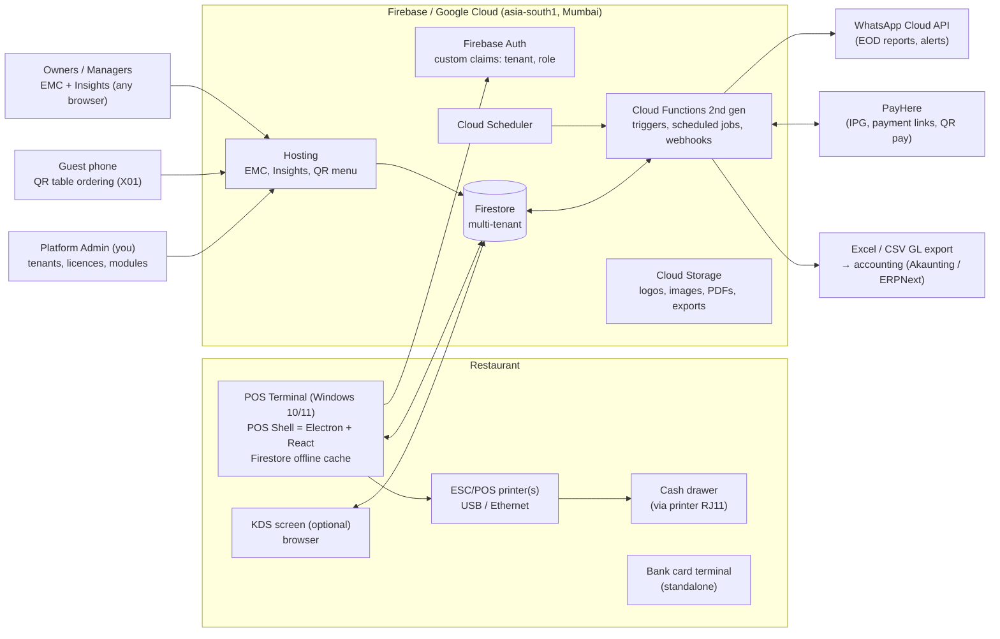

# 01 — Solution Architecture (Online-first, multi-tenant)

> Status: **Revised after client decisions (2026-10-30)**. The offline phase is dropped: the product is **cloud-native on Firebase/Google Cloud** from day 1. It is built as a **multi-tenant SaaS product**: the first restaurant is tenant #1 and later restaurants are onboarded without code changes.

---

## 1. Design goals

| # | Goal | What it means in practice |
|---|------|---------------------------|
| G1 | **Cloud-native, zero servers to manage** | Firebase (Firestore, Auth, Functions, Hosting, Storage). No on-premise server. A restaurant needs only a Windows PC, a printer and internet. |
| G2 | **Keeps selling through short internet drops** | Not an "offline mode", but **resilience**: the POS keeps taking orders, printing bills and taking cash or card payments during an outage, and syncs automatically when the connection returns. |
| G3 | **Product, not project** | One codebase serves every restaurant. Everything restaurant-specific is **configuration** in EMC: brand, logo, theme, menu, taxes, tenders, layouts, roles, modules. |
| G4 | **One calculation engine** | Totals, service charge, SSCL, VAT, discounts and rounding come from one shared package (`@pos/engine`) used by the POS, the cloud and reports, so figures agree to the cent. |
| G5 | **Sri Lanka compliant out of the box** | VAT/SSCL/service charge rules and the IRD tax-invoice format (Gazette 2481/22) are built in, with rates and rules editable and effective-dated. See [06-sri-lanka-compliance.md](06-sri-lanka-compliance.md). |
| G6 | **Budget-friendly** | Runs on any Windows 10/11 PC and any ESC/POS thermal printer. A single restaurant's cloud usage stays largely inside Firebase's free tier. See [09-costing-proposal.md](09-costing-proposal.md). |
| G7 | **Modular** | **Inventory**, **QR ordering (X01)**, **WhatsApp**, **accounting export** and the future **website** are licensable modules that can be switched on or off per tenant. |
| G8 | **Apple-grade UX** | Calm, touch-first, light and dark modes, branded per restaurant. |

---

## 2. System overview



---

## 3. Applications

| App | Users | Tech | Notes |
|-----|-------|------|-------|
| **POS** | Cashiers, servers, managers | React + TypeScript, packaged as the **POS Shell** (Electron) for Windows | The shell adds what browsers can't do: silent raw ESC/POS printing, cash drawer kick, auto-update, kiosk/full-screen lock, auto-start on boot, and a local durable invoice counter. |
| **EMC** (Enterprise Management Console) | Owner, managers, admins | React + Vite on Firebase Hosting | Configuration, **user and role management (People Management)**, menu, taxes, tenders, devices, branding, inventory back office. |
| **Insights** | Managers, owner | Same codebase as EMC, mobile-first PWA | Dashboards and reports (Daily Revenue, Item-wise, Covers, Sales, and more). |
| **KDS** *(optional)* | Kitchen, bar | React web app | Any screen with a browser. Kitchen **printers** remain the default. |
| **QR Order** *(X01, optional module)* | Guests | Lightweight web app on Hosting | Scan the table QR, view the menu (with allergens), order, and optionally pay with PayHere. |
| **Platform Admin** | You, the vendor | Part of EMC, behind a super-admin claim | Onboard tenants, assign licences and modules, view usage and health, push updates. |

### Why a desktop "POS Shell" around a web app
Browsers cannot silently send raw bytes to a USB receipt printer or open a cash drawer. The shell is a thin Electron wrapper (≈ 5% of the code) around the same React POS:
- **Printing service** with three transports:
  - **Windows spooler RAW** for any USB printer installed with its driver or "Generic / Text Only" (Epson TM-T82III, Xprinter, Rongta, Sewoo…).
  - **TCP 9100** for Ethernet printers.
  - **Serial/COM** for older devices.
- **ESC/POS renderer** for receipts, VAT bills and kitchen chits: Sinhala/Tamil/English text, logo bitmap, QR codes (for feedback, PayHere and receipt links), cut, and **drawer kick** (`ESC p`).
- **Auto-update** with staged rollout and rollback, a crash reporter, and remote diagnostics (X38).
- *Fallback:* the POS also runs in plain Chrome or Edge with HTML printing, which suits tablets and demos.

---

## 4. Multi-tenancy (sell to many restaurants)

- **Data isolation:** every document lives under `tenants/{tenantId}/…`. Firestore Security Rules require `request.auth.token.tenantId == tenantId` and check the user's privileges. Rules are covered by automated tests in the Firebase Emulator.
- **Hierarchy per tenant:** Tenant (company) → Property (outlet) → Revenue Center (dining, bar, takeaway…) → Workstation. Configuration is **inherited down the hierarchy and can be overridden** at each level (as in Simphony).
- **Licensing and modules:** `tenants/{id}.licence = { plan, terminals, modules: { inventory, qrOrdering, whatsapp, accounting, website } }`. The UI and Cloud Functions both respect the module flags.
- **Branding per tenant:** logo, colours, fonts, receipt header and footer, and QR menu theme, all set in EMC.
- **One deployment, many tenants.** The architecture also allows a **dedicated Firebase project per client** if a large client requires its own billing or isolation. The same code is deployed with a different config.

### Customising for each client: branch strategy
You suggested a sub-branch per client. **I recommend against long-lived per-client branches.** They drift from `main`, every bug fix has to be merged N times, and within a few months clients end up on different, unmaintainable products. Instead:

| Need | Mechanism |
|------|-----------|
| Different menu, taxes, layouts, branding, receipts, reports | **Configuration** (EMC), with no code |
| Feature on for some clients only | **Module or feature flags** per tenant |
| Client-specific behaviour (special rule, integration) | **Extension points**: a `packages/extensions/<client>` plugin loaded by tenant config, still on `main` |
| Client-specific deployment settings | `deploy/<client>/` config (Firebase project ID, region, domain) |
| Pinning a client to a tested version | **Release tags** (`v1.4.2`) plus a per-tenant release channel (stable or beta) |

Short-lived `client/<name>/<feature>` branches are fine **while developing**. They merge back to `main` behind a flag.

---

## 5. Data architecture

### 5.1 Firestore layout
```
platform/…                                  # vendor-level: plans, global templates
tenants/{tenantId}                          # company profile, licence, branding, TIN/VAT no.
  properties/{propId}                       # outlet: address, VAT reg., invoice settings, business-day rules
    revenueCenters/{rvcId}
    workstations/{wsId}                     # invoice classification code, printers, cash drawer
    devices/{deviceId}                      # printers, KDS
    tables/{tableId}  floorPlans/{id}
    checks/{checkId}                        # open + closed checks; lines, discounts, payments embedded
    invoices/{invoiceNo}                    # immutable fiscal record for each issued bill
    tills/{tillId}/movements/{id}           # float, pickups, paid-in/out, declarations
    businessDays/{yyyy-mm-dd}               # status, EOD run, totals summary
      totals/{dimension}                    # pre-aggregated by RVC, hour, tender, item, employee…
    inventory/…                             # (module) locations, stockLevels, lots, ledger
  menuItems/{id}  menuClasses/{id}  condimentGroups/{id}  combos/{id}
  familyGroups/{id}  majorGroups/{id}  pages/{id} (touchscreen layouts)
  taxRules/{id}  serviceCharges/{id}  discounts/{id}  tenderMedia/{id}  orderTypes/{id}  reasonCodes/{id}
  roles/{roleId}                            # privilege matrix
  users/{uid}                               # POS + EMC users: role per property, PIN hash, card id, status
  inventoryItems/{id}  vendors/{id}  recipes/{id}  purchaseOrders/{id}  grns/{id}   # (module)
  reportSchedules/{id}  waRecipients/{id}
  auditLog/{id}
```

### 5.2 Key rules
- **IDs** are ULIDs generated on the device, so they work even during an internet drop.
- **Money** is stored as integers in **cents (LKR × 100)**. No floating-point arithmetic is used for money.
- **Closed checks and invoices are immutable.** Refunds, voids after close and adjustments are new linked documents.
- **Business date** is separate from calendar date, so a check closed at 1 am belongs to the previous day until End of Day runs.
- **Audit log** records every configuration change and every privileged POS action: who, approver, when, terminal, before, after, and reason.
- **Hot-document protection:** live sales totals are aggregated by Cloud Functions into `businessDays/*/totals`. The POS never writes a shared counter, which keeps it within Firestore's limit of about 1 write per second per document.

### 5.3 Fiscal invoice numbering (works during an internet drop)
The IRD format is `YYMMM_QQQQ_XXXXX` (see [06](06-sri-lanka-compliance.md)). We set the classification code **QQQQ per workstation or outlet** (for example `26OCT_W01_1234`). Each terminal then owns its own gap-free sequence:
- It keeps a durable local counter (in the POS Shell) **and** mirrors it in Firestore (`workstations/{ws}.invoiceSeq`).
- No round-trip to the server is needed to print a valid bill, so an internet drop never blocks billing or creates duplicates.
- If a terminal is replaced, the new one resumes from the cloud value. If it cannot, a manager must confirm the starting number, and that action is audited.

---

## 6. Resilience during internet drops (no offline phase)

| Situation | Behaviour |
|-----------|-----------|
| Internet drops (minutes to hours) | Firestore **persistent cache** keeps menu and configuration available. New checks, orders, kitchen chits, bills (with valid invoice numbers) and cash or standalone-card payments all continue. Writes queue locally and **sync automatically** when the connection returns. A banner shows "Offline – 12 changes waiting". |
| What pauses during a drop | PayHere and online payments, QR ordering, WhatsApp, live Insights. Cloud-side jobs (inventory FIFO valuation, aggregations) catch up once the connection is back. |
| Multiple terminals during a drop | Each terminal keeps working on its own checks. Sharing open checks between terminals resumes when the connection returns (Firestore needs the cloud to relay changes). |
| PC failure | All data is already in the cloud. Install the POS Shell on any PC, sign in, and carry on. |
| Printer failure | Route to a backup printer, alert the user, and keep a reprint queue. |

**Recommendation for the client:** a **4G router with automatic failover** (a cheap one-off cost) in addition to fibre. With it, internet drops become practically invisible.

---

## 7. Cloud Functions (backend logic)

> **Implementation status (2026-11-04):** four functions are deployed with the **Accounting module** (`apps/functions`, see [13](13-accounting-and-audit.md)):
> - `ledgerApi`: the callable for posting, approvals, reversal, POS day, depreciation, periods, year-end and the integrity check.
> - `auditTrail` and `auditTenant`: record every change.
> - `auditSealer`: hourly hash-chain seals.
>
> Everything else still runs **without Cloud Functions**, which keeps demos and small clients inside the free tier.
> - Business logic runs in `@pos/core` on the device and is protected by Firestore security rules (`firebase/firestore.rules`, tested on the emulator).
> - Day totals are aggregated when each check closes, and stock depletion runs in batches (End of Day).
> - Printing goes through the **Print Agent** (`apps/print-agent`) instead of the POS Shell.
>
> The functions below are added when integrations go live (PayHere notify, WhatsApp sending, scheduled EOD, server-side PIN checks).

| Function | Trigger | Purpose |
|----------|---------|---------|
| `onCheckClosed` | Firestore write | Re-verifies totals with `@pos/engine` (anti-tampering), writes the invoice record, updates aggregates, queues inventory depletion |
| `inventoryDepletion` | Every 2–5 min plus on demand | Explodes recipes (including sub-recipes and modifiers) and consumes **FIFO lots** inside transactions, writing ledger entries with exact cost |
| `endOfDay` | Scheduler (per property, configurable time) or manual | Closes the business day, checks for open checks and undeclared tills, generates the PDF reports, sends them on **WhatsApp** to managers, and writes the accounting export |
| `alerts` | Firestore triggers | X18 exception alerts: voids or discounts over threshold, cash variance, low stock, EOD not run, terminal offline |
| `payhereNotify` | HTTPS webhook | Verifies PayHere's MD5 signature and marks the check payment as settled |
| `ledgerApi` ✅ | Callable | Posts accounting documents (POS day, invoices, payments, journals, depreciation) with gap-free numbers and a hash chain; approvals with segregation of duties; period and year-end close; integrity check |
| `auditTrail` / `auditTenant` ✅ | Firestore write | Field-level audit event for every business record change |
| `auditSealer` ✅ | Scheduler (hourly) | Seals new audit events into a hash chain |
| `userAdmin` | Callable | Creates users, sets custom claims (tenant, roles, properties), PIN reset, disable |
| `qrOrder` | Callable | Validates QR orders, prices them server-side, and injects them into the POS kitchen flow |

---

## 8. Security

- **EMC/Insights sign-in:** Firebase Auth with email and password or Google, plus **MFA for owners and admins**.
- **POS sign-in:** the terminal itself is registered to the property with a device credential. Employees then sign in on it with **ID + PIN** or a **swipe/NFC card**. PINs are hashed server-side.
- **Privileges:** a role-based privilege matrix (voids, discounts, refunds, reopen, no-sale, price override, reports, each EMC area…), scoped per property. Manager override at the POS is recorded with a reason.
- **Firestore Security Rules** enforce tenant isolation and privileges. Sensitive operations (users, invoice issue, refunds) run in Cloud Functions.
- **App Check** blocks API abuse. Secrets (PayHere merchant secret, WhatsApp token) live in **Secret Manager**.
- **No card data is ever stored.** Card terminals are standalone and PayHere uses its hosted checkout, which keeps PCI scope minimal.

---

## 9. Tech stack

| Layer | Choice |
|-------|--------|
| Language | TypeScript (strict) everywhere |
| Monorepo | pnpm workspaces |
| UI | React 19, Vite, Tailwind CSS, Radix UI primitives, Framer Motion, Zustand, TanStack Query |
| POS Shell | Electron (Windows x64; installer plus auto-update) |
| Backend | Firebase: Firestore (Native, `asia-south1`), Auth, Cloud Functions 2nd gen (Node 22), Hosting, Storage, Scheduler, Secret Manager, App Check |
| PDFs and Excel | pdf-lib / React-PDF; ExcelJS |
| Messaging | WhatsApp Business Platform, called directly through the Cloud API (no middle-man fees) |
| Payments | PayHere (Checkout API, Payment Links, Notify webhook), LankaQR (bank-issued), standalone bank card terminal |
| Tests | Vitest (engine), Firebase Emulator (rules and functions), Playwright (end-to-end) |
| CI/CD | GitHub Actions to Firebase deploy and signed Windows installer |

---

## 10. Repository structure

```
apps/
  pos/            React POS (runs in the shell or a browser)
  pos-shell/      Electron wrapper: printing, cash drawer, updates, local invoice counter
  emc/            EMC + Insights + Platform Admin
  kds/            Kitchen display (optional)
  qr-order/       Guest QR ordering (X01 module)
  functions/      Cloud Functions
packages/
  engine/         Pricing, Sri Lanka tax engine, discounts, service charge, rounding, invoice numbers   ← built first
  domain/         Entity types, Zod schemas, privilege catalogue
  printing/       ESC/POS receipt and chit renderer (Sinhala/Tamil/English)
  ui/             Design system
  reports/        Report definitions (shared by Insights and the PDF/WhatsApp generator)
firebase/         firestore.rules, indexes, storage.rules
deploy/<client>/  Per-client deployment config (no code)
docs/
```

---

## 11. UX principles (Apple-like)
- Use the system font (Segoe UI Variable on Windows, SF on Apple), generous spacing, rounded 12–16 px surfaces, soft depth, and restrained colour. Colour is reserved for status and the tenant brand accent.
- Touch targets are at least 44 px. Common tasks (order → send → pay → print) take three taps or fewer, with no modal stacks.
- Use progressive disclosure: the main screens stay simple and power options sit one step deeper.
- Support light and dark modes and per-tenant theming (logo, accent colour) from EMC.
- Provide a drag-and-drop touchscreen designer for POS pages per RVC and role.
- UI languages are English first, with Sinhala and Tamil ready. Receipts are multi-language.
