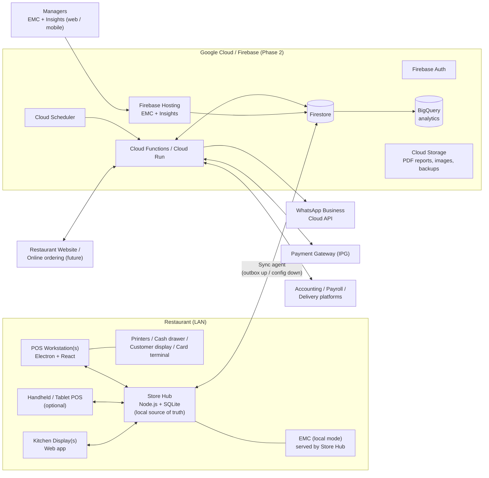

# 01 — Solution Architecture

> Status: **Draft for review**. This document proposes the architecture. Decisions marked **(Q#)** depend on answers in [05-open-questions.md](05-open-questions.md).

---

## 1. Design goals

| # | Goal | What it means in practice |
|---|------|---------------------------|
| G1 | **Never stop selling** | Orders, kitchen printing and payments keep working with no internet, no cloud, and even with the store server down (degraded mode). |
| G2 | **Start with 1 terminal, scale to many** | The same software runs 1 terminal at 1 restaurant or 50 terminals across 20 restaurants. Growth needs no re-architecture. |
| G3 | **Offline → Online is a sync, not a migration project** | Phase 1 (offline) and Phase 2 (online) use **the same data model, IDs and document paths**. Going online means switching on cloud sync and uploading the existing database. |
| G4 | **One source of truth for calculations** | Check totals, taxes, discounts, service charges and inventory depletion come from one shared calculation engine. The POS, store server and cloud always agree to the cent. |
| G5 | **Configurable, not customised** | Each restaurant is set up through EMC (menus, taxes, tenders, roles, layouts, printers, reports). Nothing per restaurant is hard-coded. |
| G6 | **Secure and auditable** | Granular privileges, manager overrides, a full audit trail, and a tamper-evident transaction journal. PCI scope is kept small: card numbers never touch our system. |
| G7 | **Apple-grade usability** | Simple, calm, touch-first UI. Common tasks take three taps or fewer. Light and dark modes. |

---

## 2. Why Phase 1 cannot be "just Firestore offline mode"

Firestore's offline persistence is a **client-side cache**, not a database of record. It is the wrong base for an offline POS because:

- **No sharing between terminals over the LAN.** Without internet, terminal A cannot see a check opened on terminal B, and the KDS cannot see either one.
- **No server-side logic offline.** There are no Cloud Functions, so no business-day close, report aggregation, inventory depletion or check-number allocation.
- **Weak durability.** The cache can be evicted or cleared, and it has no backups.
- **Limited querying** for reports over weeks or months of data.

**Decision:** use a **local-first architecture with a Store Hub**, the same pattern as Simphony's CAPS / check-and-posting service. The Store Hub keeps a durable local database whose structure **mirrors the Firestore document model one-to-one**. Phase 2 adds a sync agent that replicates this data to Firebase. The Store Hub stays in place after go-live, which keeps the restaurant running through internet outages for good.

---

## 3. System context



---

## 4. Components

| Component | Purpose | Tech | Runs where |
|-----------|---------|------|------------|
| **POS Workstation** | Front-of-house ordering, payment, table management, cash and clock in/out | Electron + React + TypeScript; local SQLite cache | Touch PC at the counter (Q5) |
| **Handheld POS** *(optional)* | Order and pay at the table | Same React app packaged for Android or iPad (Capacitor) or as a PWA | Tablets or handhelds |
| **Store Hub** | Local source of truth: open checks, check numbering, kitchen routing, business day, totals, inventory depletion, backups, sync agent, local API | Node.js (Fastify) + SQLite in WAL mode; runs as a background service | Phase 1: on the same PC as the single POS. Later: optionally a dedicated mini-PC |
| **KDS** | Kitchen and bar display: bump, recall, timers | React web app over WebSocket to the Hub | Any screen with a browser (Android TV box, tablet, PC) |
| **EMC** (Enterprise Management Console) | All configuration: menu, taxes, tenders, layouts, devices, people management, inventory back office | React + Vite web app. **One codebase, two data adapters**: Hub API (Phase 1) and Firestore (Phase 2) | Phase 1: browser → Store Hub on the LAN. Phase 2: Firebase Hosting (cloud) |
| **Insights** | Revenue and report portal for managers, mobile-first | React PWA (part of the EMC codebase, separate entry point) | Phase 1: LAN. Phase 2: cloud |
| **Cloud backend** | Sync endpoint, aggregation, scheduled reports, WhatsApp, IPG webhooks, website/ordering API, integrations | Firestore, Cloud Functions (2nd gen) / Cloud Run, Auth, Storage, Scheduler, Pub/Sub, BigQuery, Secret Manager, App Check, FCM | Google Cloud (region to be confirmed, Q12) |

### Why Electron for the workstation
- It has the most mature support for **POS hardware**: ESC/POS receipt and kitchen printers over USB, serial or network; cash drawer kick; pole and customer displays; scales; barcode scanners; card terminal SDKs.
- It uses **one language across the whole stack** (TypeScript), so the calculation engine is shared code.
- It supports auto-update with rollback, a kiosk/lock-down mode, and dual-screen output for a customer display.
- *Alternative:* Tauri (smaller footprint). It is worth revisiting once the hardware list is final (Q5).

---

## 5. Deployment topologies

**Phase 1 — Day 1 (single machine, offline)**
```
[ Touch PC ]
  ├─ POS Workstation app
  ├─ Store Hub service (SQLite)  ── nightly + hourly backup → USB/NAS drive
  └─ EMC/Insights available at http://<pc-name>.local:8080 to any LAN device (manager laptop/phone)
  + receipt printer, kitchen printer or KDS, cash drawer, card terminal
```

**Phase 1 — growing (more terminals, still offline)**: add terminals on the LAN and they connect to the Hub. Optionally move the Hub to a small dedicated PC with a UPS.

**Phase 2 — Online**: the sync agent on the Hub connects to Firebase. EMC and Insights move to the cloud. The Hub keeps running locally, so internet outages do not affect service.

**Multi-property (future)**: one Hub per restaurant and one cloud Enterprise. Configuration is inherited Enterprise → Zone → Property → Revenue Center, and enterprise-wide reporting comes from BigQuery.

---

## 6. Data architecture

### 6.1 One document model, two stores
- Every entity is a **document** with a **Firestore-compatible path**, for example `orgs/{orgId}/properties/{propId}/checks/{checkId}`.
- The Hub stores documents in SQLite as `(path, collection, id, json, version, updatedAt, deleted)`, with **generated indexed columns** for fields that are queried often (business date, RVC, status).
- In Phase 2 each local document maps 1:1 to a Firestore document with **the same path and ID**. The initial upload is a straight copy and needs no transformation.

### 6.2 Identity and numbering
- **IDs are ULIDs**: globally unique, time-sortable, and generated on any device without coordination, so they work offline.
- **Human-readable check numbers** come from **per-workstation ranges** (for example WS1 uses 1–4999 and WS2 uses 5000–9999; configurable). Two offline terminals can never issue the same number.
- **Business date** is separate from calendar date. A check at 1:30 am belongs to the previous business day until End of Day runs.

### 6.3 Data ownership: one writer per data type, so no sync conflicts

| Data | Authored by | Flows | Mutability |
|------|-------------|-------|------------|
| Configuration (menu, prices, taxes, tenders, layouts, devices, roles) | EMC (Hub in Phase 1, cloud in Phase 2) | **Down** to Hub, then to workstations | Versioned and audited, with effective dates |
| Employees and people records | EMC / People Management | Down | Versioned and audited |
| Checks and transactions | POS → Hub | **Up** | Open checks change on the Hub; **closed checks are immutable** (corrections are new, linked transactions) |
| Time and attendance punches | POS → Hub | Up | Append-only; edits are audited adjustments |
| Inventory movements | POS depletion, receiving, transfers, counts, waste | Up (and down for cloud-entered documents) | **Append-only ledger**; stock on hand is derived |
| Online orders (future) | Website/API → cloud | Down to Hub | State machine with versioned transitions |

### 6.4 Money and calculation rules
- All amounts are stored as **integers in minor units** (cents), so floating-point errors cannot occur.
- One shared `@pos/engine` package computes item pricing, condiments, combos, discounts, service charges, taxes (inclusive or exclusive, compound, tax on service charge), rounding and tender change. The same code runs on the POS, the Hub and the cloud.

### 6.5 Configuration inheritance (Simphony-style)
- The hierarchy is **Enterprise → Zone → Property → Revenue Center → Workstation**.
- A record defined high up is inherited below it. A lower level can **override** chosen fields; for example, a bar RVC can price an item differently.
- Changes can be **scheduled** (effective date and time) and published as **change sets** that can be rolled back.

### 6.6 Audit and tamper evidence
- Every configuration change and privileged POS action (void, discount, reopen, refund, no-sale drawer open, price override) writes an **audit record**: who, approved by, when, where, before, after, and reason.
- The closed-transaction journal is **hash-chained**: each record includes the hash of the previous one. Any later edit or deletion of history is detectable. This also prepares the system for fiscal or e-invoicing rules (Q2).

### 6.7 Firestore layout (Phase 2 sketch)
```
orgs/{orgId}
  zones/{zoneId}
  properties/{propId}
    revenueCenters/{rvcId}
    workstations/{wsId}
    devices/{deviceId}                 # printers, KDS, terminals
    businessDays/{yyyy-mm-dd}
      totals/{dimension}               # pre-aggregated: rvc, tender, family group, hour, employee
    checks/{checkId}                   # closed checks (detail lines embedded; < 1 MB each)
    timePunches/{punchId}
    cashTills/{tillId}/movements/{id}
    inventoryLedger/{movementId}
  menuItems/{itemId}                   # master + definitions + prices with scope/overrides
  condimentGroups/{id}  comboMeals/{id}  discounts/{id}  serviceCharges/{id}
  taxRates/{id}  taxClasses/{id}  tenderMedia/{id}  orderTypes/{id}
  roles/{roleId}  employees/{empId}  jobCodes/{id}
  inventoryItems/{id}  vendors/{id}  recipes/{id}  purchaseOrders/{id}
  auditLog/{id}
  config/changeSets/{id}
```
Hot counters (live sales totals) use **sharded counters or Function-side aggregation**, which avoids Firestore's limit of about 1 sustained write per second per document.

---

## 7. Sync engine (Phase 2)

**Upstream (Hub → cloud)**
1. Every local write that must reach the cloud also inserts a row into an **`outbox`** table **in the same SQLite transaction**, so the write and its sync job can never diverge.
2. The sync agent sends outbox rows in batches of up to 500 writes per Firestore batch, ordered per aggregate. It retries with exponential backoff.
3. Writes are **idempotent** (deterministic IDs plus a version check), so retries never duplicate data.
4. Health and lag (oldest unsynced item) appear in EMC and trigger alerts.

**Downstream (cloud → Hub)**
1. The Hub keeps Firestore listeners on configuration collections scoped to its property, with a checkpoint on `updatedAt`.
2. Changes are applied locally, then pushed to workstations over WebSocket. Workstations hot-reload configuration between transactions, never during one.

**Online orders (future website)**
- The website writes orders to `incomingOrders`. The Hub listens, accepts them, and injects them into the POS and kitchen.
- The Hub sends a **heartbeat**. If the restaurant is offline, the website automatically pauses online ordering.

---

## 8. Phase 1 → Phase 2 cutover ("Cloud Link")

A guided wizard in EMC, plus a runbook:

1. **Prepare**: create the Firebase project (region per Q12), Auth tenant and service account; deploy rules, functions and indexes.
2. **Register the property**: the Hub gets a device credential, stored in the OS keychain and backed by App Check / custom token.
3. **Freeze configuration**: block EMC edits for a few minutes. Sales continue normally.
4. **Initial upload**: the Hub streams all documents (configuration, employees, all historical checks, inventory ledger, audit log) to Firestore using the same paths and IDs. The upload can resume after interruptions.
5. **Verify**: per-collection document counts and checksums, plus a business-day totals comparison between local and cloud reports.
6. **Switch authority**: cloud EMC becomes the configuration master. Local EMC becomes read-only, with a "break-glass" local edit mode for emergencies.
7. **Enable continuous sync**, WhatsApp reports, Insights in the cloud, and IPG online flows.
8. **Rollback plan**: until sign-off, local EMC can retake authority. Nothing on the Hub is deleted.

Downtime for selling: **none**.

---

## 9. Reliability: failure matrix

| Failure | Impact | Behaviour |
|---------|--------|-----------|
| Internet down | None for selling | Sync queues locally. IPG/online payments and WhatsApp are unavailable until it returns (cash and card terminal still work if the terminal has its own connection, Q6). |
| Cloud outage | None for selling | Same as above. |
| Store Hub down | Degraded | Workstations switch to **standalone mode**: they keep selling from their local config cache and journal, then reconcile automatically with the Hub. Cross-terminal check sharing pauses. |
| Workstation crash or power loss | One terminal | Open checks live on the Hub, so another terminal picks them up. SQLite WAL means no torn writes. A UPS is recommended. |
| Disk failure on Hub | Serious | Hourly snapshots to USB/NAS, and continuous cloud replication in Phase 2. Restore runbook targets under 30 minutes. |
| Kitchen printer offline | Kitchen | Automatic **backup device routing**, an alert on the POS, and a reprint queue. |
| Bad software update | All terminals | Staged rollout and one-click rollback to the previous version. |

Targets (proposed): ≤ 2 s from tender to receipt; ≤ 1 s from order send to KDS on the LAN; zero data loss on single-component failure.

---

## 10. Security

- **POS sign-in**: employee ID with PIN, and/or an NFC/magnetic employee card (biometric optional). PINs are hashed with Argon2. Auto sign-out after inactivity.
- **EMC and Insights**: Firebase Auth (email/password or Google Workspace SSO) with **MFA for administrators**.
- **Authorisation**: role-based **privilege matrix** (hundreds of granular options, as in Simphony) with optional per-location scoping. Enforced on the Hub and in Firestore Security Rules through custom claims.
- **Manager override**: a manager swipe or PIN at the POS, with an approval reason and threshold rules (for example, discounts above 20% need a manager).
- **PCI DSS**: semi-integrated card terminals and hosted IPG pages, so the system **never stores, processes or transmits card numbers**; only tokens and masked references.
- **Secrets** live in Google Secret Manager, the cloud is protected by App Check, data is encrypted at rest and in transit (TLS on the LAN as well), and the audit log is immutable.
- **Privacy**: customer data is consent-tracked, with data export and delete capability.

---

## 11. Payments architecture (tender media)

```
POS → Tender Media (configured in EMC) → Payment Driver (plugin) → Provider
```

| Driver | Examples | Offline? |
|--------|----------|----------|
| `cash` | Local or foreign currency, denominations, rounding | ✅ |
| `card-integrated` | Bank card terminal through a semi-integrated SDK (amount is sent to the terminal automatically, with approval code and masked PAN returned) | Depends on the terminal (Q6) |
| `card-manual` | Standalone terminal; the cashier keys in the approval code | ✅ |
| `ipg` | Payment link, QR on the receipt or customer display, pay-at-table, online orders (hosted page + webhook) | ❌ needs internet |
| `wallet-qr` | Local QR / mobile wallet schemes (Q6) | ❌ |
| `voucher` / `gift-card` | Internal stored value with serial numbers and balance | ✅ (local ledger) |
| `house-account` | Credit customers / city ledger with credit limits and statements | ✅ |
| `room-charge` | Hotel PMS posting (if needed, Q3) | Depends on the PMS |
| `comp` / `staff-meal` / `officer-check` | Non-revenue tenders with authorisation | ✅ |
| `loyalty-points` | Points redemption | ✅ / cloud |
| `bank-transfer` / `cheque` | Reference required | ✅ |

**Settlement and reconciliation**
- Split and partial tenders, deposits and advances, and refunds to the original tender.
- End-of-day **card batch settlement** with integrated terminals.
- An **IPG reconciliation** report matches gateway settlement files or APIs against POS tenders.
- **Cash declaration** (blind count), with over/short by till or employee.

---

## 12. Integrations

| Integration | Approach | Phase |
|-------------|----------|-------|
| **WhatsApp reports and alerts** | WhatsApp Business Platform (Meta Cloud API): approved message templates, a PDF report sent as a document message, scheduled through Cloud Scheduler. Optional two-way bot for managers. | 2 (Phase 1 is possible if the PC has internet, Q4) |
| **Restaurant website / online ordering** | Public **Ordering API** (Cloud Run): published menu with channel-specific prices and availability, real-time 86 and stock, cart, IPG checkout, order injection to the Hub. The website can be any framework (Next.js recommended). | 3 |
| **Accounting** | Daily GL journal export (sales by revenue account, taxes, tenders, COGS from inventory) through an API or CSV (Q9) | 2 |
| **Payroll** | Hours by job code and pay rate, overtime and tips export | 2 |
| **Delivery platforms** | Order injection API, menu sync, 86 sync | 3 |
| **Tax authority / e-invoicing** | Country-specific fiscal module (Q2) | As required |
| **BigQuery / Looker Studio** | Firestore → BigQuery stream, for custom analytics | 2 |

---

## 13. Tech stack summary

| Layer | Choice |
|-------|--------|
| Language | TypeScript everywhere (strict) |
| Monorepo | pnpm workspaces + Turborepo |
| POS UI | React 19, Zustand (state), TanStack Query, Tailwind CSS + Radix UI primitives, Framer Motion |
| POS shell | Electron (auto-update, kiosk mode, hardware access) |
| Local DB | SQLite (better-sqlite3, WAL) on Hub and workstations |
| Hub | Node.js 22 LTS, Fastify, WebSocket, Zod validation |
| Cloud | Firebase: Firestore, Auth, Hosting, Cloud Functions 2nd gen / Cloud Run, Storage, Scheduler, Pub/Sub, Secret Manager, App Check, FCM; BigQuery |
| Reports | Server-rendered PDF (React-PDF / headless Chromium) + Excel (ExcelJS) |
| Testing | Vitest (engine, 100% coverage target), Playwright (E2E), Firebase Emulator Suite (rules and functions) |
| CI/CD | GitHub Actions → signed installers, Firebase deploy, staged rollout |
| Observability | Structured logs → Cloud Logging, Sentry-style crash reporting, Hub health heartbeat |

---

## 14. Proposed repository structure

```
apps/
  pos/            Electron + React workstation (and handheld build)
  hub/            Store Hub service (local API, sync agent, device router, EOD)
  emc/            EMC + Insights web app (Hub or Firestore adapter)
  kds/            Kitchen display web app
  functions/      Firebase Cloud Functions / Cloud Run services (Phase 2)
packages/
  engine/         Pricing, tax, discount, service charge, tender & inventory-depletion engine (pure TS)
  domain/         Entity types, Zod schemas, privilege catalogue, enums
  data/           Repository interfaces + SQLite and Firestore adapters
  sync/           Outbox/inbox sync engine
  devices/        ESC/POS printing, cash drawer, customer display, scale, payment-terminal drivers
  ui/             Design system (tokens, components, icons)
  reports/        Report definitions (shared by local and cloud)
  i18n/           Translations
docs/             Architecture, feature catalogue, roadmap, decisions (ADRs)
```

---

## 15. UX and design system (Apple-like)

- **Typography**: system font stack (SF Pro on Apple devices, Inter elsewhere), clear hierarchy, generous whitespace.
- **Touch first**: targets of at least 44×44 pt, no hover-only actions, gestures as shortcuts but never as the only path.
- **Calm surfaces**: translucent "frosted" headers, soft shadows, rounded corners (12–16 px), restrained colour; colour is used for **status** (table states, KDS timers), not decoration.
- **Speed**: optimistic UI, sub-100 ms tap response, no full-screen reloads.
- **Progressive disclosure**: everyday screens stay simple, and power options sit one tap deeper.
- **Configurable layouts**: an EMC **touchscreen designer** (drag-and-drop pages, keys, colours and images) per RVC, order type or role.
- **Accessibility**: WCAG 2.2 AA contrast, dynamic text size, light and dark modes, multi-language with RTL-ready layouts.
- **Consistent patterns** across POS, KDS, EMC and Insights from one `@pos/ui` package.
