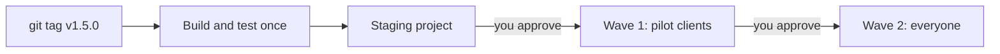

# 20 — Releases and updates

How updates, patches and fixes reach clients after go-live. Every client runs the **same code**: their differences are settings, licence and modules, never a separate copy of the code. That is what makes one release safe to deploy everywhere.

## 1. Versions

Versions are `major.minor.patch` (for example 1.4.2). The version is in `apps/web/package.json`, shown in the app (Administration → System status) and published with each deployment at `/version.json`.

| Type | Example | Contains | Rollout |
|---|---|---|---|
| **Patch** 1.4.**2** | Rounding fix on bills | Fixes only | Same day if urgent: staging, then everyone |
| **Minor** 1.**5**.0 | New report | Features that don't break anything | Waves over about a week |
| **Major** **2**.0.0 | Restructured stock data | Data or rule changes | Planned with clients; backup and migration |

`CHANGELOG.md` lists every release. Its **For clients** part is what you send to clients as release notes.

## 2. How a release flows



For each project, `tools/release/deploy.mjs` runs, stopping at the first failure:

1. **Backup:** Firestore export to the client's backup bucket (`pre-release/<version>-<time>`).
2. **Indexes** first, because they take time to build.
3. **Data migrations** that haven't run on this project yet.
4. **Security rules and Cloud Functions.**
5. **Web app** (hosting) last.
6. **Check:** `https://<project>.web.app/version.json` must report the new version.

**Compatibility rule:** screens with the previous version stay open for a while. Each release must work with the previous version's screens and data. Rules and functions accept both; the web app goes last.

## 3. One-time setup (vendor)

1. **Release robot.** In *your* Google Cloud project, create a service account, for example `pos-release@YOUR-VENDOR-PROJECT.iam.gserviceaccount.com`. It holds no keys: GitHub signs in as it through **Workload Identity Federation** (Google Cloud → IAM → Workload Identity Federation → create a pool and a GitHub provider limited to your repository, and let it impersonate the service account).
2. **GitHub repository variables** (Settings → Secrets and variables → Actions → Variables):
   - `GCP_WORKLOAD_IDENTITY_PROVIDER`: the provider's full name.
   - `GCP_DEPLOY_SERVICE_ACCOUNT`: the robot's email.
   - `LICENCE_PUBLIC_KEY`: your licence public key. It is public, not a secret.
3. **GitHub environments** (Settings → Environments):
   - `staging`: no approval needed.
   - `production-wave-1` and `production-wave-2`: add yourself (and a colleague) as **required reviewers**. Optionally add a wait timer, for example 24 hours after staging.
4. **Staging project:** a Firebase project of yours with the demo restaurant. Put its id in `release/clients.json` under `staging`.

## 4. Per client (at installation)

1. Add the client to `release/clients.json`. `pnpm deploy:setup` does this for you (deployment manual F); by hand it looks like:

   ```json
   { "id": "kandy-myst", "name": "Kandy Myst Restaurant", "projectId": "kandy-myst-pos", "region": "asia-south1",
     "wave": 1, "maintenanceWindow": "23:30-05:00 Asia/Colombo", "backupBucket": "gs://kandy-myst-pos-backups", "enabled": true }
   ```

   Put your first and most closely supported clients in wave 1, everyone else in wave 2.
2. **For automatic updates from GitHub (optional):** with the client's owner, run the access script once. It grants your release robot the deploy roles, creates the backup bucket (90-day retention) and switches on Firestore delete protection. If you deploy updates from your own PC with `pnpm release:deploy`, you can skip it: the release tool creates the backup bucket itself the first time it needs one. On Windows, run it in Git Bash or Google Cloud Shell:

   ```bash
   bash tools/release/grant-access.sh kandy-myst-pos pos-release@YOUR-VENDOR-PROJECT.iam.gserviceaccount.com asia-south1
   ```

   The client stays the owner of their project and can remove the access at any time.

## 5. Making a release

1. Merge the changes into `main`. CI runs typecheck, unit, rules and migration tests on every change.
2. Start the release:

   ```bash
   pnpm release:version 1.5.0
   ```

   This sets the version and adds a CHANGELOG entry. Write the **For clients** notes.
3. If old screens must not keep running (a breaking change), raise `minSupportedVersion` in `release/policy.json`.
4. Commit, tag and push:

   ```bash
   git commit -am "Release 1.5.0"
   ```

   ```bash
   git tag v1.5.0
   ```

   ```bash
   git push && git push origin v1.5.0
   ```

5. GitHub **Actions → Release** builds and tests, deploys to staging, then waits.
6. Check staging, ideally a full sale on a phone and a terminal. Then **approve wave 1**. Watch the pilot clients for a day or two (System status, Audit Center), then **approve wave 2**.
7. Send the release notes to clients.

Deploys run at the time you approve them. Approve after the clients' closing time (each client's `maintenanceWindow`).

**By hand** (for example from your laptop, for one client). It needs only your Firebase sign-in (`pnpm exec firebase login`): the backup, the data migrations and the permissions check use it too.

```bash
pnpm build
```

```bash
pnpm release:deploy --target kandy-myst --dry-run
```

```bash
pnpm release:deploy --target kandy-myst
```

**Redeploy** the current `main` without a new version: Actions → Release → *Run workflow*, target `staging`, `wave:1`, `wave:2` or client ids. Anything other than staging needs the production approval.

**From the Polymath Console** ([22](22-polymath-console.md), setup in [23 Q](23-polymath-console-deployment.md)): Deployments → *New update* (staging, a wave, or chosen clients) runs the same workflow with each client's settings from the console (the `registry` input), so `release/clients.json` doesn't need to be up to date; the console follows the run and shows each client's version after its next check-in. It needs the console's GitHub settings and token (`pnpm console:setup --github-token`), and the repository variable **`CONSOLE_URL`** (the console's check-in address) so client deploys from GitHub check in too.

## 6. How devices update

- Every screen checks `/version.json` every five minutes, when it comes back into view, and when the internet returns.
- **Newer version live:** a notice *Version x is available, Update now*. Devices where nobody is signed in on the POS reload by themselves within a minute. A signed-in employee's screen never reloads by itself.
- **Older than `minSupportedVersion`:** the screen is blocked with *Update required* until it reloads.
- **Administration → System status** lists each POS device with its version and last contact, so you can see who hasn't updated.
- **Print Agent:** on the restaurant PC, `git pull`, `pnpm install`, then restart the agent when the release notes say so. The Print Agent protocol stays backward compatible.

## 7. Data migrations

- Data changes run as scripts in `tools/release/migrations/NNNN-name.mjs`. Each exports `id`, `description` and `up({ db, FieldValue, log })`.
- They run in file order, each once per project, and are recorded in `deployment/config/migrations`.
- **Rules for writing one:**
  - It must be safe to run twice.
  - It must work while the previous app version is still running. Use three releases: add the new field, migrate the data, then remove the old field in a later release.
  - It must never edit fiscal records (invoices, ledger, POS journal), which are hash-chained. Corrections are reversing entries.
- Test against the emulator with `pnpm test:migrations`; see `tools/release/test-migrations.mjs`.
- Migrations so far:
  - **0001** records the deployment owner, so only they and existing owners or administrators can create businesses.
  - **0002** moves PIN hashes and card numbers into `staffSecrets`.

## 8. Rollback

| What | How |
|---|---|
| Web app | Firebase console → Hosting → release history → **Rollback** on the previous release (one click, immediate). |
| Rules, functions | Check out the previous tag and deploy: `git checkout v1.4.2 && pnpm build && pnpm release:deploy --target CLIENT --skip-backup`, then `git checkout main`. |
| Data | Last resort: restore the pre-release export. Google Cloud console (the client's project) → **Firestore → Import/Export → Import**, and choose the folder `gs://PROJECT-ID-backups/pre-release/<version>-<time>`. This overwrites changes made since, so agree it with the client and note the invoice numbers issued in between. |

Because each release works with the previous version's data, rolling back the app is safe without touching data.

## 9. Urgent fixes and support levels

| Severity | Example | Response |
|---|---|---|
| **P1** | Can't sell, print or take payment; wrong tax on bills | Workaround within 1 hour, fix the same day |
| **P2** | A report is wrong; one function broken | Next patch, within a few days |
| **P3** | Cosmetic issues, requests | Next minor release |

**Hotfix:**

1. Branch from the release tag (`git checkout -b hotfix/1.4.3 v1.4.2`).
2. Reproduce the fault with a test, then fix it.
3. `pnpm release:version 1.4.3`, then tag `v1.4.3` and push.
4. Approve the affected client first if needed: `--target CLIENT-ID` by hand, or the waves.
5. Merge the hotfix back into `main`.

## 10. Updates and the licence

- **Subscriptions** include updates.
- **Perpetual licences** receive updates until the support end date in the licence. Set `"enabled": false` in `release/clients.json` for clients whose support has ended, and their projects are skipped.

## 11. The Enterprise Hotel Edition

It has its own release cycle on the `enterprise/hotel-suite` branch. Shared code (`packages/*`) flows from `main` into that branch after each release, as before.
