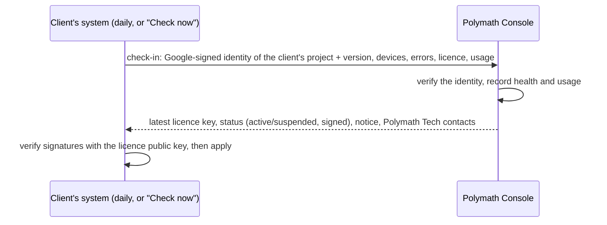

# 22 — Polymath Console: managing every client centrally

The **Polymath Console** is Polymath Tech's own system for running the business behind POS Suite: every client, their licences, subscriptions and renewals, the health of their systems, their usage, and the updates they run. It is a separate web app in **your** Firebase project (not a client's), used by you and your staff from any browser.

| | POS Suite (each client) | Polymath Console (you) |
|---|---|---|
| Firebase project | The client's own (`noura-kitchen-pos`) | Yours (for example `polymath-console`) |
| Who uses it | The restaurant's staff | Polymath Tech staff |
| Code | `apps/web`, `apps/functions` | `apps/console`, `apps/console-functions` |
| Deploy | `pnpm release:deploy --target …` | `pnpm console:deploy` |

## 1. What it does

| Area | What you can do |
|---|---|
| **Dashboard** | Clients needing attention: not seen for over a day, licence ending within 30 days, renewal due or overdue, errors on their devices, devices on an old version. Totals: clients, active, suspended, revenue due. |
| **Clients** | Each client's profile (business, contacts, Firebase project, region, release wave), status, notes and full history. |
| **Licences** | Issue, renew, upgrade or add modules from the browser. The licence reaches the client's system **by itself** within a day (or at once, when they press *Check now*); the key can also be copied and pasted as before. Every licence ever issued is kept. |
| **Suspend / restore** | Suspend a client (for example unpaid). Their system shows a notice for the grace period you choose (7 days by default), then the licensed modules stop, as when a licence expires. **Their data is always kept**, and **Restore** brings everything back at the next check-in. |
| **Subscriptions** | Plan, price, billing cycle, paid-until date, payments received; one click records a payment and renews the licence to the new paid-until date. Clients see a reminder in their back office before the renewal date. |
| **Health** | From each client's daily check-in: the server version, each device and its version, errors in the last 24 hours, licence status, businesses in the project, last check-in. |
| **Usage** | Per business and day: bills, covers, net sales and total (only if the client's owner leaves *Share daily figures with Polymath Tech* on, under About). |
| **Updates** | Start a release to one client, a wave or everyone; it runs the GitHub Actions release pipeline ([20](20-release-and-updates.md)) with each client's settings from the console, and shows its progress. |
| **Staff** | Owner, Admin, Sales, Support and Engineer roles; every action is written to an audit log. |
| **Company** | Polymath Tech's contact details, shown on every client's About page ("Help and support"). |

### Roles

| | Owner | Admin | Sales | Support | Engineer |
|---|---|---|---|---|---|
| See clients, health, usage, licences | ✓ | ✓ | ✓ | ✓ | ✓ |
| Add and edit clients, subscriptions, payments | ✓ | ✓ | ✓ | | |
| Issue and renew licences | ✓ | ✓ | ✓ | | |
| Suspend and restore | ✓ | ✓ | | | |
| Start updates (deployments) | ✓ | ✓ | | | ✓ |
| Staff, company details, GitHub settings | ✓ | ✓ (not owners) | | | |

## 2. How it works



- **Who is calling.** Each client's server function proves which Firebase project it runs in with a Google-signed identity token (its project's service account). No passwords or keys are shared with clients. The console only answers projects registered to a client; a new project number is shown to you for one-click confirmation the first time.
- **What the console can change.** Only what it signs with your licence key: a licence (as today) and the active/suspended status. The client's system checks both signatures with the public key it already has, so nobody else (not even someone pretending to be the console) can suspend or upgrade a client.
- **If the console can't be reached** nothing changes for the client: their licence keeps working until its expiry date as it does today. A restaurant never stops because of the console.
- **The licence signing key** lives in your console project's **Secret Manager**, readable only by the console's server functions. You issue licences from any browser; the key no longer sits on a PC. (`pnpm licence` keeps working with the file for emergencies.)
- **Usage figures** are yesterday's totals per business (bills, covers, net sales, total): no customers, items or staff. The owner can switch the sharing off.

## 3. Data (console project)

| Collection | Holds |
|---|---|
| `clients/{id}` | Profile, Firebase project ID and number, region, wave, status, subscription, current licence, suspension, last health report, notice |
| `clients/{id}/usage/{date}` | Daily figures per business |
| `clients/{id}/payments/{id}` | Payments received |
| `licences/{licenceId}` | Every licence issued: payload, key, who issued it and why |
| `deployments/{id}` | Updates started from the console and their GitHub run |
| `staff/{uid}`, `invites/{email}` | Staff and their roles |
| `audit/{id}` | Every action by every staff member |
| `config/company`, `config/github` | Contact details; repository settings |

Staff read through the security rules; **every change goes through the console's server functions**, which check the role and write the audit log.

## 4. Setting it up (once)

1. **Firebase project** for the console (Firebase console → Add project, for example `polymath-console`), on the **Blaze** plan with a USD 5 budget alert, like a client's (deployment manual B and C). In it:
   - **Firestore**: create the database in `asia-south1`, production mode.
   - **Authentication → Sign-in method**: enable **Google** (and Email/Password if staff without Google accounts will sign in; they must verify their email).
   - **Project settings → Your apps**: register a web app (nickname `Polymath Console`).
2. On your PC, in the project folder:

   ```bash
   pnpm console:setup
   ```

   It asks for the console's project ID and your email (the **owner**). It stores your licence signing key from `licence-keys/vendor-key.txt` in the project's Secret Manager, writes `release/console.json`, and adds the console's address to `apps/functions/.env` so every client deploy knows where to check in.
3. Deploy the console:

   ```bash
   pnpm console:deploy
   ```

4. Open `https://CONSOLE-PROJECT-ID.web.app`, sign in with the owner's Google account, and fill in **Settings → Company** (support email, phone, WhatsApp, website).
5. **Clients → Add client** for each existing client (Noura Kitchen: `noura-kitchen`, project `noura-kitchen-pos`). Then deploy each client once (`pnpm release:deploy --target noura-kitchen`) so their system starts checking in; their first check-in shows on the client's page within a minute of pressing **About → Check now** in their back office.
6. Optional, for **Updates** from the console: Settings → GitHub (repository, workflow) and the GitHub token (`pnpm console:setup --github-token`), plus the one-time release pipeline setup in [20 §3](20-release-and-updates.md).

## 5. Daily use

- **New client:** Clients → Add client → (deploy them: deployment manual) → Licence → *Issue*: edition, add-ons, limits, months. It reaches their system at the next check-in; or copy the key for the client's administrator.
- **Payment received:** client → Subscription → *Record payment* (amount, method, reference, paid until) → *Renew licence to paid-until date*.
- **Not paid:** client → *Suspend*, with a message the client sees and a grace period. *Restore* when paid.
- **Release:** Updates → *New update* → target (staging, wave 1, wave 2, or clients) → follows the run; the dashboard shows which clients run which version after their next check-in.

## 6. Costs

The console is one more small Firebase project: a few hundred reads and writes a day, one scheduled job (the daily GitHub status refresh), Secret Manager (6 secret versions free), all inside the free tier. Each client's check-in is one function call a day in their project (one Cloud Scheduler job, still inside the 3 free jobs per billing account together with the hourly audit sealer).

## 7. Trying it on your PC (no cloud)

Two terminals, in the project folder:

```bash
pnpm console:emulators
```

```bash
pnpm console:dev
```

Open `http://localhost:5174`, choose *Invited? Create an account with your email*, and sign up as `owner@polymath.test`. The emulator prints a verification link in the first terminal: open it, then sign in. That address is the owner on the emulators; everything you create there disappears when you stop them. On the emulators the console signs licences with the public **demo** key, never your own.

`pnpm test:console` does all of this automatically: a client system's real check-in code against the console (licences, suspend and restore, usage, refusals), then every console screen in light and dark, on a PC and a phone (screenshots in `manual-pdf/console/`).
