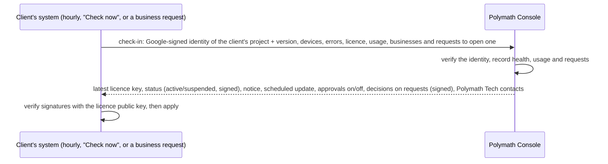

# 22 — Polymath Console: managing every client centrally

The **Polymath Console** is Polymath Tech's own system for running the business behind POS Suite: every client, their licences, subscriptions and renewals, the health of their systems, their usage, and the updates they run. It is a separate web app in **your** Firebase project (not a client's), used by you and your staff from any browser.

| | POS Suite (each client) | Polymath Console (you) |
|---|---|---|
| Firebase project | The client's own (`noura-kitchen-pos`) | Yours (for example `polymath-console`) |
| Who uses it | The restaurant's staff | Polymath Tech staff |
| Code | `apps/web`, `apps/functions` | `apps/console`, `apps/console-functions` |
| Deploy | `pnpm release:deploy --target …` | `pnpm console:deploy` |

## 1. What it does

| Area | What you can do |
|---|---|
| **Overview** | Welcome banner with the systems' status; four figures with 30-day trend lines (clients, systems checking in, revenue this month, health); where clients are (world and Sri Lanka maps); platform health (healthy, attention, offline, not linked; licences valid, paid, on the latest version); recent activity; your clients; quick actions. The bell at the top lists every client needing attention: not seen for over a day, licence ending within 30 days, renewal due or overdue, errors on their devices, devices on an old version. Search (Ctrl/⌘ K) finds a client by name, town, project or licence. |
| **Clients** | Each client's profile (business, industry, town and country, contacts, Firebase project, region, release wave), status, notes and full history. Since 1.11.0 each business in the client's system also shows its **industry model** (restaurant, wholesale, retail…), reported at check-in: one platform, a model per business ([25](25-industry-models-wholesale-whatsapp.md)). |
| **Licences** | Issue, renew, upgrade or add modules from the browser. The licence reaches the client's system **by itself** within the hour (or at once, when they press *Check now*); the key can also be copied and pasted as before. Every licence ever issued is kept. |
| **Suspend / restore** | Suspend a client (for example unpaid). Their system shows a notice for the grace period you choose (7 days by default), then the licensed modules stop, as when a licence expires. **Their data is always kept**, and **Restore** brings everything back at the next check-in. |
| **Subscriptions** | Plan, price, billing cycle, paid-until date, payments received; one click records a payment and renews the licence to the new paid-until date. Clients see a reminder in their back office before the renewal date. The Subscriptions page totals monthly recurring revenue, renewals due, overdue amounts and the latest payments. |
| **Monitoring** | Every system as it reported at its last check-in: status, version, devices (and how many run an older version), errors in 24 hours, last check-in, licence end, and what to look at. |
| **Reports & Analytics** | Revenue collected by month, clients over time, sales through POS Suite across clients that share their figures, and the mix of versions, editions, plans and industries; every chart also as a table. |
| **Support** | What clients see on their About page, the guides, systems that need help, and every client's contact person. |
| **Health** | From each client's daily check-in: the server version, each device and its version, errors in the last 24 hours, licence status, businesses in the project, last check-in. |
| **Usage** | Per business and day: bills, covers, net sales and total (only if the client's owner leaves *Share daily figures with Polymath Tech* on, under About). |
| **Updates** | The catalogue of POS Suite versions (from the release notes), which version each client runs, and **pushing a version to chosen clients**: now, at a set time, or in each client's maintenance window. Clients see a maintenance notice first; a client is done when its own system reports the new version (§8). |
| **Businesses** | **Two-step validation** of every new business: the client's system is step one (its project is registered and its identity confirmed); each business it opens is step two. Requests wait here with who asked, the kind of business (industry model), whether that is the client's contact, and any business with the same name; you approve or decline with a message (§9). Below: every business in every client's system, flagged when archived, duplicated or not approved. |
| **Deployments** | The technical history: GitHub Actions release runs ([20](20-release-and-updates.md)) started from Updates or by hand (staging, a wave, chosen clients). |
| **Privacy & data** | What the console holds about clients and why, how long it is kept (applied every morning), each client's data agreement, and a client's full export or (after the contract ends) erasure ([24](24-privacy-and-data-protection.md)). |
| **Message to all clients** | Support → one notice for every client's back office (support hours, holidays, planned work); a client's own notice comes first. |
| **Staff** | Owner, Admin, Sales, Support and Engineer roles; every action is written to an audit log. |
| **Company** | Polymath Tech's contact details, shown on every client's About page ("Help and support"). |

### Roles

| | Owner | Admin | Sales | Support | Engineer |
|---|---|---|---|---|---|
| See clients, health, usage, licences | ✓ | ✓ | ✓ | ✓ | ✓ |
| Add and edit clients, subscriptions, payments | ✓ | ✓ | ✓ | | |
| Issue and renew licences | ✓ | ✓ | ✓ | | |
| Suspend and restore | ✓ | ✓ | | | |
| Push updates, load release notes | ✓ | ✓ | | | ✓ |
| Approve or decline new businesses, message to all clients, data agreements | ✓ | ✓ | ✓ | | |
| Switch approvals off for a client, export a client's data | ✓ | ✓ | | | |
| Staff, company details, GitHub settings, retention, erasing a client's data | ✓ | ✓ (not owners) | | | |

## 2. How it works



- **Who is calling.** Each client's server function proves which Firebase project it runs in with a Google-signed identity token (its project's service account). No passwords or keys are shared with clients. The console only answers projects registered to a client; a new project number is shown to you for one-click confirmation the first time.
- **What the console can change.** Only what it signs with your licence key: a licence (as today), the active/suspended status, and approvals of new businesses. The client's system checks every signature with the public key it already has, so nobody else (not even someone pretending to be the console) can suspend, upgrade or open a business for a client. The maintenance notice and messages are information only.
- **If the console can't be reached** nothing changes for the client: their licence keeps working until its expiry date as it does today. A restaurant never stops because of the console.
- **The licence signing key** lives in your console project's **Secret Manager**, readable only by the console's server functions. You issue licences from any browser; the key no longer sits on a PC. (`pnpm licence` keeps working with the file for emergencies.)
- **Usage figures** are yesterday's totals per business (bills, covers, net sales, total): no customers, items or staff. The owner can switch the sharing off.

## 3. Data (console project)

| Collection | Holds |
|---|---|
| `clients/{id}` | Profile, Firebase project ID and number, region, wave, status, subscription, current licence, suspension, last health report, notice |
| `clients/{id}/usage/{date}` | Daily figures per business |
| `clients/{id}/payments/{id}` | Payments received |
| `licences/{licenceId}` | Every licence issued: payload, key, who issued it and why |
| `deployments/{id}` | GitHub release runs started from the console |
| `releases/{1_10_0}` | The release catalogue: version, date, type, what clients get, the changes |
| `rollouts/{id}` | A version pushed to clients: when, by whom, the message, and each client's state |
| `businessRequests/{client__id}` | Requests to open a business: who asked, modules, duplicates, the decision and its signed token |
| `metrics/{date}` | Each day's figures for the Overview's trend lines (clients, checking in, healthy, paid, monthly recurring revenue, versions), written by housekeeping |
| `staff/{uid}`, `invites/{email}` | Staff and their roles |
| `audit/{id}` | Every action by every staff member |
| `config/company`, `config/github`, `config/broadcast`, `config/privacy` | Contact details; repository settings; the message to all clients; retention periods |

Staff read through the security rules; **every change goes through the console's server functions**, which check the role and write the audit log.

## 4. Setting it up (once)

The step-by-step guide, with every screen, setting and message, is [23-polymath-console-deployment.md](23-polymath-console-deployment.md). In short:

1. **Firebase project** for the console (Firebase console → Add project, for example `polymath-console`), on the **Blaze** plan with a USD 5 budget alert, like a client's (deployment manual B and C). In it:
   - **Firestore**: create the database in `asia-south1`, production mode.
   - **Authentication → Sign-in method**: enable **Google** (and Email/Password if staff without Google accounts will sign in; they must verify their email).
   - **Project settings → Your apps**: register a web app (nickname `Polymath Console`).
2. On your PC, in the project folder:

   ```bash
   pnpm console:setup
   ```

   It asks for the console's project ID and your email (the **owner**). It stores your licence signing key from `licence-keys/vendor-key.txt` in the project's Secret Manager, writes `release/console.json`, and adds the console's address to `apps/functions/.env` so every client deploy knows where to check in.
3. Deploy the console:

   ```bash
   pnpm console:deploy
   ```

4. Open `https://CONSOLE-PROJECT-ID.web.app`, sign in with the owner's Google account, and fill in **Settings → Company** (support email, phone, WhatsApp, website).
5. **Clients → Add client** for each existing client (Noura Kitchen: `noura-kitchen`, project `noura-kitchen-pos`). Then deploy each client once (`pnpm release:deploy --target noura-kitchen`) so their system starts checking in; their first check-in shows on the client's page within a minute of pressing **About → Check now** in their back office.
6. Optional, for **Deployments** from the console: Settings → GitHub (repository, workflow) and the GitHub token (`pnpm console:setup --github-token`), plus the one-time release pipeline setup in [20 §3](20-release-and-updates.md).

## 5. Daily use

- **New client:** Clients → Add client → (deploy them: deployment manual) → Licence → *Issue*: edition, add-ons, limits, months. It reaches their system at the next check-in; or copy the key for the client's administrator.
- **Payment received:** client → Subscription → *Record payment* (amount, method, reference, paid until) → *Renew licence to paid-until date*.
- **Not paid:** client → *Suspend*, with a message the client sees and a grace period. *Restore* when paid.
- **Release:** Updates → *Load release notes* → choose the version → tick the clients (those behind are ticked) → *Schedule update* (in each maintenance window) or *Update now* → follow each client to **Done** (§8).
- **New business at a client:** the bell and Businesses show the request → check who asked and the duplicates → *Approve* or *Decline* with a message (§9).

## 6. Costs

The console is one more small Firebase project: a few hundred reads and writes a day, two scheduled jobs (housekeeping every morning: the GitHub status refresh, the day's dashboard figures and retention; rollouts every 15 minutes: start updates that are due), Secret Manager (6 secret versions free), all inside the free tier. Each client's check-in is one function call an hour in their project (24 a day, a few hundred reads; one Cloud Scheduler job, still inside the 3 free jobs per billing account together with the hourly audit sealer).

## 7. Trying it on your PC (no cloud)

Two terminals, in the project folder:

```bash
pnpm console:emulators
```

```bash
pnpm console:dev
```

Open `http://localhost:5174`, choose *Invited? Create an account with your email*, and sign up as `owner@polymath.test`. The emulator prints a verification link in the first terminal: open it, then sign in. That address is the owner on the emulators; everything you create there disappears when you stop them. On the emulators the console signs licences with the public **demo** key, never your own.

`pnpm test:console` does all of this automatically: a client system's real check-in code against the console (licences, suspend and restore, usage, refusals, business requests and approvals, duplicates, archiving, update rollouts and the maintenance notice, the message to all clients, privacy), then every console screen in light and dark, on a PC and a phone (screenshots in `manual-pdf/console/`).

## 8. Updates from the console

The first update pushed this way is **1.10.0**. The flow:

1. **Load release notes** (Updates). With GitHub connected (Settings → GitHub and the token) the console reads `CHANGELOG.md` on the release branch; without it, the notes built into the console (as of its last `pnpm console:deploy`). Each version shows what clients get and how many clients run it.
2. **Choose the version and the clients.** Every client shows the version its system reported at its last check-in; those behind are ticked. A client in another rollout can't be ticked (cancel it there first); a client never gets a version it already has.
3. **When:**
   - *In each maintenance window* (default): the client's window (Clients → the client, for example `23:30-05:00 Asia/Colombo`), at least an hour from now, so every screen sees the notice first (check-ins are hourly).
   - *Now*: starts at once.
   - *At a time*: a date and time in Sri Lanka.
4. **What the client sees** from their next check-in: a banner for owners, administrators and managers (*Update 1.10.0 tonight, 23:30–05:00. The system may pause for a few minutes: finish open bills before 23:30.*), the same on the POS sign-in screen within 12 hours of the start, an item in Tasks, and the update with its notes on About. During the update: *Updating to 1.10.0 now*. After it, every back-office user sees **What's new** once.
5. **The update runs** every 15 minutes the console checks for clients that are due:
   - **GitHub connected:** it starts the release workflow (`release.yml`, *Redeploy*) for those clients, on the tag `v1.10.0` if there is one, else on the release branch if that is still 1.10.0 (otherwise the client is marked failed with the reason). Production runs wait for approval in GitHub if you set reviewers on the `production-wave-1` environment.
   - **No GitHub connection:** the client shows **Run on the release PC** with the command (`pnpm release:deploy --target noura-kitchen`); run it at the time, from the version's code.
6. **Done** only when the client's own system reports the new version at its next check-in (within the hour; *Check now* on their About page makes it immediate). A GitHub run that succeeded shows *Deployed · waiting for check-in* until then. **Cancel** (before it starts), **Mark done** (for a manual update whose check-in can't confirm it) and **Retry now** (after a failure) are on each row.

## 9. Opening a business: two-step validation

From 1.10.0, a client's system that is linked to the console asks Polymath Tech before it opens a new business (a second outlet, a company, or a demo or training copy):

1. **The client** is validated by its check-in: the console answers only a project registered to a client, whose identity (project ID, or project number confirmed once) it has checked.
2. **The business:** on *Set up a business*, the owner's request goes to the console at once. The owner sees *Waiting for approval* (the screen asks again every 20 seconds, and they can leave and come back). In the console, **Businesses** shows who asked (and whether that is the client's contact on file), the modules, and **any business with the same name** in that system, in its other requests, or at another client (names are compared ignoring case, accents, punctuation, "(demo)" and "Pvt Ltd"). Approve, or decline with a message the owner sees. Approving a name the system already has needs *It's a different business* ticked.
3. The decision is **signed** with the licence key and reaches the client's system at its next check-in (the waiting screen triggers it). The security rules then let **only the person who asked** open that business, under the id they asked for; nobody can switch the check off from the client's side (the flag is in `deployment/link`, written only by the client's server).

Also:

- **The same name again** (Noura Kitchen's case): typing the name of a business the person already has shows *You already have Noura Kitchen. Open it instead* and holds *Create business* until *It's a different business* is ticked; the console sees the duplicate anyway.
- **Opened by mistake:** the owner archives it (Account → *Archive this business*). It disappears from the business list, its POS devices stop, and all its data is kept; *Set up a business → Archived businesses → Restore* brings it back. The console shows it as archived.
- **Businesses opened before approvals** (before 1.10.0) show as *Before approvals*; one opened after without an approval shows **Not approved** (only possible from a system on an older version, or by a platform administrator).
- **Your own demo or training systems:** Clients → the client → Controls → *Open without approval*.
- **Unlinked systems** (no `CONSOLE_URL`) open businesses straight away, as before.

## 10. Privacy

The console holds business data about clients, never their guests', customers' or employees' details: those stay in each client's own Firebase project. See [24 · Privacy and data protection](24-privacy-and-data-protection.md) for what each side holds, the legal basis, retention, the client's data agreement, access and erasure.
