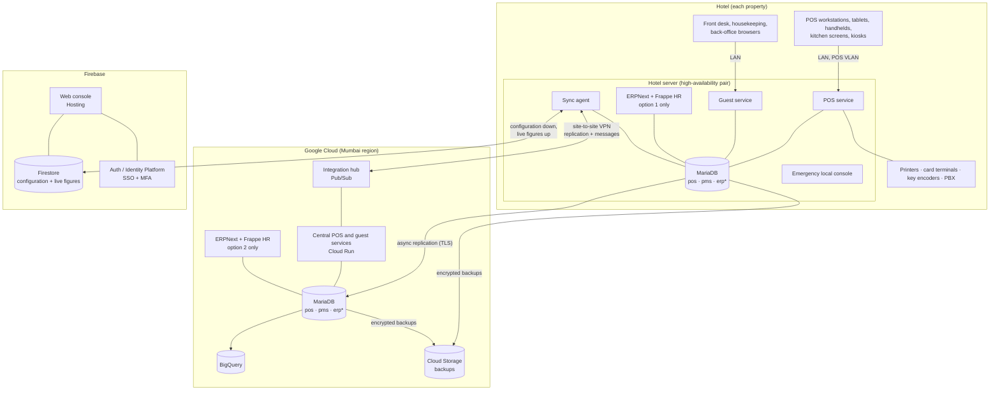

# 01 — Architecture

## 1. Goals

1. **Never stop service.** Restaurants, bars, room service and the front desk keep working through internet, cloud or Firebase outages.
2. **One place to configure everything.** POS, guest system and ERP settings are managed from the same Firebase web console as Model 1.
3. **Enterprise security and audit:** encrypted, least-privilege, fully audited, ready for external audit and card-payment (PCI DSS) scope reduction.
4. **Hosting choice for the ERP:** in the hotel (option 1) or in Google Cloud (option 2).
5. **Scales from one hotel to a group:** properties, revenue centres and workstations as in Simphony; multi-company books in ERPNext.
6. **Reuse what is proven in Model 1:** Sri Lanka tax engine, bill and KOT printing, privileges and journal, validation, licensing, the console and the POS front end.

## 2. Systems

| System | Role | Benchmark | Technology |
|---|---|---|---|
| **POS** | Restaurants, bars, room service, banquets, spa and retail outlets | Oracle MICROS Simphony (with its on-property service host for offline operation) | Property POS service (Node.js/TypeScript) + MariaDB `pos` database; workstation clients reuse the Model 1 POS screens |
| **Guest system (PMS)** | Reservations, front desk, rooms and housekeeping, cashiering and folios, accounts receivable, night audit | Oracle OPERA Cloud functions (our own implementation and naming) | Property guest service (Node.js/TypeScript) + MariaDB `pms` database |
| **ERP** | Accounting, purchasing, stores, assets, HR and payroll | SAP S/4HANA-class processes | ERPNext + Frappe HR on MariaDB `erp` database, with our connector app |
| **Console and insights** | Configuration of all three, dashboards, mobile apps, alerts, sign-in | Simphony EMC, OPERA Cloud configuration | Firebase: Auth / Identity Platform, Firestore, Hosting, Functions, Cloud Messaging |
| **Integration hub** | Reliable messages between systems, the hotel and the cloud | — | Outbox tables + Google Pub/Sub + sync agent; Cloud Run services |
| **Analytics** | Group reporting across hotels | — | BigQuery (fed from the cloud MariaDB) |
| **Backup** | Encrypted, locked backups and disaster recovery | — | Google Cloud Storage |

## 3. Topology

`erp*`: the ERP database is on the hotel server in option 1 and in Google Cloud in option 2. The other location holds a replica for reporting and recovery.

## 4. Which database owns which data

One writer per piece of data is the rule that keeps the system consistent. The other copies are replicas or read models.

| Data | Owner (system of record) | Copies |
|---|---|---|
| **Configuration** of POS, guest system and ERP (menus, prices, roles and privileges, room types, rate codes, transaction codes, chart-of-accounts mapping, employees' POS settings…) | **Firestore** (authored in the console) | Applied to every MariaDB that uses it; audited on both sides |
| POS transactions (checks, payments, invoices, journal, time cards) | **Hotel `pos` database** | Cloud `pos` (replica); summaries in Firestore |
| Guest system transactions (reservations, profiles, folios, room status, night audit) | **Hotel `pms` database** | Cloud `pms` (replica); summaries in Firestore |
| Bookings from the web booking engine, OTAs and the central reservations office | Received by the **cloud guest service**, then delivered to the hotel through the queue | Confirmed by the hotel's `pms` |
| Accounting, purchasing, stores, assets, HR and payroll | **ERPNext**: hotel `erp` (option 1) or cloud `erp` (option 2) | The other location (replica) |
| Employee master data (people, contracts, pay) | **Frappe HR** | The POS receives each employee's POS profile (role, PIN, revenue centres) from the console |
| Live dashboards and alerts | **Firestore** read models | — |

Why the hotel owns guest-system data although OPERA Cloud is cloud-hosted: you asked for the hotel to keep running on its own server. The cloud copy gives the same group-wide view and central reservations that OPERA Cloud offers. Bookings taken in the cloud while a hotel is offline are protected by channel allotments and confirmed when the link returns (see [04 §6](04-guest-system.md)).

## 5. How the parts talk

| Path | Transport | Notes |
|---|---|---|
| Workstations → hotel POS service | HTTPS + WebSocket on the POS VLAN | Works with no internet |
| Front-desk browsers → hotel guest service | HTTPS on the hotel LAN | Same |
| POS → guest system (room charges, guest lookup) | Service-to-service API on the hotel server | Local, so room charges work offline |
| Hotel → cloud | Site-to-site VPN (Cloud HA VPN or WireGuard); 4G/5G backup link | MariaDB async replication over TLS; outbox messages through Pub/Sub |
| Hotel ↔ Firebase | Outbound HTTPS from the sync agent | The agent signs in as a device of its property; rules confine it to that property |
| POS and guest system → ERPNext | ERPNext REST API through the connector app | Queued, retried, idempotent (never posts twice) |
| Cloud → BigQuery | Scheduled export / change stream | Group analytics |

## 6. What happens when something fails

| Failure | Effect | Behaviour |
|---|---|---|
| Internet down at the hotel | Hotel can't reach cloud or Firebase | POS, front desk and housekeeping carry on locally. Messages queue in outbox tables and replication resumes later. Console changes wait in Firestore and apply on reconnect. |
| One hotel server fails | — | The second server takes over (high-availability pair); workstations reconnect automatically. |
| Both hotel servers fail | Local systems stop | Disaster-recovery mode: run from the cloud replicas over the internet. Workstations keep their current check open and can finish in offline-capture mode (see [03 §4](03-pos.md)). |
| Google Cloud region issue | Central services unavailable | Hotels run normally; backups also exist in a second region. |
| Firebase down | Console and dashboards unavailable | Hotels run normally on the last configuration; urgent operational changes use the emergency local console. |
| ERPNext down | No new postings to the books | POS and guest system carry on; postings queue and catch up. |

## 7. Size targets (initial)

| | Target |
|---|---|
| Rooms per hotel | 50–1,000 |
| Revenue centres per hotel | 1–30 |
| Workstations per hotel | 5–150 |
| Checks per day per hotel | up to 10,000 |
| Hotels per group | 1–50 |
| Recovery | Hotel server failover within 2 minutes; see [07](07-backup-dr.md) for backup recovery targets |

## 8. Reused from Model 1

| Model 1 part | Use in Model 2 |
|---|---|
| `packages/engine` (Sri Lanka service charge, SSCL, VAT, TDL; IRD invoice numbers) | As is, in the POS and guest services |
| `packages/printing` (bills, KOTs, reports) and `apps/print-agent` | As is |
| `packages/core`: privileges and role levels, POS journal hash chain, licensing, validation schemas | As is. The `DocStore` interface gets a MariaDB implementation. |
| `apps/web` console: launchpad, workspaces, People & Security, themes, Audit Center | As is on Firebase; new workspaces for the guest system and ERP |
| `apps/web` POS screens | Point their data layer at the hotel POS service instead of Firestore |
| `packages/ledger` (built-in general ledger) | **Not used**: ERPNext keeps the books in this edition |
