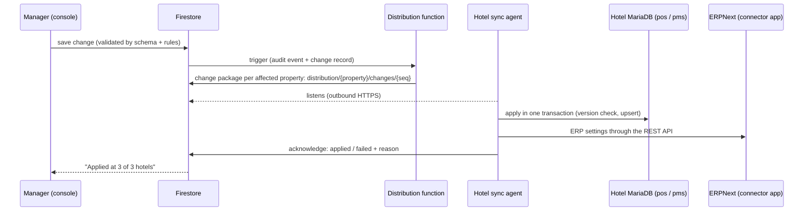

# 02 — Firebase control plane: one console for POS, guest system and ERP

Managers and administrators configure the POS, the guest system and the ERP in **the same web console as Model 1**, which runs on Firebase. The POS, guest system and ERP run on MariaDB. This document defines how a change made in the console reaches every MariaDB system, safely and traceably, including when a hotel is offline.

## 1. Principles

1. **Same console, same way of working.** It keeps:
   - the launchpad and workspaces;
   - the forms and Excel feeders;
   - validation on save and the field-level audit trail;
   - roles and licence-controlled modules.

   New workspaces are added for the guest system (Rooms and rates, Front office, Cashiering) and for the ERP (Finance, Procurement and stores, HR and payroll).
2. **Firestore is the master of configuration only.** Transactions never live in Firestore in this edition. They live in MariaDB. Firestore also holds read-only **live figures** for dashboards and mobile apps.
3. **Every change is versioned, validated, distributed, applied and acknowledged.** The console shows for each change where it has been applied.
4. **A hotel never depends on the console to keep running.** It runs on the last configuration it received.
5. **Each record has one owner.** Configuration is owned by the console. Operational state (room status, 86'd items, open checks, folios) is owned by the hotel.

## 2. The flow of a configuration change

1. **Save.** The console validates with the Model 1 schemas plus Model 2 schemas (`packages/core/src/validation.ts`). Firestore security rules check role, property scope and licence.
2. **Record.** The existing audit trigger records who changed what (before and after). The distribution function creates a numbered **change package** for each affected property: collection, record id, new version, full new record, author and time.
3. **Publish (optional).** For sensitive areas, the change can be marked **draft** and released with a **Publish** step:
   - prices, tax rules, rate codes;
   - transaction codes, chart-of-accounts mapping and payroll components.

   Publish also lets you schedule an effective date ("new menu prices from 1 December 00:00"), as Simphony EMC and OPERA configuration allow.
4. **Distribute.** Each hotel's **sync agent** listens to its own `distribution/{propertyId}/changes` queue. It reconnects and catches up by sequence number after an outage.
5. **Apply.**
   - The agent applies the package to the right MariaDB database in one transaction.
   - It refuses a package whose version is older than the one already applied.
   - It writes an entry to the database's own configuration audit table, carrying the Firestore change id.
6. **Acknowledge.** The agent writes back `applied` (with time) or `failed` (with the reason). The console shows the status per hotel and alerts administrators on failures.

The cloud MariaDB databases are applied by a cloud instance of the same agent, so cloud and hotels stay identical.

## 3. What is configured where

| Area | Configured in the console (Firestore master) | Applied to |
|---|---|---|
| Organisation | Enterprise, properties, revenue centres, workstations, printers, devices | `pos`, `pms` |
| POS | Menu items, definitions per revenue centre, price levels, modifiers, categories, discounts, service charges, tenders, reason codes, order types, tables and floor plans, KDS stations, themes and item photos | `pos` |
| People and security | Roles, privileges, levels and limits; employees' POS profile (role per property, revenue centres, PIN, card); sign-in policy | `pos` (employee master data from Frappe HR, see §5) |
| Guest system | Room types, room classes, rooms and features, rate codes and seasons, packages, market and source codes, transaction codes, routing codes, housekeeping sections, cancellation and deposit policies, guarantee types, reservation types | `pms` |
| Finance mapping | POS and guest-system transaction codes → ledger accounts and cost centres (USALI departments) | Connector app in ERPNext |
| ERP master data (day-to-day) | Items and stock items, suppliers, warehouses (stores per outlet), cost centres, departments, designations, holiday lists, leave types | ERPNext through its REST API |
| ERP specialist setup | Chart of accounts, tax templates, salary structures, payroll periods, fiscal years, approval workflows | **ERPNext's own screens**, opened from the console with single sign-on; changes are mirrored back into Firestore so the console shows them |
| Licence and modules | Edition, modules, limits | Every system |

**ERPNext has its own complete configuration screens.** Re-creating every ERPNext setting in our console would duplicate a large, changing product. So the console covers the day-to-day masters that managers touch. For specialist accounting and HR setup it opens ERPNext directly, with the same sign-in, so it feels like one system.

## 4. Changes made outside the console

| Where | Example | Rule |
|---|---|---|
| ERPNext screens | Accountant adds a supplier in ERPNext | The connector app sends a webhook. The cloud function mirrors the change into Firestore with `origin: erp`. The agent skips changes that came from the system it would apply them to, so nothing loops. |
| At the hotel during an outage | Manager marks an item 86, changes room status, unlocks a cashier | **Operational state** is owned by the hotel and synced up as live figures. It is not configuration, so there is no conflict. |
| Emergency local console (hotel server) | Internet down for a day and a price must change | Allowed only for a short list of settings and only for owner/administrator roles. Each change is applied locally, marked `pending-sync`, and pushed to Firestore on reconnect. If the console changed the same record meanwhile, the console version wins and the local change is shown for review. |

## 5. Employees: three systems, one person

| Attribute | Owner | Edited in |
|---|---|---|
| Name, contact, department, designation, contract, pay, bank, leave | Frappe HR | Console HR workspace (writes to Frappe HR through the API) or Frappe HR screens |
| POS profile: employee number, role per property, revenue centres, PIN, card, sign-in status | Console (Firestore) | Console People & Security |
| Back-office login (email, SSO, MFA, member role) | Firebase Auth / Identity Platform | Console logins |
| Time cards (clock in/out) | Hotel `pos` | Recorded on the POS; sent to Frappe HR for attendance and payroll |

A new hire is created once, in HR. The console then offers "Set up POS access" for them.

## 6. Live figures back to Firebase (read models)

The sync agent publishes small summary documents, not raw transactions:

| Read model | Example contents | Frequency |
|---|---|---|
| `live/{property}/today` | Sales by revenue centre and hour, covers, open checks, voids and discounts so far | Every 1–5 minutes (configurable) |
| `live/{property}/rooms` | Occupancy, arrivals, departures, in-house, out-of-order, ADR, RevPAR | Every 5 minutes and at night audit |
| `alerts/{property}/…` | Large void, no-sale after hours, failed interface, replication lag, disk space, backup missed | Immediately, also pushed to phones (FCM) |
| `daily/{property}/{date}` | Final figures after End of Day and night audit | Daily |

These keep Firestore usage small and predictable. A group of several hotels stays within a modest Firebase bill. Detailed reports run against MariaDB or BigQuery.

## 7. Security of the control plane

- **Console users:**
  - Firebase Auth upgraded to Identity Platform, with single sign-on (Microsoft Entra ID or Google Workspace) and enforced MFA for owners, administrators and finance;
  - property-scoped roles (a manager of hotel A cannot change hotel B).
- **Sync agents:**
  - each hotel's agent signs in as a **device identity** with a `propertyId` claim, so the rules let it read only its own distribution queue and write only its own acknowledgements and live figures;
  - its MariaDB account can write configuration tables only.
- **Change integrity:**
  - change packages carry a hash of their content;
  - the agent verifies the hash before applying;
  - the applied version and hash are stored in MariaDB, so the integrity check can prove that the configuration in every hotel matches the console.
- **Audit end to end:** console audit event → change package → apply record in MariaDB, all sharing one change id.

## 8. Build notes

- Firestore paths keep the Model 1 shapes (`tenants/{t}/menuItems/{id}` …) with an added `propertyScope` field.
- New collections: `distribution/{property}/changes`, `distribution/{property}/acks`, `live/…`, `alerts/…`.
- The sync agent is a small Node.js service (`services/sync-agent`). It uses the Firestore client SDK with a device token for the change stream, and a MariaDB connection pool.
- Mapping from Firestore documents to MariaDB tables is declared once per collection (table, key, columns, JSON columns) in `packages/sync-map`. Unit tests assert that every validated collection has a mapping.
