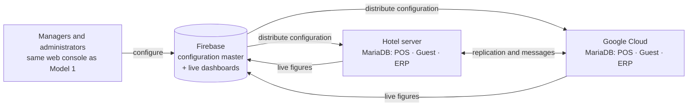

# Enterprise Hotel Edition (Model 2)

> **Branch:** `enterprise/hotel-suite` · **Status:** design and build documentation. The systems below are not built yet. This branch starts from the Cloud Restaurant Edition so it can reuse its code.

## Two editions, one repository

| | **Cloud Restaurant Edition** (Model 1) | **Enterprise Hotel Edition** (Model 2, this branch) |
|---|---|---|
| For | Small to medium restaurants and cafés | Medium to large hotels, up to 5-star and hotel groups |
| Systems | POS, back office, recipes, inventory, purchasing, CRM, built-in general ledger | POS (Oracle Simphony-level), guest system (Oracle OPERA Cloud-level functions), ERPNext with HR and payroll |
| Databases | Firebase Firestore only | MariaDB for every system, in the hotel and in Google Cloud |
| Where it runs | Fully in the cloud (Firebase) | A server in every hotel, plus Google Cloud |
| Without internet | Short drops only | Keeps running for any length of outage; cloud catches up later |
| Configuration | Web console on Firebase | **The same web console on Firebase**, distributing configuration to every MariaDB system |
| ERP hosting | Built in | ERPNext **on the hotel server (option 1)** or **in Google Cloud (option 2)** |
| Backups | Excel and audit exports (free tier) | Encrypted, locked backups in Google Cloud Storage, with restore drills |
| Branch | `main` (work in progress on `develop`) | `enterprise/hotel-suite` |

Clients choose the edition that fits their size, requirements and budget.

## The central idea

- **Firebase is the control plane.** Every setting of the POS, the guest system and the ERP is changed in one web console. The console uses Firebase sign-in, the launchpad and workspaces, the validation and the audit trail of Model 1, and stores the settings in Firestore.
- **MariaDB is the data plane.** Checks, payments, reservations, folios, stock, the general ledger and payroll live in MariaDB:
  - in the hotel, so the hotel never stops when the internet does;
  - in Google Cloud, for group-wide operation, reporting, backup and disaster recovery.
- **A sync agent in each hotel** applies configuration changes to the local MariaDB databases and sends live figures back to Firebase for dashboards and mobile apps.

## Documents

| # | Document | What it settles |
|---|---|---|
| 01 | [Architecture](01-architecture.md) | Systems, topology, which database owns which data, failure behaviour |
| 02 | [Firebase control plane](02-firebase-control-plane.md) | How configuration made in the Firebase console reaches POS, guest system and ERP |
| 03 | [POS (Simphony-level) on MariaDB](03-pos.md) | Property POS service, workstation clients, offline operation, schema |
| 04 | [Guest system (OPERA Cloud-level functions)](04-guest-system.md) | Reservations, front desk, rooms, cashiering, accounts receivable, night audit, interfaces |
| 05 | [ERPNext, HR and payroll](05-erp-hr.md) | Hosting options 1 and 2, modules, connector app, Sri Lanka payroll |
| 06 | [MariaDB security baseline](06-mariadb-security.md) | Enterprise security controls for every database |
| 07 | [Backup and disaster recovery](07-backup-dr.md) | Google Cloud Storage backups, recovery targets, drills |
| 08 | [Infrastructure and deployment](08-infrastructure.md) | Hotel server hardware, network, Google Cloud resources, releases |
| 09 | [Build plan](09-build-plan.md) | Repository layout, phases, reuse from Model 1, testing, partners |
| 10 | [Decisions and open questions](10-decisions-and-questions.md) | What is decided and what still needs an answer |
