# Configuration guide

**For:** owners, managers and accountants who set up and look after their own business in the system: the books, stock, the menu and the rules behind them.

This guide explains each setting in plain words, with examples from a restaurant, and says what to choose when you are not sure. Read it once from the start; afterwards use the contents to find a topic.

> **Not an accountant?** You don't need to be. Sections 3 and 4 explain the few accounting ideas the system uses, and the Excel workbook in section 9 comes filled with an example to copy.

## Contents

1. [Where to start: the Setup checklist](#1-where-to-start-the-setup-checklist)
2. [Business and tax details](#2-business-and-tax-details)
3. [Accounting ideas in five minutes](#3-accounting-ideas-in-five-minutes)
4. [Setting up the books](#4-setting-up-the-books)
5. [Recording the day to day](#5-recording-the-day-to-day)
6. [Stock](#6-stock)
7. [The menu: categories, items, modifiers and recipes](#7-the-menu-categories-items-modifiers-and-recipes)
8. [Payments, discounts, reasons and roles](#8-payments-discounts-reasons-and-roles)
9. [The Excel workbooks](#9-the-excel-workbooks)
10. [Month end](#10-month-end)
11. [Questions and common mistakes](#11-questions-and-common-mistakes)
12. [Go-live checklist for accounting and stock](#12-go-live-checklist-for-accounting-and-stock)

---

## 1. Where to start: the Setup checklist

**Administration → Setup checklist** lists what your business still needs, in order, for the modules you use. Each step has a button that takes you to the right page; a tick shows it is done.

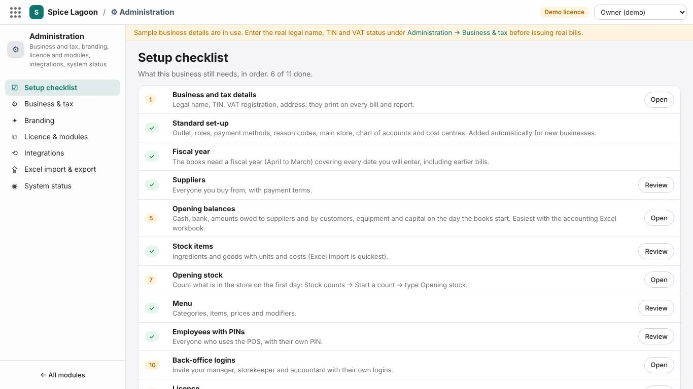

| Step | What it means | Section |
|---|---|---|
| Business and tax details | Legal name, TIN, VAT and SSCL registration, address. | 2 |
| Standard set-up | Outlet, roles, payment methods, reason codes, main store, chart of accounts, cost centres. A new business gets these automatically; if one is missing, **Add the missing basics** puts it back. | — |
| Fiscal year | The books need a year (April to March) covering every date you will enter. Choose **Books start on** and press **Open fiscal year(s)**. | 4.3 |
| Suppliers | Everyone you buy from. | 4.5 |
| Opening balances | Cash, bank, what you owe and are owed, equipment and capital on the first day. | 4.4 |
| Stock items | Ingredients and goods you keep in the store. | 6.2 |
| Opening stock | A first count of what is on the shelves. | 6.4 |
| Menu, employees with PINs | Only when the POS is used. | 7, 8 |
| Back-office logins | Your manager, storekeeper and accountant each with their own login. | 8.4 |
| Licence | Activate the key from your supplier before the trial ends. | — |

**Which modules?** Under **Administration → Licence & modules**, a business that starts with its books and stores turns on **Accounting**, **Inventory** and **Purchasing** (purchase orders, goods receipts and suppliers). **Recipes** is useful once the menu is costed. The POS can be turned on later; nothing set up now has to be redone.

---

## 2. Business and tax details

**Administration → Business & tax**

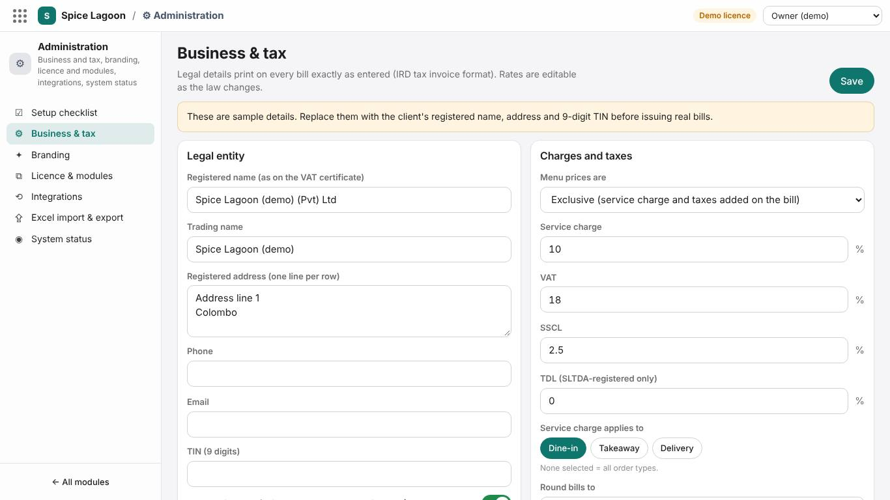

| Setting | Choose |
|---|---|
| Registered name, TIN (9 digits), registered address | Exactly as on the business registration and VAT certificate: they print on tax invoices. |
| Trading name | The name guests know. |
| VAT | On only if the business is VAT registered. Then supplier bills can show VAT separately (you claim it back) and sales carry output VAT. |
| SSCL | On only if the business is liable for the Social Security Contribution Levy. |
| Service charge | The rate (usually 10 %) and what it applies to. |
| Menu prices are | *Exclusive* (tax added on the bill) or *inclusive* (tax inside the price). |
| Round bills to | Rounding of the bill total (for example to the nearest rupee). |

> If you are not VAT registered, leave VAT off. VAT on supplier bills is then simply part of the cost, and the system adds it to the expense for you.

---

## 3. Accounting ideas in five minutes

### 3.1 Accounts

Everything the business has, owes, earns and spends is kept in **accounts**, each with a code. The code tells you its kind:

| Codes | Kind | Examples |
|---|---|---|
| 1000–1999 | **Assets**: what the business has | 1000 Cash on hand, 1010 Bank, 1200 Inventory, 1500 Kitchen equipment |
| 2000–2999 | **Liabilities**: what it owes | 2000 Trade creditors (suppliers), 2100 VAT output, 2800 Bank loans |
| 3000–3999 | **Equity**: the owners' share | 3000 Stated capital, 3100 Retained earnings |
| 4000–4999 | **Income** | 4000 Sales – food, 4300 Service charge |
| 5000–5999 | **Cost of sales** | 5000 Cost of sales – food, 5100 Wastage |
| 6000–6999 | **Running costs** | 6000 Salaries, 6100 Rent, 6200 Electricity and water |
| 7000–7999 | **Finance costs and tax** | 7000 Interest expense |

Accounts sit in **groups** (for example *110 Cash and cash equivalents* holds Cash, Petty cash and Bank). You post to accounts, never to groups.

### 3.2 Debit and credit

Every entry has two sides that are equal: a **debit** and a **credit**. You rarely need to choose them yourself; the system does it for expenses, bills, payments, sales and stock. Where you do (journals, opening balances), this table is all you need:

| Something… | goes up with a | goes down with a |
|---|---|---|
| the business **has** (cash, bank, stock, equipment, money owed to it) | Debit | Credit |
| the business **owes** (suppliers, loans, taxes) or the owners **put in** (capital) | Credit | Debit |
| **earned** (sales, service charge) | Credit | Debit |
| **spent** (costs, expenses) | Debit | Credit |

*Example:* paying Rs 38,600 electricity from the bank: Debit 6200 Electricity (spent goes up), Credit 1010 Bank (the bank balance goes down).

### 3.3 What posts by itself

| When you… | the system posts… |
|---|---|
| record an expense or a supplier bill | the cost (debit) and what you owe the supplier (credit) |
| pay a supplier | what you owe goes down (debit), cash or bank goes down (credit) |
| receive goods into the store (goods receipt) | stock goes up; *received but not billed* until the bill arrives |
| count stock, record waste or production | the change in stock value against cost of sales, wastage or count differences |
| close a POS day (or enter a day of manual bills) | sales, service charge, taxes and the money received |
| run depreciation | the month's wear of equipment |

Posted entries are never edited or deleted. A mistake is corrected by **reversing** the entry (with a reason) and entering it again. That is what makes the books trustworthy for owners, banks and auditors.

---

## 4. Setting up the books

### 4.1 Chart of accounts

**Finance → Setup → Chart of accounts**

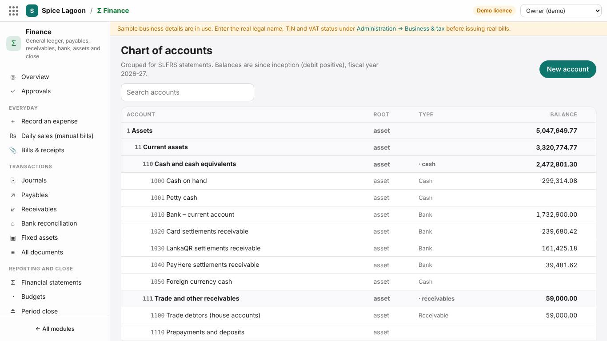

A new business gets a ready chart for a Sri Lankan restaurant (about 90 accounts). Most businesses add only a few accounts of their own. To add one, press **New account**:

| Field | What to enter |
|---|---|
| Code | 4 digits, not used yet, in the right range (section 3.1). Leave gaps so related accounts sit together: 6150 for *Gas* between 6100 Rent and 6200 Electricity. |
| Name | What people will understand: *Gas (LP gas cylinders)*. |
| Group / Parent group | The group it belongs to: **6** Operating expenses for a running cost, **110** for a new bank account. |
| Account type | **Expense** for running costs; **Bank** or **Cash** for money accounts (only these can be used to pay); **FixedAsset** for equipment. Leave empty if unsure. |
| Statement line | Leave as suggested; it decides where the account appears in the financial statements. |
| Frozen | Stops new postings to an account you no longer use. Accounts are never deleted. |

**Accounts restaurants often add**

| Code | Name | Group | Type |
|---|---|---|---|
| 1015 | Bank – savings account | 110 | Bank |
| 3200 | Owner's drawings | 3 | Equity |
| 6150 | Gas (LP gas cylinders) | 6 | Expense |
| 6160 | Cleaning supplies | 6 | Expense |
| 6170 | Telephone and internet | 6 | Expense |
| 6180 | Licences and fees (trade licence, liquor licence) | 6 | Expense |
| 6190 | Transport and delivery | 6 | Expense |

> Keep the chart short. A new account is worth adding when you want to see that cost on its own in the profit or loss. Otherwise use the nearest existing account and describe the entry well.

### 4.2 Finance settings

**Finance → Setup → Finance settings.** Only the owner or an administrator can change these.

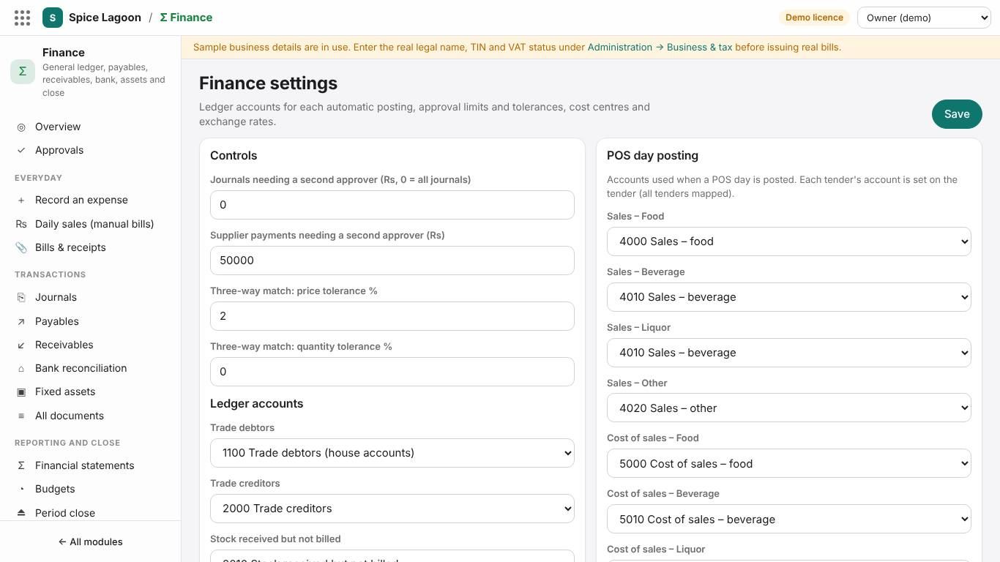

#### Approval limits (the "second pair of eyes")

| Setting | What it does |
|---|---|
| **Journals needing a second approver (Rs, 0 = all journals)** | A journal at or above this amount waits under **Finance → Approvals** until a *different* person approves it. **0 means every journal waits**, including opening balances and daily sales from manual bills. |
| **Supplier payments needing a second approver (Rs)** | Payments at or above this amount wait for a second person. |
| **Three-way match: price / quantity tolerance %** | A supplier bill for stock is compared with the purchase order and the goods receipt. Within these limits it posts; outside them it waits for approval. Defaults: price 2 %, quantity 0 %. |

The approver can never be the person who created or submitted the entry. Choose limits that fit who keeps the books:

| Who keeps the books | Journals limit | Payments limit |
|---|---|---|
| **One person** (the owner, or one accountant with nobody else in the system) | High enough that routine entries post, for example **Rs 1,000,000** | For example **Rs 500,000** |
| **Two people** (an accountant and the owner or manager who checks) | **0** (all journals) or **Rs 50,000** | **Rs 50,000** (default) |
| **A finance team** | 0 | Rs 50,000 or lower |

> With one person and the default limit of 0, every journal waits for an approver who doesn't exist. If entries pile up under Approvals, either raise the limit or give a second person a login to approve.

#### Ledger accounts and POS day posting

These say which account each kind of amount goes to (sales by major group, cost of sales by major group, service charge, VAT, SSCL, discounts, rounding, inventory, wastage, stock count differences, complimentary meals, suppliers, customers, VAT input, retained earnings and so on). **The defaults match the standard chart; leave them unless your accountant asks for a change.**

#### Cost centres

A cost centre is a part of the business you want results for: an outlet, the bakery, events. A single restaurant needs only the one it was given (**MAIN**). Add more only if you want separate profit or loss per part.

### 4.3 Fiscal year and periods

The fiscal year runs from April to March, in twelve monthly periods. Entries can only be made in an **open** period of an existing fiscal year.

- **Setup checklist → Fiscal year:** choose the date your books start (for a business already trading, usually 1 April or the first day of a month) and press **Open fiscal year(s)**. It opens that year and the current one.
- **Finance → Period close** closes a month once it is final (section 10).

### 4.4 Opening balances

For a business that already trades, the books start on a chosen day with what the business has and owes on that day. The easiest way is the **accounting workbook** (section 9.2). Here is what goes in, with the example business from the workbook:

| What | Where it goes | Example |
|---|---|---|
| Cash in the till and safe | Opening balances sheet, Debit 1000 | 25,000 |
| Bank balance (from the statement) | Debit 1010 | 640,000 |
| Deposits paid (rent deposit) | Debit 1110 | 300,000 |
| Loans still owed | Credit 2800 | 400,000 |
| Money the owners put in | Credit 3000 | 1,400,000 |
| Unpaid supplier bills | **Suppliers** sheet, *We owe them at the start* | 60,500 in total |
| What credit customers owe | **Customers** sheet, *They owe us at the start* | 42,000 |
| Stock on the shelves | **Opening stock** sheet, item by item | valued at each item's cost |
| Equipment, furniture | **Fixed assets** sheet, with depreciation to date | cost 950,000, depreciated 100,000 |

**How it balances.** The system uses a temporary account, **3900 Opening balances (temporary)**: suppliers, customers and stock are entered against it, and the opening journal clears it to zero. Whatever is left over after everything is entered is the profit (or loss) of the years before the books started; it goes to **3100 Retained earnings**. The import shows you this amount *before* anything is saved: if it looks wrong, a figure is probably missing (often a loan, capital or a bank account).

> Don't know the exact capital? Enter what you know. The difference goes to retained earnings and your accountant can split it later with one journal.

### 4.5 Suppliers and customers

**Finance → Setup → Suppliers** (or Inventory → Vendors) and **Finance → Setup → Customers**.

| Supplier field | Meaning |
|---|---|
| Code | Short and unique: VEG01, MEAT01, GAS01. Used in Excel and reports. |
| Name, contact person, phone, email, address | As on their bills. |
| VAT number | Needed for VAT invoices you claim back. |
| Pays after (days) | Credit period: 0 = cash on delivery, 7, 14, 30. Sets the due date of their bills. |

Customers here are **credit customers** only (companies that pay later, events). Walk-in guests don't need a record.

Cash purchases without a named supplier (a market trip, a hardware shop) go to one supplier called **Sundry suppliers (cash purchases)**, which the system creates by itself.

---

## 5. Recording the day to day

### 5.1 Photos of paper bills: Bills & receipts

**Finance → Everyday → Bills & receipts**

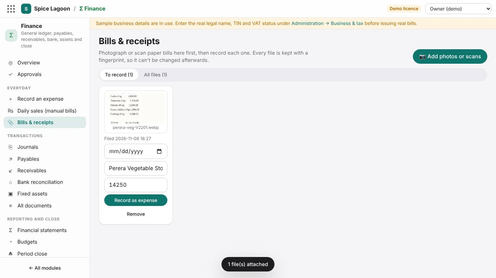

Keep the paper evidence with every entry:

1. On a phone or tablet, press **Add photos or scans** and photograph each bill (or choose PDFs from a scanner). Photos are made smaller automatically and kept with a **fingerprint**: if a file were ever altered, the system would show it.
2. Type the date, supplier and amount under each photo (optional, but it fills in the expense for you).
3. Press **Record as expense** on each one. The expense form opens with the photo attached.

You can also attach photos directly on **Record an expense**, a supplier bill (Payables), a journal or a goods receipt with **Add photo or scan**. Every document shows its attached files; open one to see it full size and download it.

Only owners and administrators can remove a file, and only while it is still unfiled in the inbox. Once a file is attached to an entry, it stays.

### 5.2 Record an expense

**Finance → Everyday → Record an expense**

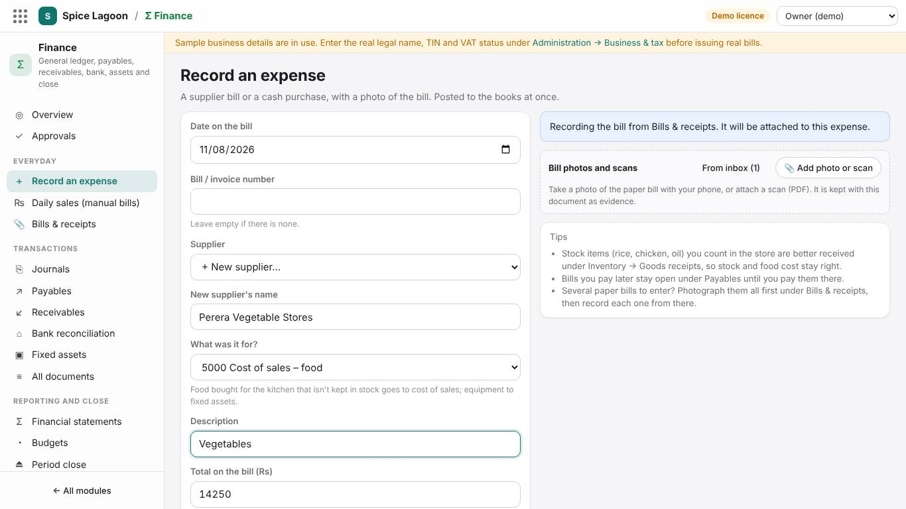

One form for a supplier bill or a cash purchase. Behind it the system makes a supplier bill and, when it was paid at once, the payment, both posted with their numbers.

| Field | What to choose |
|---|---|
| Date on the bill, bill number | From the paper. |
| Supplier | A supplier from the list; **+ New supplier…**; or **No named supplier (cash purchase)**. |
| What was it for? | The account. See the table below. |
| Total on the bill | Including VAT. If VAT registered, also enter the **VAT included** from a VAT invoice. |
| Paid from | **Not paid yet** (stays open under Payables until you pay it), **Cash**, **Petty cash** or **Bank**. |

**Which category?**

| The bill is for… | Choose |
|---|---|
| Vegetables, meat, fish, rice **used at once and not counted in the store** | 5000 Cost of sales – food |
| Drinks for resale not kept in stock | 5010 Cost of sales – beverage |
| Stock items you count in the store | **Don't use this form**: receive them under Inventory → Goods receipts (section 6.5) |
| Staff meals | 5200 Complimentary and staff meals |
| Rent | 6100 Rent |
| Electricity, water | 6200 Electricity and water |
| Gas | 6150 Gas (add the account, section 4.1) |
| Card machine fees | 6300 Card and payment fees |
| Repairs, servicing | 6400 Repairs and maintenance |
| Printing, advertising, social media | 6500 Marketing |
| Bank charges | 6700 Bank charges |
| Accountant, lawyer, consultant | 6800 Professional fees |
| Salaries and wages | 6000 Salaries and wages (EPF/ETF employer share: 6010) |
| Equipment or furniture that lasts more than a year | 1500 Kitchen equipment, 1510 Furniture and fittings, 1520 IT and POS equipment; then add it under Finance → Fixed assets |
| Loan interest | 7000 Interest expense |
| The owner's personal spending | Not an expense: 3200 Owner's drawings (add the account) |

### 5.3 Daily sales from manual bills

**Finance → Everyday → Daily sales (manual bills)**, for days sold on handwritten bills (before the POS, or when it was down).

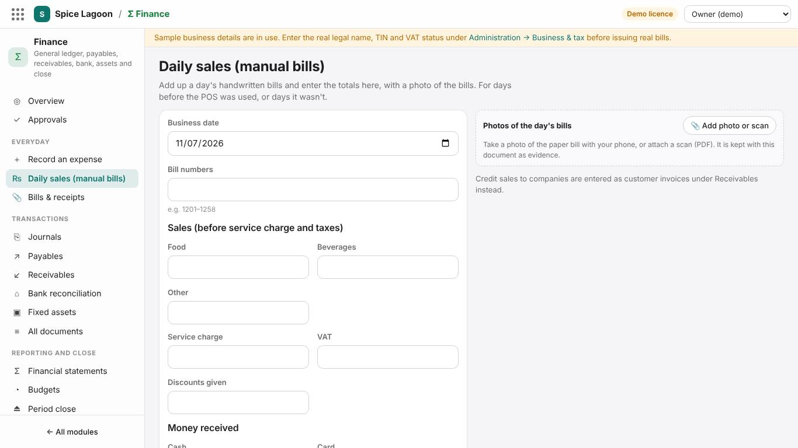

Add up the day's bills and enter:

| Field | Example |
|---|---|
| Date, bill numbers | 2026-04-01, bills 1001–1046 |
| Food, beverages, other (before service charge and taxes) | 98,500 · 21,300 · 0 |
| Service charge | 9,800 |
| VAT, SSCL | Only if registered |
| Discounts given | 2,500 |
| Cash, card, bank / LankaQR received | 74,100 · 41,000 · 12,000 |

Sales minus discounts must equal the money received (here 127,100 both ways); the form shows the difference until they match. **Post the day** posts it (or sends it for approval, section 4.2).

### 5.4 Paying supplier bills later

**Finance → Payables** lists open bills by supplier and age. Press **Pay supplier**, choose the supplier and the bank or cash account, and allocate the payment to the bills it pays. Large payments wait for approval (section 4.2).

### 5.5 Without the POS: stock to cost of sales

When sales are entered from manual bills, the POS doesn't deduct ingredients. Use a **kitchen usage** count instead (section 6.4): what is missing since the last count is what the kitchen used, and it becomes cost of sales.

---

## 6. Stock

### 6.1 Units: stock unit and purchase unit

Each stock item is kept in a small **stock unit** — grams (g), millilitres (ml) or pieces (pcs) — and bought in a **purchase unit**. The **stock units per purchase unit** connects them:

| Item | Stock unit | Purchase unit | Stock units per purchase unit |
|---|---|---|---|
| Samba rice | g | kg | 1000 |
| Wheat flour | g | 50 kg bag | 50000 |
| Coconut oil | ml | litre | 1000 |
| Fresh milk | ml | 1 L packet | 1000 |
| Eggs | pcs | tray 30 | 30 |
| Soft drink 330 ml | pcs | case 24 | 24 |
| Chicken | g | kg | 1000 |

Prices and par levels are per **purchase unit**; recipes and counts use **stock units**. When counting 25 kg of rice, enter 25000 (g).

### 6.2 Stock items

**Inventory → Stock items**

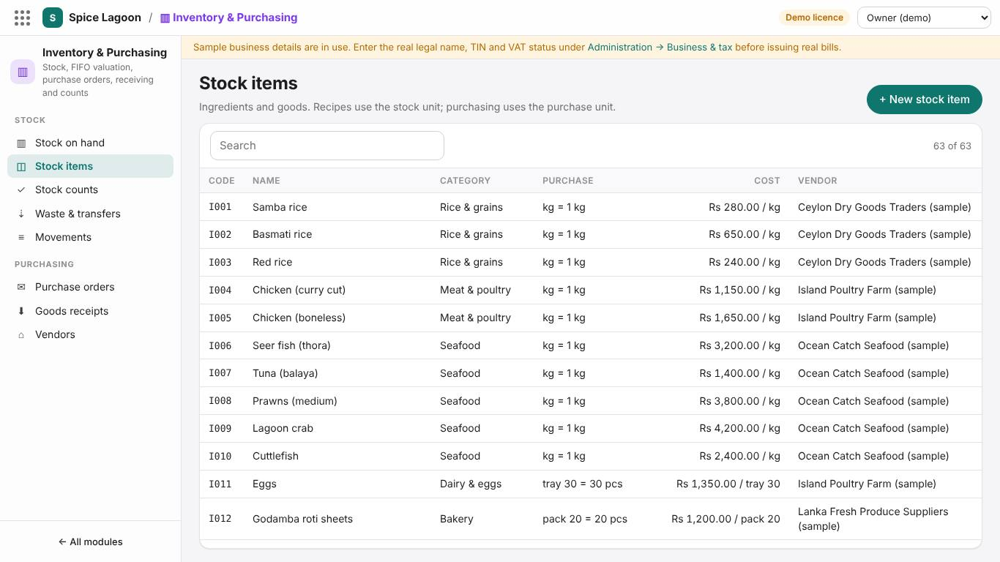

| Field | Meaning |
|---|---|
| Code, name, category | CODE like RICE-SAMBA; category for lists (Grains, Meat, Dairy…). |
| Major group | Food, Beverage, Liquor or Other: decides which cost-of-sales account it goes to. |
| Stock unit, purchase unit, stock units per purchase unit | Section 6.1. |
| Cost per purchase unit | Latest price. Goods receipts update it automatically. |
| Main vendor | Who you usually buy it from. |
| Par level, reorder quantity | Minimum to hold and the usual order, in purchase units. *Suggest from par levels* on purchase orders uses them. |
| Prep item | Made in-house from other items (gravies, batters). |
| Track stock | Off for items you don't count (prep items used through their ingredients). |

Many items at once: use the **data feeder** workbook (section 9.1).

### 6.3 Stores

A new business has one store, **MAIN** (*Main store*), which is all most restaurants need: count the dry store, cold room and bar together as one. If you need separate stores, ask your supplier to add them; transfers then move stock between them.

### 6.4 Stock counts: three kinds

**Inventory → Stock counts → Start a count**, choose the **Type of count**:

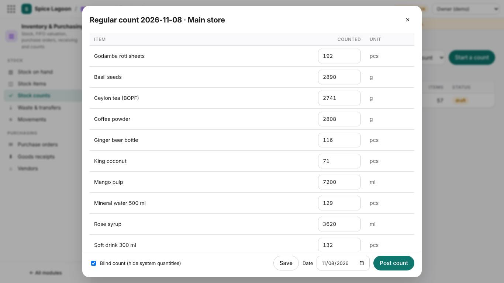

| Type | Use it for | What the difference becomes |
|---|---|---|
| **Opening stock** | The first count when you start | Your opening stock (against 3900, cleared by the opening balances) |
| **Kitchen usage** | Businesses without POS sales: count regularly (weekly or monthly) | What is missing is what the kitchen used: **cost of sales** |
| **Regular count** | Checking stock when the POS deducts sales | Losses or errors: **stock count differences** |

Enter what is on the shelves and **Post count**. With accounting on, the result goes to the books at once.

### 6.5 Receiving goods and the supplier's bill

1. **Purchase order** (optional): Inventory → Purchase orders.
2. **Goods receipt (GRN):** Inventory → Goods receipts: supplier, bill number, items, quantities in purchase units and prices. Attach a photo of the delivery note or bill. **Post to stock** adds the stock and posts *Inventory* against *Stock received but not billed*.
3. **Supplier bill:** Finance → Payables → New supplier invoice, linked to the goods receipt. It is matched against the order and receipt (section 4.2) and becomes payable.

> Enter a stock delivery **once**, as a goods receipt. Entering the same bill again as an expense counts the cost twice.

### 6.6 Waste, transfers and production

**Inventory → Waste & transfers:** spoilage with a reason (posts to wastage), moves between stores, and production of a prep item from its recipe.

---

## 7. The menu: categories, items, modifiers and recipes

Needed when the POS is used. Everything here can also be filled from the data feeder workbook (section 9.1).

### 7.1 Categories

**Menu Management → Categories**

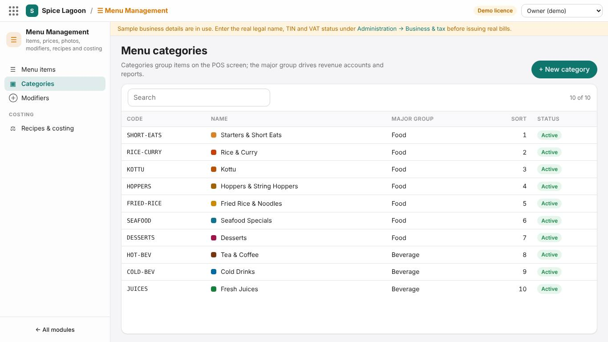

| Field | Meaning |
|---|---|
| Name | As on the POS: Rice & Curry, Kottu, Hoppers, Soft drinks. |
| **Major group** | Food, Beverage, Liquor or Other. **This is what sends the item's sales to the right sales account** (4000 food, 4010 beverage…) and drives reports. |
| Colour, sort order | Button colour and position on the POS. |

### 7.2 Menu items

**Menu Management → Menu items → + New menu item.** The fields are described in the user manual (section 7.1). The ones that affect the books:

- **Category** (and through it the major group): which sales account.
- **Tax class:** *Standard (VAT-able)* or *Exempt*.
- **Price:** exclusive or inclusive of tax, as set in Business & tax.

### 7.3 Modifiers

**Menu Management → Modifiers.** A modifier group is a question asked when an item is ordered.

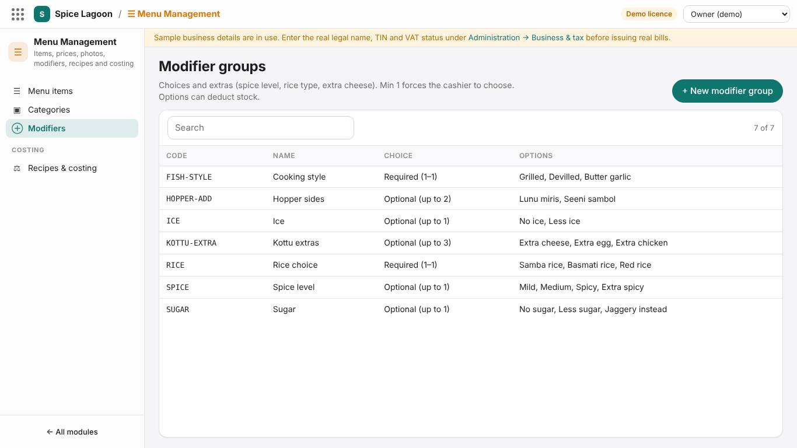

| Field | Meaning |
|---|---|
| Name | The question: *Spice level*, *Extras*, *Choice of bread*. |
| Minimum choices | 0 = optional; 1 = the guest must choose. |
| Maximum choices | How many options can be picked. |
| Options | Each with a name and a price (0 for no charge), and optionally a **stock item and quantity** it uses. |

**Examples**

| Group | Min | Max | Options |
|---|---|---|---|
| Spice level | 1 | 1 | Mild 0 · Medium 0 · Hot 0 |
| Kottu extras | 0 | 3 | Extra cheese 300 (uses 40 g cheese) · Extra egg 150 (uses 1 pcs egg) · Extra chicken 400 (uses 60 g chicken) |
| Choice of bread | 1 | 1 | Roti 0 · Paratha 50 · Naan 100 |

Attach groups to items on the item (*Modifier groups*).

### 7.4 Recipes and costing

**Menu Management → Recipes & costing.** For each menu item list the ingredients and quantities **per portion** in stock units (180 g rice, 120 g chicken, 15 ml oil). The system shows the cost per portion, the food-cost % and the price for your target food cost. With the POS, every sale deducts its recipe from stock at End of Day.

**Prep recipes** (a pot of chicken curry, dhal) say what a batch yields; produce them under Waste & transfers → Production, and use them in menu recipes like any stock item.

---

## 8. Payments, discounts, reasons and roles

### 8.1 Tender media (payment methods)

**POS Configuration → Tender media.** Each payment method has a type (cash, card, LankaQR, PayHere, gift voucher, house account…) and a **ledger account** where the money goes: Cash → 1000, Card → 1020 Card settlements, LankaQR → 1030, PayHere → 1040, House account → 1100 Trade debtors. *Can give change* and *Opens the cash drawer* are usually on for cash only.

### 8.2 Discounts

**POS Configuration → Discounts:** a name, a percentage or fixed amount, whether it applies to an item or the whole check, and whether it **needs a manager**. All discounts post to 4900 Discounts allowed.

### 8.3 Reason codes

**POS Configuration → Reason codes:** the reasons staff choose for voids, refunds, discounts, complimentary meals, waste and paid-outs. Short and clear: *Guest changed mind*, *Kitchen error*, *Spoiled*. They appear in the exceptions reports.

### 8.4 Roles

**Back-office logins** (People & Security → Back-office logins) — give each person their own:

| Role | Can |
|---|---|
| Owner | Everything, including licence, modules and logins |
| Administrator | All configuration and logins, except removing the owner |
| Manager | Menu, prices, staff, reports, stock and POS operations |
| Accountant | Accounting: expenses, bills, payments, journals, imports, approvals; read-only elsewhere |
| Storekeeper | Stock, receiving, counts, waste, purchase orders; can photograph bills |
| Auditor | Read-only access to everything, including the audit trail |
| Viewer | Read-only reports and settings |

**POS roles and privileges** (People & Security → Roles & privileges) are separate: they decide what each employee may do on the POS (void, discount, refund…) and their limits.

---

## 9. The Excel workbooks

There are two. Both are checked row by row before anything is saved, and both are safe to import again: what is already in is recognised.

### 9.1 The data feeder: menu, stock items, suppliers, customers

**Administration → Excel import & export.** Sheets for categories, menu items, modifier groups, stock items, recipes, vendors and customers, with drop-downs. **Export current data** gives you today's data to edit; codes are the keys, so re-importing updates instead of duplicating.

### 9.2 The accounting workbook: bring your books in

**Finance → Setup → Excel import**

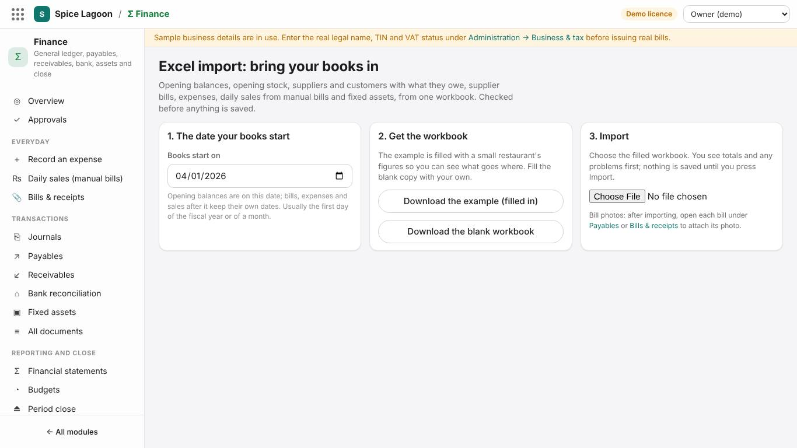

1. Set **Books start on**.
2. **Download the example (filled in)** and read it: it is a small restaurant that starts its books on 1 April, with every sheet filled.
3. **Download the blank workbook**, fill in your own figures (or delete the example rows from the example copy).
4. Choose the file. Read the **check results**: totals, the retained-earnings figure, and any problems with their sheet and row. Fix the file and choose it again until it is clean.
5. Press **Import**. Keep the page open; a bar shows progress. The results list what was posted, what waits for approval, and anything that could not be imported.

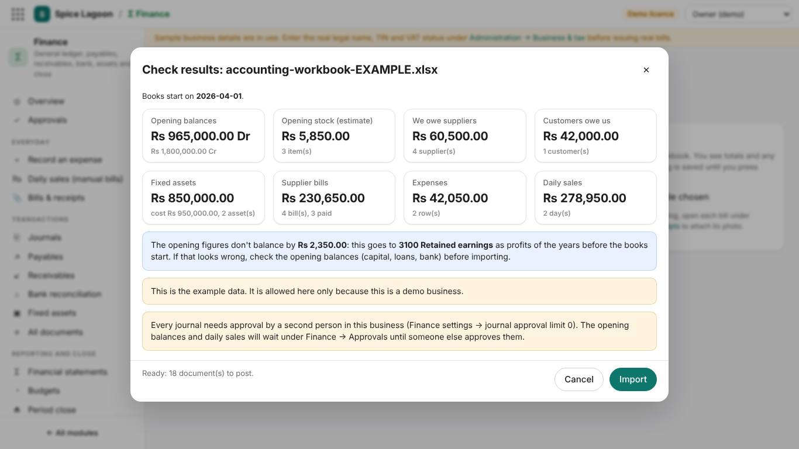

| Sheet | One row per… | Notes |
|---|---|---|
| New accounts | account to add | Only if the chart lacks it (section 4.1). |
| Opening balances | account balance on the start date | Debit what you have, credit what you owe or put in. Not suppliers, customers, stock or equipment: they have their own sheets. |
| Opening stock | stock item | Code of an existing stock item and the quantity in stock units. Imported by the owner or an administrator (an accountant's login can't change stock); otherwise count it under Inventory → Stock counts. |
| Suppliers | supplier | With *We owe them at the start*. |
| Customers | credit customer | With *They owe us at the start*. |
| Supplier bills | bill after the start date | Supplier code, bill number, account, amount, VAT; if paid, *Paid on* and *Paid from*. |
| Expenses | paid cost without a supplier bill | Date, what for, account, amount, Paid from. |
| Daily sales | day of manual bills | Sales must equal the money received. |
| Fixed assets | piece of equipment owned on the start date | Category, bought on, cost, depreciation to date, useful life in years. |

**Rules:** dates as YYYY-MM-DD (2026-04-03); amounts without "Rs" (14250 or 14250.50); codes unique. The account columns have a drop-down of your chart, and the column headings have help notes.

**Common problems the check finds**

| Message | What to do |
|---|---|
| *account 6150 is not in the chart* | Add it on the New accounts sheet (or choose an existing account). |
| *list what suppliers and customers owe on their own sheets* | Remove 2000/1100 rows from Opening balances; use the Suppliers or Customers sheet. |
| *the bill is before the start date* | Include it in that supplier's opening amount instead. |
| *sales … and money received … differ by …* | Recheck that day's totals. |
| *stock item … is not in the system* | Add the stock item first (Inventory → Stock items or the data feeder). |
| *This is still the example data* | Replace the example rows with your own, or start from the blank workbook. |

After importing, open the trial balance (**Finance → Financial statements**) and compare it with your own figures, then attach the bill photos to the imported bills (Payables → open a bill → **Add photo or scan**).

---

## 10. Month end

1. **Bank reconciliation** (Finance → Bank reconciliation): import the bank statement, accept the matches, look into the rest.
2. **Kitchen usage count** if you don't use the POS (section 6.4).
3. **Depreciation** (Finance → Fixed assets: choose the month under *Depreciation for period* and press **Run depreciation**).
4. **Approvals:** nothing left waiting.
5. **Statements:** trial balance balanced; profit or loss and financial position look right.
6. **Period close:** close the month so nothing more posts to it.

---

## 11. Questions and common mistakes

**I entered a wrong amount.** Open the document and **Reverse** it with a reason, then enter it again. Posted entries are never edited.

**My journal is stuck under Approvals.** Someone other than you must approve it, or the owner raises the journal limit (section 4.2).

**A payment says the bill is not posted.** The bill is waiting for approval (often a stock bill outside the three-way match tolerance). Approve the bill first.

**Food cost looks doubled.** The same delivery was entered both as a goods receipt and as an expense. Reverse the expense.

**Stock value is zero although we have stock.** Do the opening stock count (section 6.4).

**The retained earnings at import is a big number.** A balance is missing from Opening balances: usually capital, a loan or a bank account.

**Do I need cost centres?** Not for one restaurant.

**VAT on a non-VAT-registered business.** Leave VAT off; VAT on bills is part of the cost.

---

## 12. Go-live checklist for accounting and stock

- [ ] Modules on: Accounting, Inventory, Purchasing (Administration → Licence & modules)
- [ ] Business & tax details entered
- [ ] Fiscal year opened from the start date
- [ ] Approval limits chosen for who keeps the books
- [ ] Extra accounts added (gas, telephone, drawings…)
- [ ] Stock items entered (data feeder) with units and costs
- [ ] Suppliers entered with terms
- [ ] Accounting workbook imported: opening balances, suppliers' and customers' openings, fixed assets
- [ ] Opening stock counted and posted
- [ ] Bills, expenses and sales since the start date imported or entered
- [ ] Trial balance checked against your own figures
- [ ] Logins for the accountant and storekeeper; each knows their pages
- [ ] Bill photos: everyone knows to photograph bills into Bills & receipts
