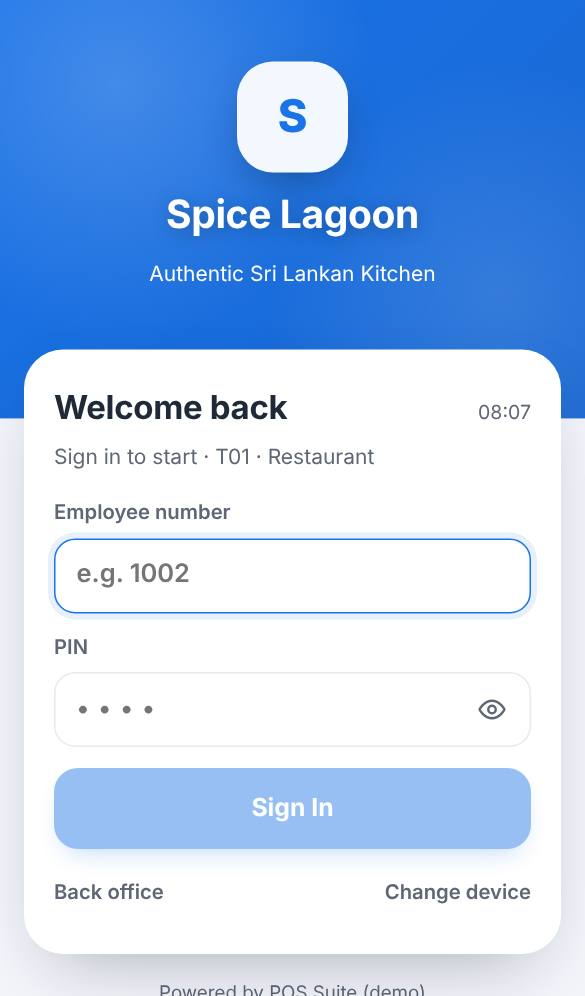
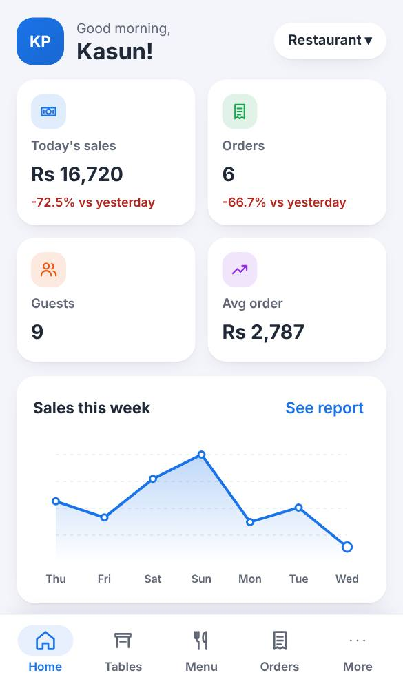
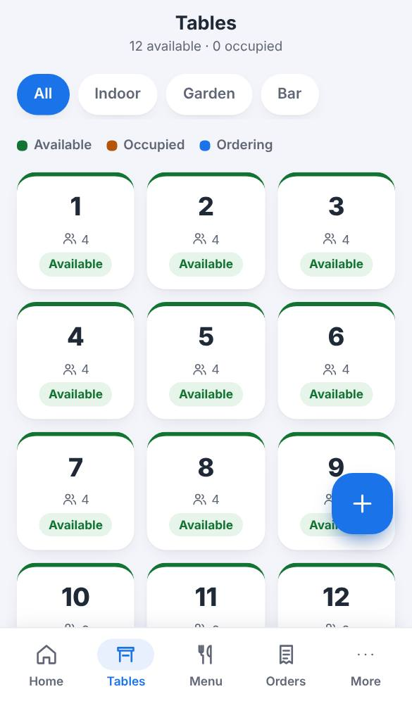
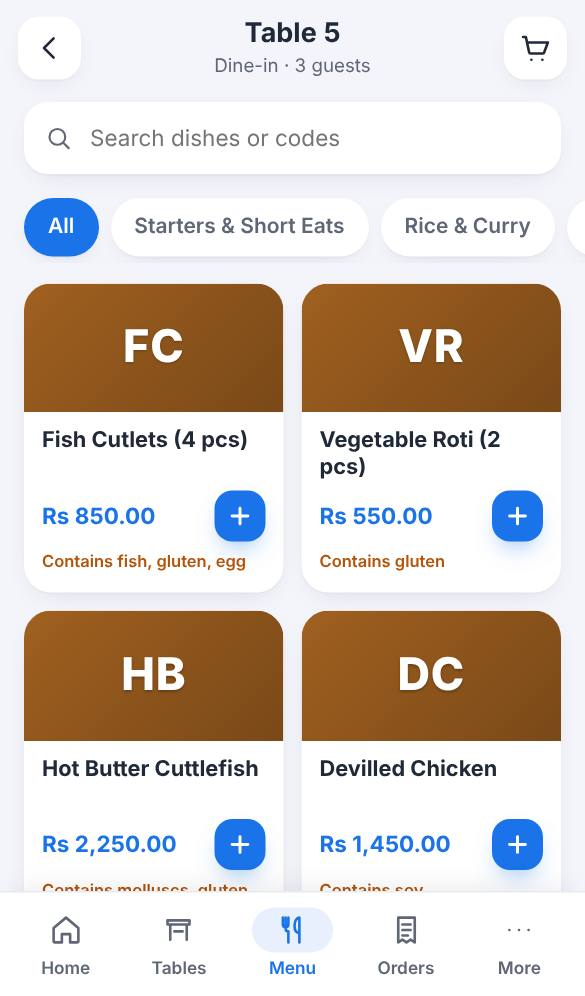
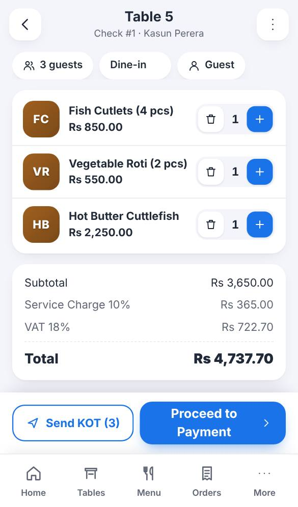
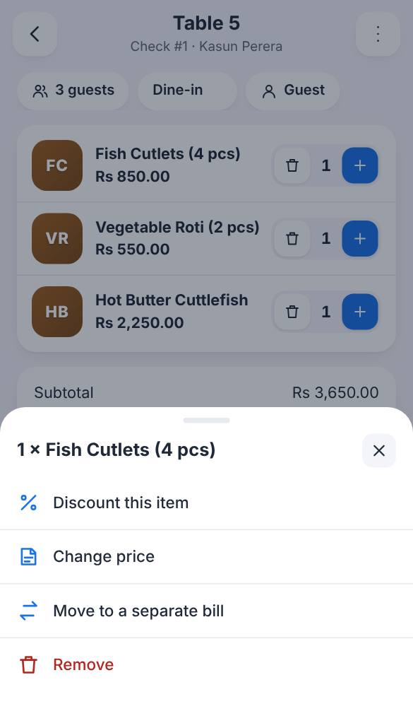

# Training: Steward / waiter

**Time:** 2 hours · **Device:** a phone (app layout) and, if used, a terminal · **Sign in as:** 1003 Tharindu (PIN 3333) or 1004 Fathima (PIN 4444)

## What you will be able to do

- Sign in and out, and know why the POS signs you out by itself
- Open a table, take an order with modifiers and notes, and send it to the kitchen
- Add to an order later, change guests, move or split items
- Print the bill for the guest
- Handle allergies, out-of-stock dishes and mistakes correctly

## 1. Sign in (10 min)

1. Open the POS on your phone (the app on its home screen). Enter your **employee number** and **PIN**, then **Sign In**.
   - Your manager connects the phone once with a code. If it shows an email and password screen, or *This phone is no longer connected*, ask the manager to connect it: never type a password there.
   - It works on the restaurant Wi-Fi or mobile data. If the connection drops for a moment, carry on: orders are sent when it returns.
2. Never share your PIN. Everything you do is recorded under your name.
3. Five wrong PINs lock you out: ask your supervisor to unlock you.
4. The phone signs you out after a short time without a touch. Sign in again; nothing is lost.
5. Lost your phone, or got a new one? Tell the manager at once so the old one is removed.
6. **Bluetooth printer** (when your phone prints to a printer beside it): the home screen shows the printer button. *Connect printer* or *2 waiting* means it isn't connected: switch the printer on, tap the button → **Connect printer**. Waiting prints then come out.

**Exercise 1.** Sign in with a wrong PIN once and read the message. Then sign in correctly.

## 2. Find your way (10 min)

The bar at the bottom: **Home · Tables · Menu · Orders · More**.

- **Home:** your open orders and quick actions.
- **Tables:** the floor, with free and occupied tables.
- **Menu:** the dishes for the current order.
- **Orders:** today's orders.
- **More:** functions, reports, sign out.

## 3. Open a table and take an order (30 min)

1. **Tables** → tap a green (**Available**) table → enter the number of guests.
2. The menu opens. Use the category chips or **search**.

   

3. Tap **+** to add a dish. If options appear (spice level, extras), choose them, add a **kitchen note** if the guest asks ("no onions"), set the quantity and **Add**.
4. The bar at the bottom shows the items and total. Tap it to see the order.

   

5. Check the order with the guest. Use **− / +** to correct quantities.
6. **Send KOT** sends the order to the kitchen and bar and prints the kitchen ticket. Items show *sent*.

**Exercise 2.** Table 3, two guests: two Chicken Kottu (one *extra spicy*), one Lime Juice, one Watalappan with the note "serve with coffee". Send it.

**Exercise 3.** Back at table 3: add two more Lime Juice and send.

## 4. Allergies and 86 (15 min)

- If the guest has an allergy: open the order → **Guest** → tick the allergies. A dish containing them shows an **allergy alert** before it is added. Read it to the guest; add only if they confirm.
- Dishes marked **Sold out** cannot be ordered. Tell the guest and suggest another dish.

**Exercise 4.** Record an *egg* allergy on table 3, then try to add an Egg Hopper.

## 5. Changes after sending (20 min)

Tap a line in the order:

| Situation | What to do |
|---|---|
| Wrong item, **not sent** yet | **Remove** (or − to zero). |
| Wrong item, **already sent** | **Void**. Choose the reason. A void ticket prints in the kitchen. Your supervisor may need to approve. |
| Guests want separate bills | **Move to a separate bill** on the items to split. |
| More or fewer guests | **⋮ → Number of guests**. |
| Guests move to another table, or your shift ends | **⋮ → Transfer to a table or employee**. |

**Exercise 5.** On table 3, void one Lime Juice ("guest changed mind"). Your supervisor approves with their PIN.

## 6. The bill (15 min)

1. When the guests ask for the bill: open the order → **⋮ → Print bill**. This is the guest check, not the final bill.
2. Payment is taken by you or the cashier ([cashier manual](02-cashier.md)). If your role cannot take payment, **Proceed to Payment** asks for a supervisor.

**Exercise 6.** Print the bill for table 3 and check it against the order.

## 7. End of your shift (5 min)

- Make sure your tables are paid, or transfer them to the next steward.
- **More → Functions → Clock out** if your restaurant uses time cards.
- **More → Sign out.**

## Quick reference

| I want to… | Tap |
|---|---|
| Start a table | Tables → table → guests |
| Order without a table | Tables → **+** |
| Add a dish | Menu → **+** |
| Send to kitchen | Order → **Send KOT** |
| Find an order | Orders (or Home → My open orders) |
| Print the bill | Order → **⋮** → Print bill |
| Void a sent dish | Order → tap the dish → Void |
| Sign out | More → Sign out |

## Sign-off checklist

- [ ] Signs in and out; knows not to share the PIN
- [ ] Opens a table with the right number of guests
- [ ] Takes an order with modifiers and a note, and sends it
- [ ] Adds to an existing order
- [ ] Records an allergy and handles the alert
- [ ] Removes an unsent item and voids a sent one with a reason
- [ ] Splits an item to a separate bill and transfers a table
- [ ] Prints the guest check
- [ ] Ends the shift correctly

Trainee: ____________________ Trainer: ____________________ Date: __________
