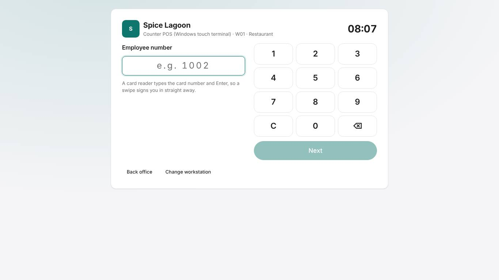
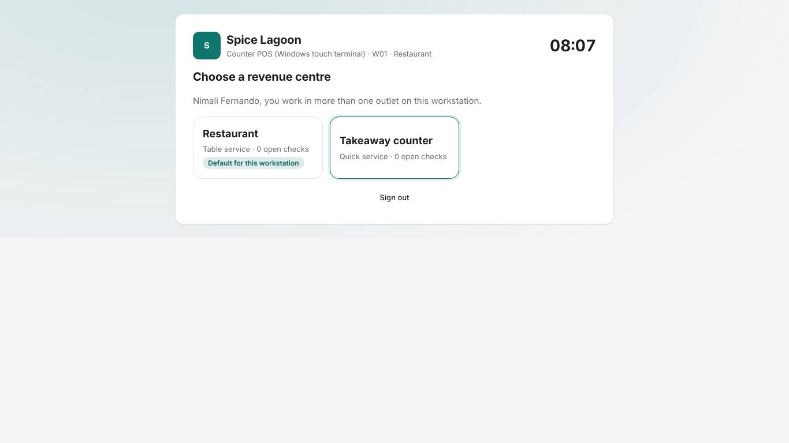
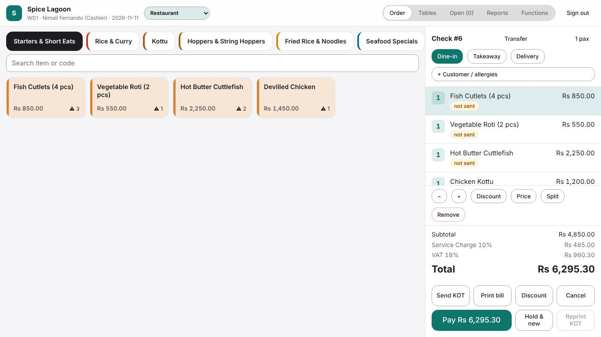
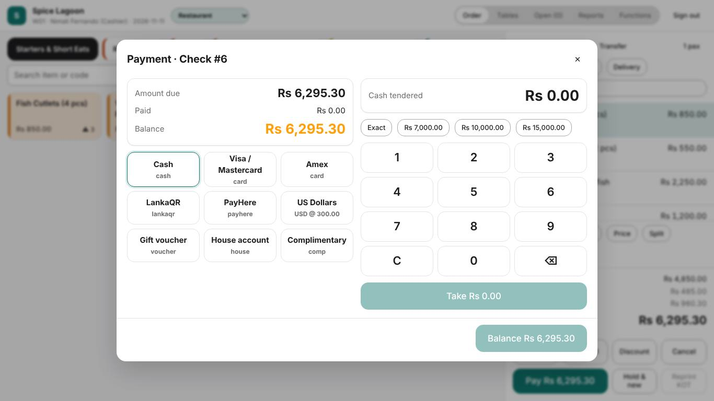
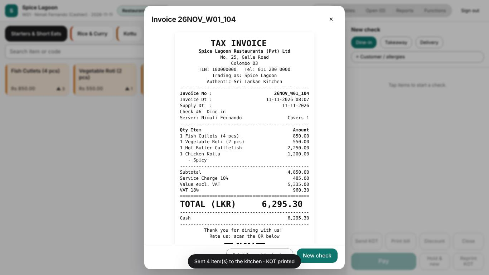
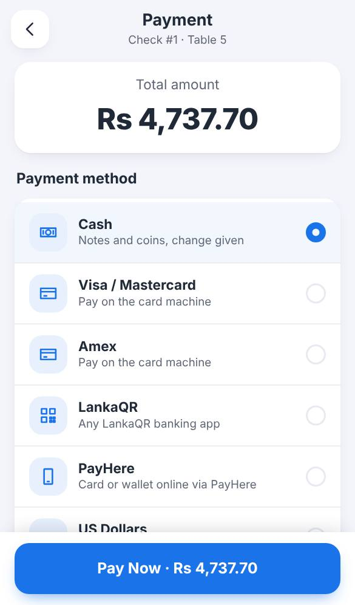
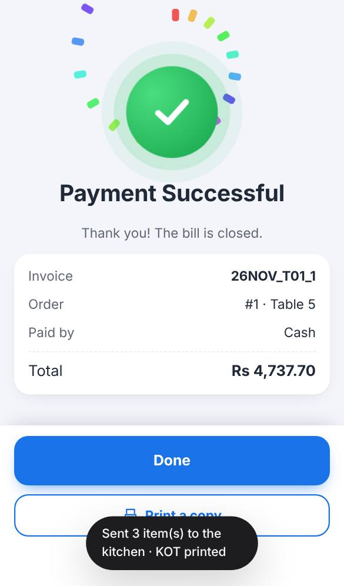

# Training: Cashier

**Time:** 2 hours · **Device:** counter terminal (and phone if used) · **Sign in as:** 1002 Nimali (PIN 2222)

## What you will be able to do

- Take quick-service and takeaway orders
- Take payment in cash, card, LankaQR/PayHere and foreign currency, and split payments
- Issue a tax invoice to a VAT-registered company
- Reprint, give change, and handle paid-ins and paid-outs
- Count your drawer against the X report

## 1. Sign in and choose the revenue centre (10 min)

1. Type your employee number, **Next**, then your PIN on the keypad.
2. Choose the revenue centre you are working in (Restaurant or Takeaway).

## 2. Take a takeaway order (20 min)

1. On the order screen, tap the **Takeaway** chip.
2. Tap items (categories on top, search box below).
3. Check the order panel on the right. Tap a line to change its quantity, discount it or remove it.
4. **Send KOT** if the kitchen must prepare it (the kitchen ticket prints at once), or go straight to **Pay**.

**Exercise 1.** Takeaway: one Chicken Fried Rice, one Egg Hopper ×3, two Soft Drinks. Send, then pay.

## 3. Payments (40 min)

| Method | Steps |
|---|---|
| **Cash** | Cash → tap **Exact** or the note the guest gave (or type the amount) → **Take** → give the **change** shown → **Close check**. |
| **Card** | Run the card on the bank's machine first. Card → enter the **approval code** from the slip → **Take** → **Close check**. |
| **LankaQR** | LankaQR → the guest scans the QR with their banking app → when their app shows *success*, enter the reference → **Confirm received**. |
| **PayHere** | As LankaQR: the guest pays online by card or wallet. |
| **Foreign cash** | Choose the currency (for example USD) → type the foreign amount → the rupee value and change are shown. |
| **Split** | Take part with one method (type the amount), then the balance with another. |

The bill prints and the drawer opens for cash. The invoice number appears at the top, for example `26NOV_W01_112`.

**Exercise 2.** Bill of Rs 4,737.70: guest pays Rs 5,000 cash. What change do you give?

**Exercise 3.** Split a bill: Rs 2,000 by card (approval code 123456), the rest cash.

**Exercise 4.** A company asks for a tax invoice in its name: **+ Customer / allergies** → VAT buyer → enter the company name, TIN and address → pay. Check that *Purchaser* and the TIN print on the invoice.

## 4. On the phone (if your restaurant uses phones) (15 min)

Order → **Proceed to Payment** → choose the method → enter the cash received or the reference → **Pay Now**. The **Payment Successful** screen shows the invoice and the change. **Print Receipt** prints it if it did not print automatically.

The phone (connected once by the manager) works on Wi-Fi or mobile data. The bill prints on the restaurant's bill printer, or on the **Bluetooth printer beside the phone** in a small restaurant, and the cash drawer opens there too. With a Bluetooth printer, keep it switched on and charged: if the phone shows *Connect printer* or *2 waiting*, tap it → **Connect printer**. If a bill doesn't print, the payment is still recorded: tell the manager (the printer PC may be offline), and use **Print Receipt** later.

## 5. Cash drawer work (20 min)

**Functions** (top bar on the terminal; **More → Functions** on the phone):

| Function | When | Note |
|---|---|---|
| **Paid in** | Adding float or change from the bank | Enter the amount. Needs a supervisor. |
| **Paid out** | Cash for a small purchase (for example ice) | Enter the amount; keep the receipt. Needs a supervisor. |
| **No sale** | Open the drawer without a sale | Recorded. Use rarely. |
| **Reprint last bill** | Guest lost the bill | Prints COPY. Needs a supervisor. |
| **X report** | Mid-shift or before handing over | Sales and tenders so far today. |

**Exercise 5.** Record a paid-out of Rs 1,200 for ice (supervisor 1006 approves with PIN 6666).

## 6. End of shift (15 min)

1. **Reports → Employee financial** (scope: *My sales*): it shows your sales by tender and the cash you should hold.
2. Count your drawer. Report any difference to the supervisor; never "fix" it with a paid-in or paid-out.
3. **Sign out.**

## Quick reference

| I want to… | Do |
|---|---|
| Takeaway order | Order → Takeaway chip → items → Pay |
| Exact cash | Pay → Cash → Exact → Close check |
| Card | Pay → Card → approval code → Take → Close check |
| Tax invoice for a company | + Customer / allergies → VAT buyer → Pay |
| Reprint | Functions → Reprint last bill (supervisor) |
| Cash for a purchase | Functions → Paid out (supervisor) |
| My cash total | Reports → My sales → Employee financial |

## Sign-off checklist

- [ ] Signs in and chooses the right revenue centre
- [ ] Takes a takeaway order
- [ ] Takes cash and gives the correct change
- [ ] Takes a card payment with the approval code
- [ ] Takes a LankaQR payment (demo: simulate)
- [ ] Splits a bill between two methods
- [ ] Issues a tax invoice to a VAT-registered company
- [ ] Records a paid-out with approval and keeps the receipt
- [ ] Reads the employee financial report and balances the drawer

Trainee: ____________________ Trainer: ____________________ Date: __________
