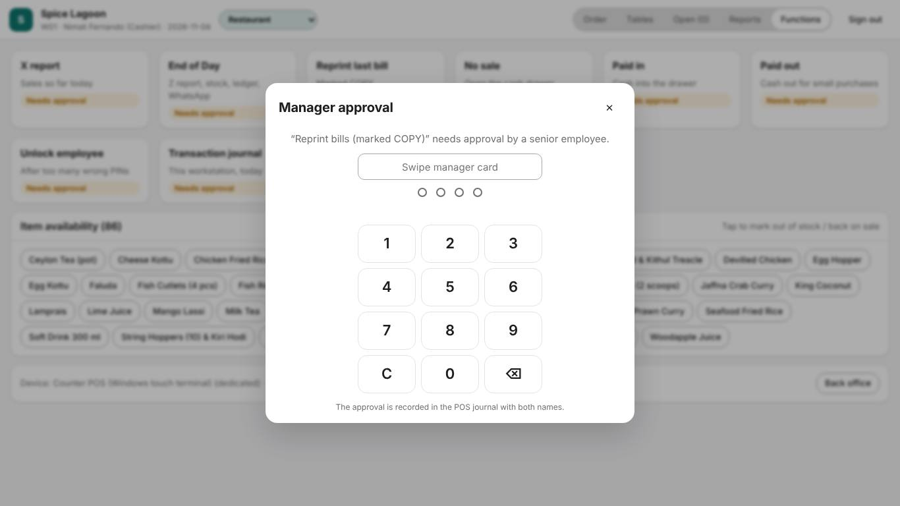
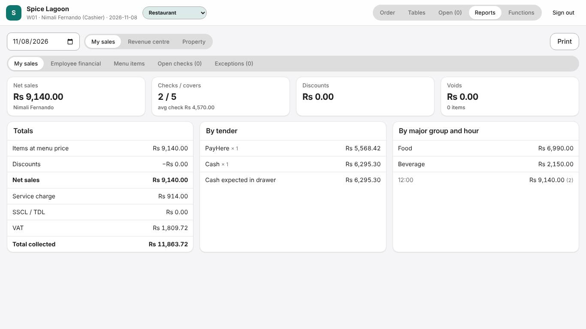
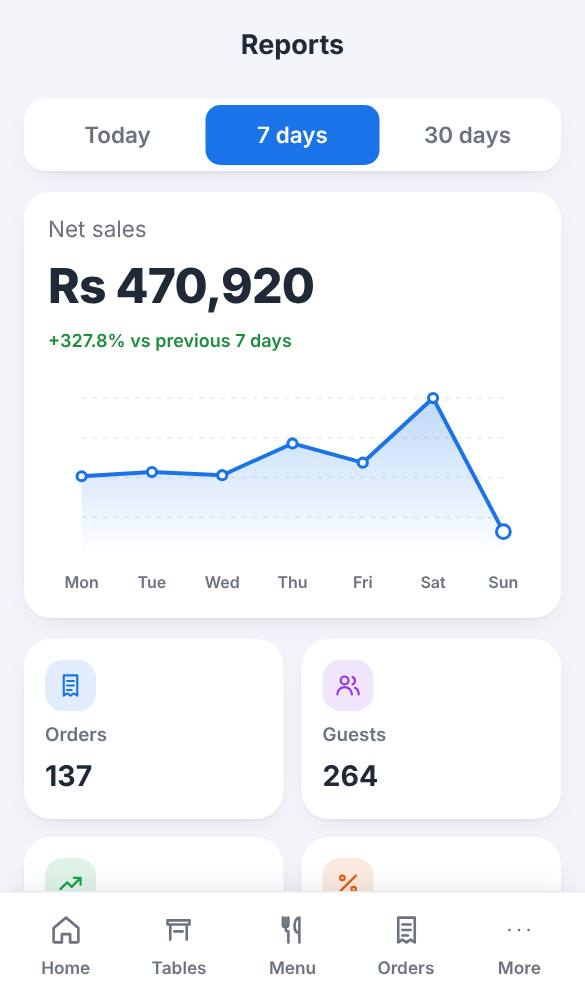
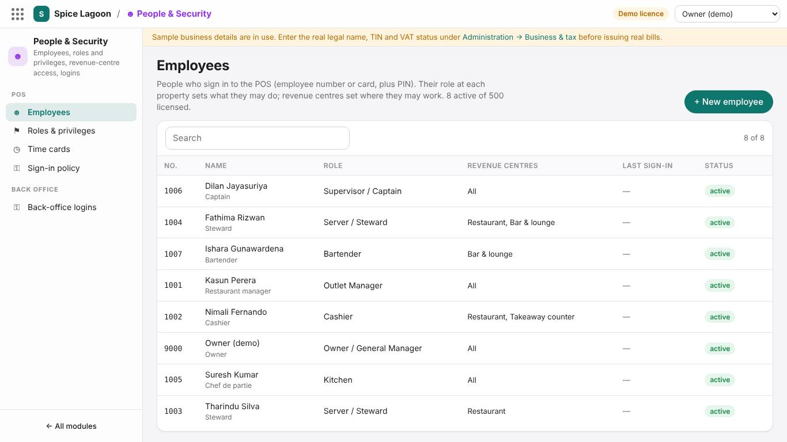

# Training: Supervisor and manager

**Time:** 3 hours · **Sign in as:** 1006 Dilan (supervisor, PIN 6666, card CARD1006) or 1001 Kasun (manager, PIN 1111, card CARD1001)

## What you will be able to do

- Approve voids, discounts, price changes, reprints and cash movements correctly
- Unlock staff, move tables and checks, and handle 86
- Run the X report, check cash, and run End of Day
- Read the POS reports and the exceptions report
- Manage employees, PINs and time cards in the back office

## 1. Approvals (40 min)

When an employee does something their role does not allow, or above their limit, the **Manager approval** window opens on their screen.

1. **Look at what is being approved**: the window names the action and the amount.
2. Ask why. For a void: was the item really not served? For a discount: which discount and why?
3. Swipe your card or enter your PIN.

Both names are recorded in the transaction journal and the exceptions report. **Never tell anyone your PIN, and never let staff use your card.**

You can only approve:

- actions your own role allows, including the *manager override* privilege;
- for employees at your level or below;
- within **your** limits (maximum discount %, single void, price change, refund, paid-out).

**Exercise 1.** A cashier voids a sent item: approve it.

**Exercise 2.** Try to approve your own void (you are the one asking). It is refused: approvals need a different person.

**Exercise 3.** A steward applies a manager-only discount: approve it, then find it in **Reports → Exceptions**.

## 2. During service (30 min)

| Situation | Where |
|---|---|
| Employee locked out | Functions → **Unlock employee** |
| Dish out of stock | Functions → **Item availability (86)** |
| Steward going home with open tables | Pick up the check → **Transfer** → to another employee |
| Guests move tables | Pick up the check → **Transfer** → to another table |
| Open checks overview | **Open (n)** on the terminal, **Orders → Open** on the phone |
| Guest disputes the bill | Reprint the guest check; void or discount with a reason if justified |
| Cash for a purchase | Approve the cashier's **Paid out**; keep the receipt |

**Exercise 4.** Lock employee 1004 by entering three wrong PINs (your trainer sets the limit), then unlock them.

## 3. Reports on the POS (30 min)

Scope **My sales / Revenue centre / Property**, then:

- **Summary:** net sales, checks, guests, averages, discounts, voids, tenders.
- **Employee financial:** what each employee sold and the cash they should hand in.
- **Menu items:** what sold.
- **Open checks:** what is still open, and by whom.
- **Exceptions:** every void, discount, price change, approval, no-sale and paid-out, with who approved it.

On the phone, **Reports** shows the dashboard with charts; **Detailed reports** opens the same reports.

## 4. Closing the day (30 min)

1. **Open checks:** make sure every check is paid or transferred. End of Day warns about open checks, which stay on the day until closed.
2. **X report** and **Employee financial**: collect each cashier's cash and compare it with the report. Record differences.
3. **Functions → End of Day.** It:
   - deducts the day's stock by recipe (FIFO);
   - posts the day's sales to the ledger (if Finance is used);
   - prints the **Z report**;
   - sends the WhatsApp summary to the managers' phones.
4. Late sale after End of Day? Run End of Day again: it posts only the difference.

**Exercise 5.** Run the X report, then End of Day, and read the summary it shows.

## 5. Back office: people (40 min)

**People & Security → Employees**

1. **+ New employee:** employee number, name, job title, role, revenue centres, start date.
2. **Set PIN:** the employee chooses a PIN (4–8 digits); easy PINs are refused. Nobody, not even you, can read a PIN back.
3. Staff card: swipe it in the card field.
4. When someone leaves: set the end date and status *Terminated*. Never delete; history stays with their name.

**Time cards:** check clock-ins and clock-outs for payroll.

**Exercise 6.** Add a new steward with your own PIN, sign in on a phone with it, then suspend the employee and try again.

## 6. Weekly checks (10 min)

- **Audit Center → Exceptions:** look for patterns (one employee with many voids, frequent no-sales).
- **Reports → Menu engineering:** which dishes to promote, reprice or remove.
- **Inventory:** high-value stock count (see the [storekeeper manual](05-storekeeper.md)).

## Sign-off checklist

- [ ] Approves a void and a discount, and knows when to refuse
- [ ] Unlocks an employee
- [ ] Transfers a check to another employee and table
- [ ] Marks a dish 86
- [ ] Reads the employee financial and exceptions reports
- [ ] Balances cash against the X report
- [ ] Runs End of Day and understands what it does
- [ ] Adds an employee with a PIN and ends an employee correctly

Trainee: ____________________ Trainer: ____________________ Date: __________
