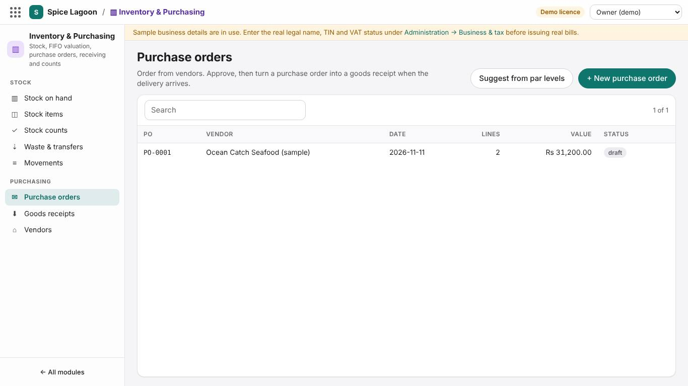
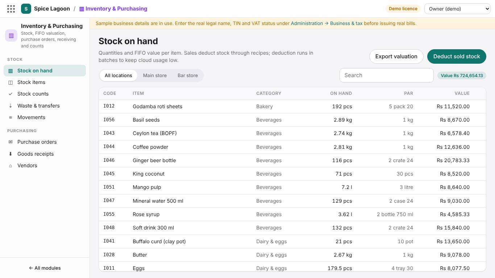
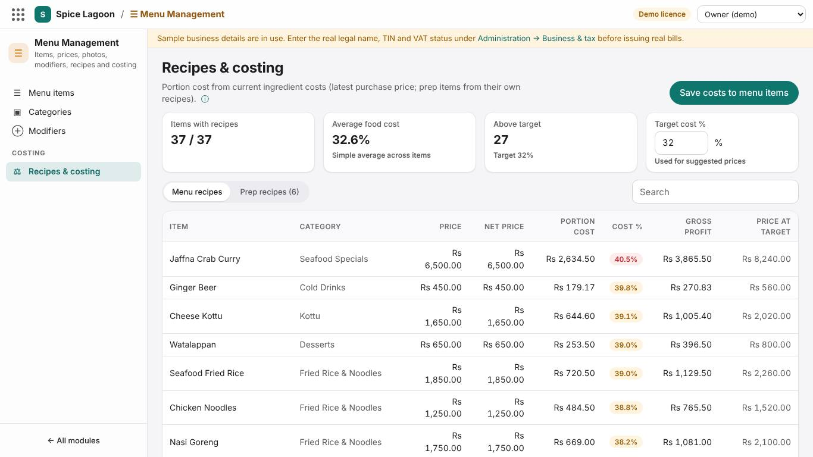

# Training: Storekeeper

**Time:** 3 hours · **Back office:** a *Storekeeper* or *Manager* login · **Workspace:** Inventory & Purchasing (and Menu Management for recipes)

## What you will be able to do

- Keep stock items correct (units, costs, par levels)
- Order from vendors and receive deliveries
- Count stock, record waste, transfer and produce prep items
- Read stock on hand and movements, and cost recipes

## 1. Stock items and vendors (30 min)

**Inventory & Purchasing → Stock items**

| Field | Example |
|---|---|
| Code, name, category | `CHK-01`, Chicken (boneless), Meat |
| Stock unit | g (grams), ml or pcs: the unit recipes use |
| Purchase unit, stock units per purchase unit | kg, 1000 |
| Cost per purchase unit | Rs 1,450 per kg |
| Main vendor, par level, reorder quantity | Island Poultry; 10 kg; 20 kg |
| Prep item, track stock | For gravies and batters made in-house |

**Vendors:** name, contact, TIN, payment terms.

**Exercise 1.** Add a stock item *Coconut milk (tetra 1 l)*, stock unit ml, 1,000 ml per purchase unit, Rs 650.

## 2. Purchase orders and goods receipts (45 min)

1. **Purchase orders → Suggest from par levels** creates draft orders, one per vendor, for every item below its par level. Or choose **+ New** and enter the vendor, delivery store and date, and the items with quantities in purchase units.
2. When the order is checked, set its status to **approved** (and **sent** once it has gone to the vendor).
3. When the delivery arrives: **Receive** next to the order. This creates a draft goods receipt.
4. **Goods receipts:** open the draft and enter the quantities **actually** received, the supplier invoice number, the real costs and the input VAT on the invoice.
5. **Post to stock.** Stock increases as a new FIFO lot at the received cost, and the latest price updates recipe costs. A posted receipt can no longer be changed. Give the supplier's invoice to the accountant, who enters it under Finance → Payables and matches it against your order and receipt.

**Photos of delivery notes and bills:** on the goods receipt, **Add photo or scan** and photograph the supplier's delivery note or bill. Bills you can't record yet go to **Finance → Bills & receipts** for the accountant.

> A delivery of stock items is entered **once**, as a goods receipt. The accountant then enters the supplier's bill against it; it must not also be recorded as an expense.

**Exercise 2.** Order 20 kg chicken from Island Poultry; receive 18 kg at Rs 1,480 per kg, attach a photo of the delivery note; post.

## 3. Counts, waste, transfers, production (45 min)

| Task | Where | Effect |
|---|---|---|
| **Stock count** | Stock counts → choose the **type of count** → **Start a count** → enter the counted quantities → **Post count** | *Regular count:* differences are losses or errors. *Kitchen usage* (no POS sales): what is missing is what the kitchen used, to cost of sales. *Opening stock:* the first count. Losses at FIFO cost, gains at standard cost |
| **Waste** | Waste & transfers → **Record waste**: item, quantity, reason | Stock reduced; cost goes to wastage |
| **Transfer** | Waste & transfers → **Transfer stock**: from and to store | Stock moves between locations |
| **Production** | Waste & transfers → Production (prep batch) → **Produce batch** | Consumes ingredients at FIFO cost, adds the prep item |

**Exercise 3.** Count three items (chicken, rice, coconut oil) and post the count.

**Exercise 4.** Record 500 g of prawns as waste ("spoiled").

**Exercise 5.** Produce 5 litres of curry gravy (prep item).

## 4. Stock on hand and movements (20 min)

- **Stock on hand:** quantity and FIFO value per item and store; items below par are highlighted.
- **Movements:** every receipt, sale deduction, waste, transfer, count and production with its cost: use it to explain any stock difference.

Sales deduct ingredients through recipes when End of Day runs.

## 5. Recipes and costing (40 min)

**Menu Management → Recipes & costing**

1. Choose a menu item; add ingredients with quantities in stock units and wastage %.
2. The cost per portion, food-cost % and suggested price update from the latest purchase prices.
3. Prep recipes (gravies) can be used as ingredients.

**Exercise 6.** Cost a new dish *Chicken Curry*: 180 g chicken, 120 ml curry gravy, 5 ml coconut oil. Note the food-cost %.

## Sign-off checklist

- [ ] Adds a stock item with correct units and conversion
- [ ] Raises (or suggests), approves and receives a purchase order, and posts the goods receipt with the real quantities and costs
- [ ] Posts a stock count, and knows when to use the opening-stock and kitchen-usage types
- [ ] Records waste with a reason and a transfer
- [ ] Produces a prep batch
- [ ] Explains a stock difference from Movements
- [ ] Costs a recipe and reads the food-cost %

Trainee: ____________________ Trainer: ____________________ Date: __________
