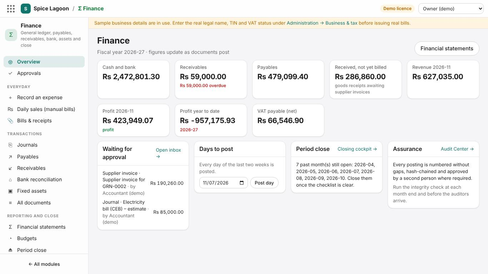
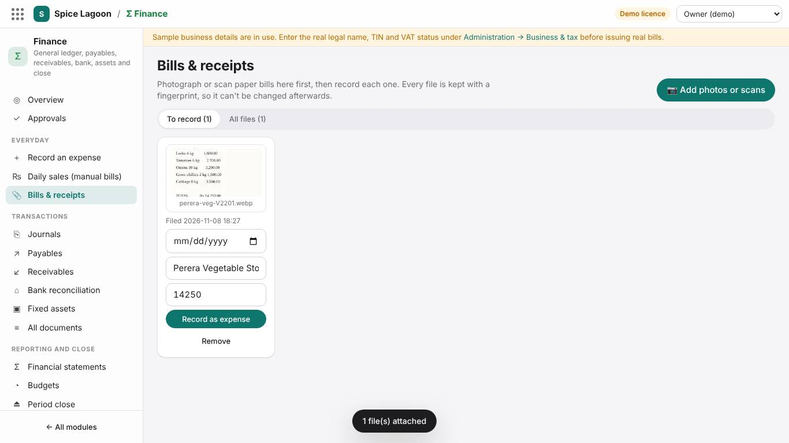
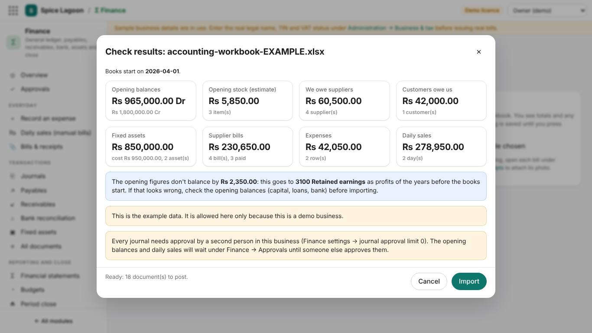
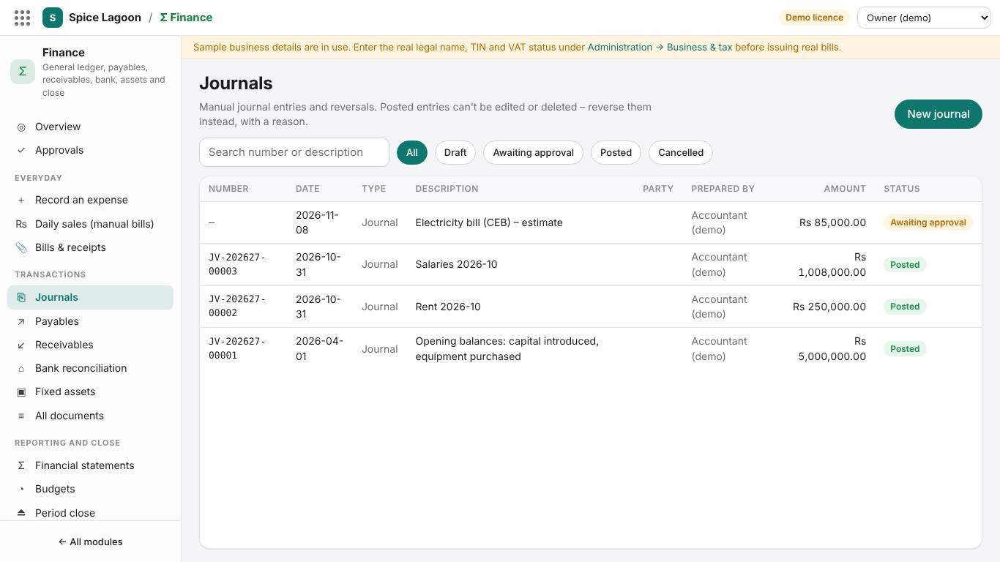
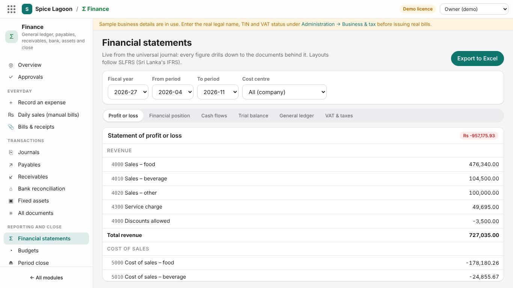
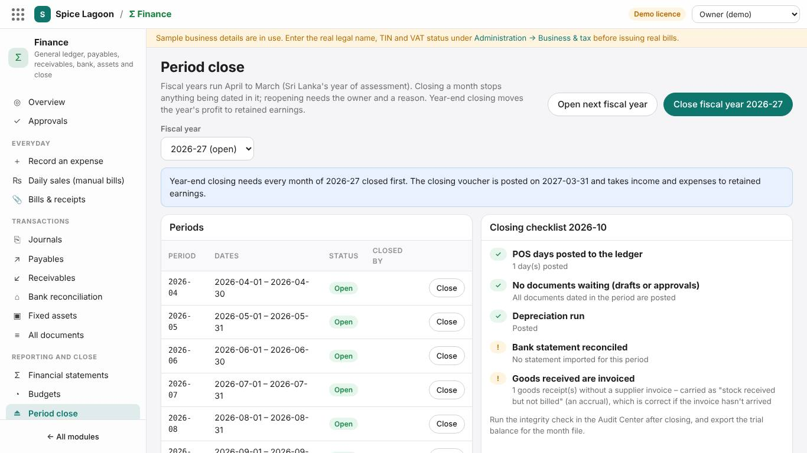
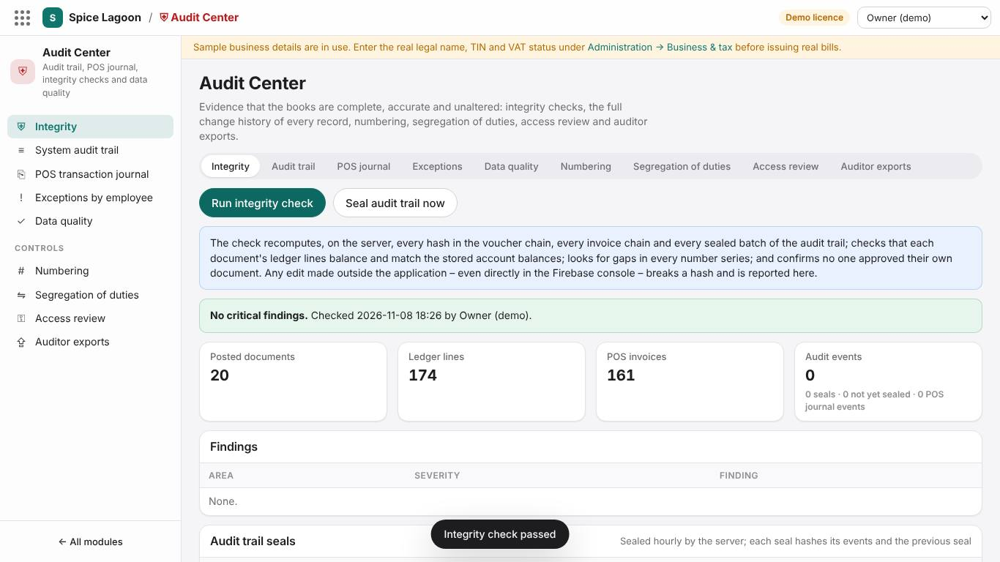

# Training: Accountant

**Time:** 4 hours · **Back office:** an *Accountant* login (an *Auditor* login is read-only) · **Workspaces:** Finance, Audit Center, Reports & Analytics

## What you will be able to do

- Understand what posts automatically from the POS and stores
- Record everyday expenses and manual sales, with photos of the paper bills
- Bring existing books in with the accounting workbook
- Enter journals, supplier invoices and payments, customer invoices and receipts
- Reconcile the bank, run depreciation, and close a month
- Prepare the VAT return figures and the financial statements
- Use the Audit Center to prove the books are complete and unaltered

## 1. What posts by itself (20 min)

| Source | Posts | When |
|---|---|---|
| POS sales | Sales by major group, service charge, VAT, SSCL, discounts, rounding, and each tender to its account | End of Day (or **Post** next to the day on Finance → Overview) |
| Stock usage | Cost of sales by major group against inventory (FIFO) | End of Day |
| Goods receipts | Inventory against *stock received not billed* | When the storekeeper posts the receipt |
| Waste, counts | Wastage and stock adjustment; *kitchen usage* counts to cost of sales; *opening stock* counts to opening balances | When posted |

The accounts used are set in **Finance → Finance settings**. End of Day can run again: it posts only the difference. Days with stock activity but no POS sales appear under **Days to post** on the Overview; **Post day** posts any date.

## 1a. Everyday entries and bill photos (40 min)

1. **Bills & receipts:** photograph the day's paper bills (**Add photos or scans**), type the date, supplier and amount under each.
2. **Record as expense** on each: choose what it was for (the configuration guide has a table of common restaurant costs and their accounts) and how it was paid. The photo is attached; the bill and its payment post with their numbers.
3. **Daily sales (manual bills):** add up a day's handwritten bills; sales minus discounts must equal the money received.
4. On any supplier bill, payment, journal or goods receipt: **Add photo or scan**, or **From inbox**. Open a file to check its fingerprint.

**Exercise 1a.** Photograph a vegetable bill of Rs 14,250 from *Perera Vegetable Stores* paid in cash and record it to *5000 Cost of sales – food*. Then enter yesterday's manual sales: food 98,500, beverages 21,300, service charge 9,800, discount 2,500; cash 74,100, card 41,000, bank 12,000.

## 1b. Bringing existing books in (30 min)

1. **Finance → Excel import:** set **Books start on**; **Download the example (filled in)** and go through each sheet with the trainer.
2. Fill the blank workbook (or a copy of the example) with the business's figures: opening balances, opening stock, suppliers and customers with what they owe, bills and expenses since the start date, daily sales, fixed assets.
3. Choose the file; read the totals, the retained-earnings figure and any problems (sheet and row). Fix and choose again until it is clean, then **Import**.
4. Approve what waits under **Approvals** (a different person), then check the trial balance against the business's own figures.

**Exercise 1b.** In the demo business, import the example workbook and find the opening journal, a supplier's opening bill and the asset register entries it created.

## 2. Journals and approvals (40 min)

1. **Journals → New journal:** posting date, description, lines (account, cost centre, debit, credit). **Add balancing line** completes the entry.
2. **Save draft** or **Submit**. Journals above the threshold (Finance settings → *Journals needing a second approver*) wait in **Approvals** for a second person.
3. Posted journals cannot be edited or deleted. **Reverse** them with a reason.

**Exercise 1.** Accrue an electricity bill of Rs 85,000 (Electricity expense / Accrued expenses). Submit it, and have a second accountant approve it.

## 3. Payables and receivables (60 min)

**Payables**

1. **New supplier invoice:** supplier, their invoice number, invoice and due dates, lines (stock items from the goods receipts to match, or service and expense lines), input VAT on the invoice.
2. The **three-way match** compares the invoice with the purchase order and goods receipts, within the price and quantity tolerances in Finance settings. Differences are flagged.
3. **Pay a supplier:** bank or cash account, amount, bank charges; **Allocate oldest first** or choose the invoices. Payments above the threshold need a second approver.
4. The ageing (*As at*, days overdue) shows what is due; **Export to Excel**.

**Receivables:** **New customer invoice** for credit customers (corporate accounts, events), **Receive from a customer**, ageing.

**Exercise 2.** Enter the supplier invoice for the goods receipt from the storekeeper training (18 kg chicken at Rs 1,480), then pay it by bank transfer.

## 4. Bank, assets, budgets (40 min)

- **Bank reconciliation:** **Import statement** (the bank's CSV or Excel file), accept the suggested **Match**es, investigate what is left. Post bank charges or missing receipts with a journal. **Export reconciliation** for the file.
- **Fixed assets:** **New fixed asset** (code, account, purchase date, cost, residual value, life, cost centre), then run depreciation for each period. The register shows net book value.
- **Budgets:** annual amount per account and cost centre, spread over the months; compare with actuals.

**Exercise 3.** Register a new kitchen oven (Rs 450,000, five years, residual Rs 50,000) and run this month's depreciation.

## 5. Statements and VAT (40 min)

**Financial statements:** Trial balance, Financial position, Profit or loss, Cash flows, General ledger, VAT & taxes, for any period, with Excel export.

**VAT & taxes** gives output VAT on sales, input VAT on purchases, and SSCL, for the VAT return. Check it against:

- **Reports → Daily revenue** (VAT on sales per day);
- **Audit Center → Numbering** (no gaps in invoice numbers).

## 6. Month-end close (30 min)

1. All POS days posted (Finance → Overview).
2. Stock count posted (storekeeper).
3. Supplier invoices entered; bank reconciled; depreciation run; accruals journalled.
4. **Audit Center → Integrity** and **Data quality** show no issues.
5. **Period close:** **Close** the month. Nothing more can post to it. If a correction is unavoidable, **Reopen period**; the reopening is recorded in the audit trail. At year end, **Open next fiscal year**.

## 7. Audit Center (30 min)

| Tab | Use it to |
|---|---|
| **Integrity** | Prove that invoices, the ledger and the POS journal are unaltered (hash chains and seals) and the books balance. |
| **Audit trail** | See who changed what, when, with before and after values. |
| **POS journal / Exceptions** | Review voids, discounts and cash movements by employee. |
| **Data quality** | Find invalid records and missing account mappings. |
| **Numbering** | Show there are no gaps or duplicates in invoice and document numbers. |
| **Segregation of duties** | Find people who can both create and approve. |
| **Access review** | Review who has which access. |
| **Auditor exports** | Give the external auditor the ledger, invoices, journal and audit trail in Excel. |

## Sign-off checklist

- [ ] Explains what posts automatically and from where
- [ ] Records an expense from a bill photo and a day of manual sales
- [ ] Imports an accounting workbook and explains the retained-earnings figure
- [ ] Enters, submits, approves and reverses a journal
- [ ] Enters a supplier invoice with three-way match and pays it
- [ ] Reconciles the bank from an imported statement
- [ ] Registers an asset and runs depreciation
- [ ] Produces the trial balance, P&L and VAT & taxes report
- [ ] Closes a period after the integrity and data quality checks
- [ ] Prepares auditor exports

Trainee: ____________________ Trainer: ____________________ Date: __________
