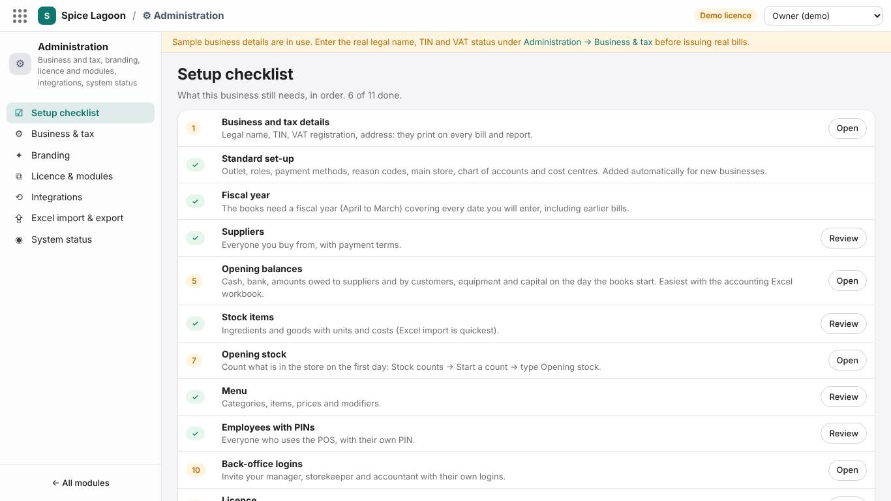
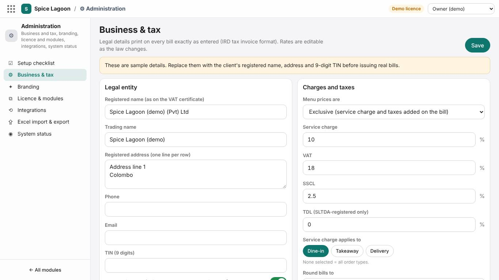
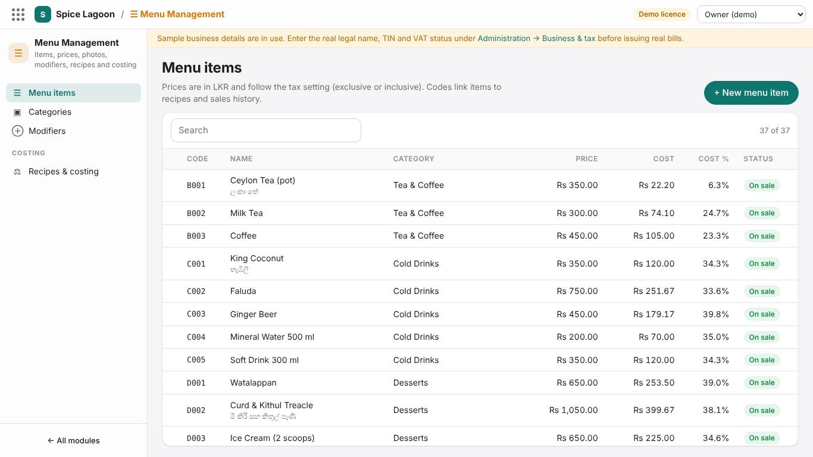
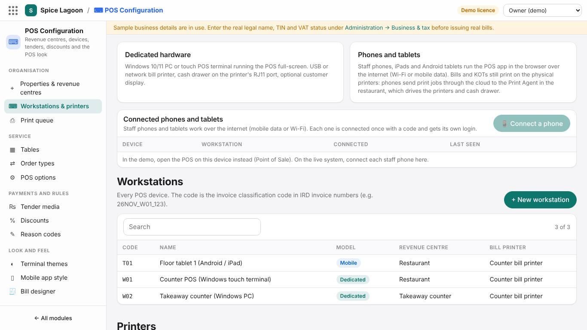
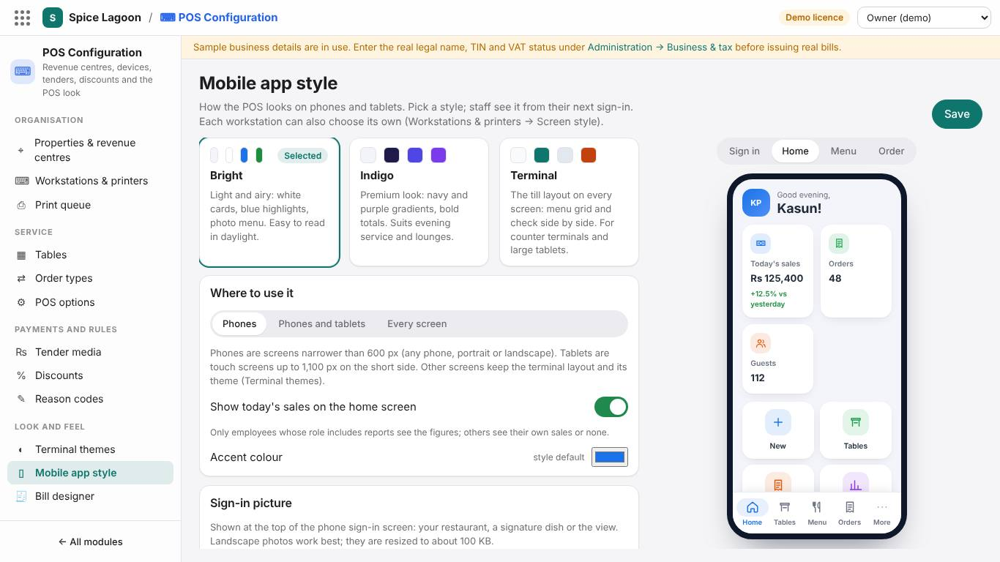
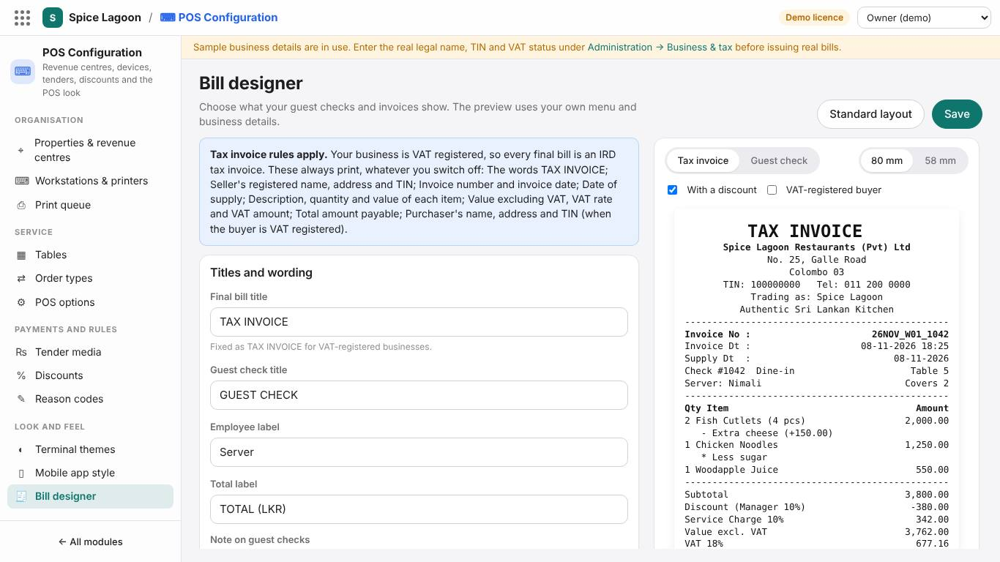
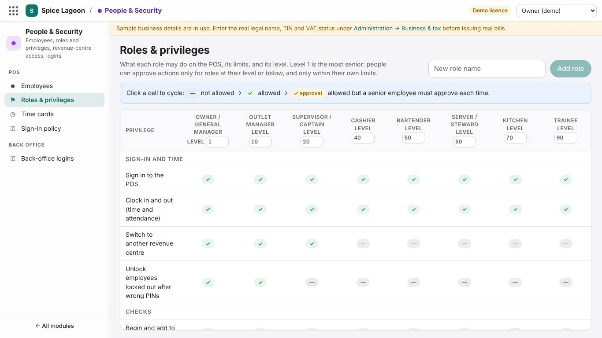
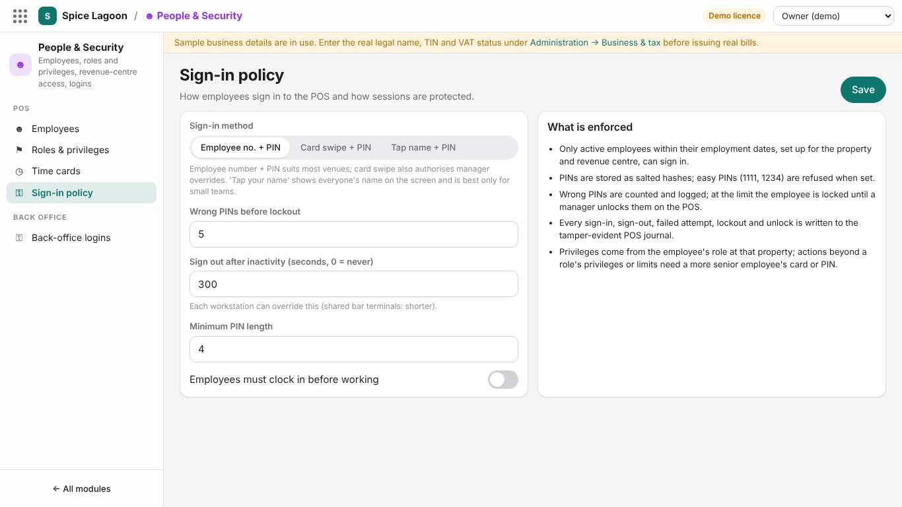
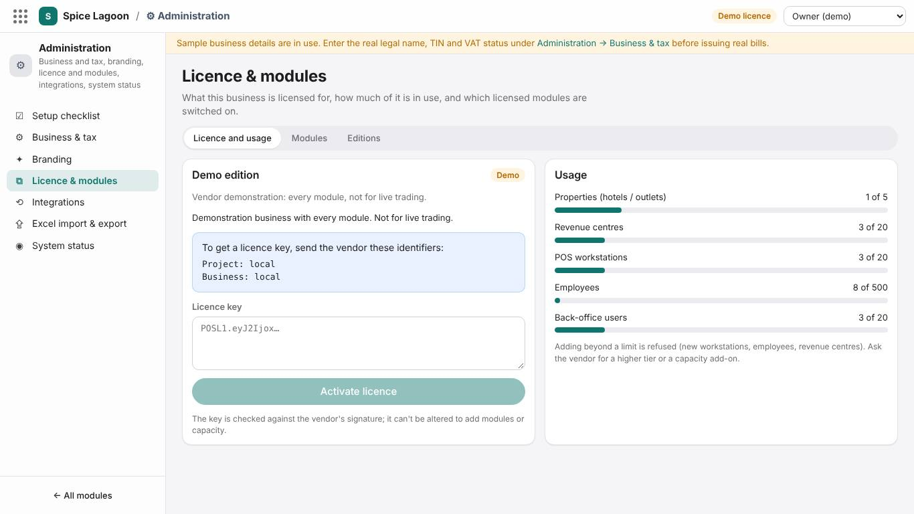

# Training: Administrator and owner

**Time:** 4 hours · **Back office:** *Owner* or *Administrator* login · **Covers:** setting the system up for your business, and keeping it safe

## What you will be able to do

- Enter the business, tax and branding details that print on bills
- Load and maintain the menu (including by Excel)
- Set up revenue centres, tables, workstations, printers, tenders and discounts
- Choose the mobile app style and design the bill
- Add employees, roles, back-office logins and the sign-in policy
- Activate the licence and keep the system healthy

## 0. The Setup checklist (10 min)

**Administration → Setup checklist** lists what the business still needs, in order, for its modules, each with a button to do it. Work down it; the rest of this training follows the same order. The **configuration guide** explains each setting with examples (accounts, approval limits, stock units, modifiers, tenders, the Excel workbooks).

## 1. Business, tax and branding (30 min)

**Administration → Business & tax**

- **Legal entity:** legal name, trading name, TIN, VAT registered (yes/no), SSCL liable, address, phone, email, website. These print on every bill exactly as typed: check them with your accountant.
- **Charges and taxes:** prices exclusive or inclusive of tax; service charge rate and the order types it applies to; VAT, SSCL and TDL rates; bill rounding; when invoice numbers restart.

**Administration → Branding:** display name, logo, colours, bill header and footer lines, "Powered by".

**Exercise 1.** Enter your real business details in the training business and print a test bill.

## 2. The menu (45 min)

- **Fastest:** **Administration → Excel import & export** → **Download blank template** (with drop-down lists) or **Export current data** → fill in categories, items, prices, modifiers → import. The system checks every row and shows the results; nothing is saved until you confirm. Codes are the keys, so re-importing updates prices instead of duplicating items.
- **On screen:** Menu Management → Categories, Modifiers, Menu items. Add photos to items for the mobile app and the terminal.
- **Costing:** Recipes & costing (with the storekeeper or head chef).

**Exercise 2.** Change three prices by Excel and re-import. Add a photo to two items and check them on a phone.

## 3. Outlet, devices and printers (45 min)

1. **Properties & revenue centres:** your outlet, then *Restaurant*, *Takeaway*, *Bar*…
2. **Tables** (with areas) and **Order types**.
3. **Printers:** bill printer, kitchen and bar printers (address, port, 80/58 mm), and the Print Agent on the restaurant PC.
4. **Workstations:** one per device. The code goes into invoice numbers (W01, P01…), so never reuse a code. Set the bill printer, allowed revenue centres, printing mode and **Screen style**.
5. **Tender media:** switch on the payment methods you accept; set each one's ledger account.
6. **Discounts** and **Reason codes.**
7. **POS options:** business day start time, automatic bill printing, loyalty points.

**Exercise 3.** Add a workstation *P01 Floor phone 1* with screen style *Business setting*, and set up the phone with it.

## 4. Look and the bill (40 min)

**Mobile app style**

Choose **Bright** or **Indigo** (or the terminal layout), where it applies (phones; phones and tablets; every screen), the accent colour and the sign-in picture. Save, then check on a phone.

**Terminal themes:** the look of the counter terminals (Classic, Modern, Midnight, and any colour or size).

**Bill designer**

Switch elements on and off, change titles and wording, and check the live preview on 80 mm and 58 mm. For a VAT-registered business, the IRD particulars always print. **Save** applies to the next bill.

**Exercise 4.** Rename *Server* to *Steward*, hide the phone number, add a footer line, and print a test bill.

## 5. People and access (40 min)

1. **Roles & privileges:** review each role's privileges, level and limits. Use **✓ approval** for actions that should always need a second person.
2. **Employees:** everyone who uses the POS, with their own number and PIN. Never share PINs or use the demo employees in the real business.
3. **Sign-in policy:** method, lockout after wrong PINs, automatic sign-out, minimum PIN length, clock-in.
4. **Back-office logins:** invite managers, storekeepers and accountants by email with the right role. Keep **two** owners or administrators so you are never locked out.

**Exercise 5.** **Add role** *Head steward* (it starts with sign-in and open-check privileges). Tick the server's privileges plus *transfer check* and *discount*, set level 45 and max discount 10%. Give it to a trainee and test a 15% discount: it should ask for approval.

## 6. Licence, modules and integrations (20 min)

- **Licence & modules:** paste the licence key from your supplier and **Activate licence**. Switch modules on or off within the licence. A business that starts with its books and stores (no POS yet) turns on **Accounting**, **Inventory** and **Purchasing**; the POS can be added later without redoing anything.
- **Finance settings** (owner or administrator only): choose the approval limits for who keeps the books. With one person keeping the books, raise the journal limit; with 0, every journal waits for a second person (configuration guide, section 4.2).
- **Integrations:** LankaQR, PayHere and WhatsApp settings stay in *mock* mode until your bank or gateway approves your account; your installer then switches them to live.

## 7. Keeping the system healthy (25 min)

| How often | Task | Where |
|---|---|---|
| Daily | Read the WhatsApp End of Day summary | Your phone |
| Weekly | Exceptions by employee | Audit Center |
| Monthly | Integrity and data quality checks | Audit Center |
| Monthly | Access review: remove leavers, check roles | Audit Center, People & Security |
| Monthly | Excel export of the menu and customers as a working copy | Administration → Excel import & export |
| Quarterly | Check that cloud backups are running (your installer set them up) | Deployment manual, section on backups |
| When staff leave | End their employment; remove back-office logins | People & Security |

## Sign-off checklist

- [ ] Business, tax and branding details correct on a printed bill
- [ ] Menu maintained on screen and by Excel, with photos
- [ ] Revenue centres, tables, printers, workstations and tenders set
- [ ] Mobile app style chosen and checked on a phone
- [ ] Bill designed and printed
- [ ] Roles reviewed, employees added with PINs, sign-in policy set
- [ ] Back-office logins given, with two administrators
- [ ] Licence activated
- [ ] Setup checklist complete; approval limits chosen for who keeps the books
- [ ] Knows the routine health checks

Trainee: ____________________ Trainer: ____________________ Date: __________
