# User Manual

**Restaurant POS & Back Office: complete guide to every function**

This manual explains every screen of the system, for the people who use it every day: stewards and cashiers, supervisors and managers, storekeepers, accountants, administrators and owners. Staff training plans and exercises per role are in the [training manuals](training/README.md).

The screenshots come from the demo restaurant *Spice Lagoon*. Your own system shows your name, logo, menu and prices.

---

## Contents

1. [The system at a glance](#1-the-system-at-a-glance)
2. [Signing in to the back office](#2-signing-in-to-the-back-office)
3. [The POS on a terminal (PC or large tablet)](#3-the-pos-on-a-terminal)
4. [The POS app on phones and tablets](#4-the-pos-app-on-phones-and-tablets)
5. [Approvals, privileges and the transaction journal](#5-approvals-privileges-and-the-transaction-journal)
6. [POS Configuration](#6-pos-configuration)
7. [Menu Management](#7-menu-management)
8. [Inventory & Purchasing](#8-inventory--purchasing)
9. [Customers and loyalty](#9-customers-and-loyalty)
10. [Reports & Analytics](#10-reports--analytics)
11. [Finance](#11-finance)
12. [Audit Center](#12-audit-center)
13. [People & Security](#13-people--security)
14. [Administration](#14-administration)
15. [Daily, weekly and monthly routines](#15-daily-weekly-and-monthly-routines)
16. [Troubleshooting](#16-troubleshooting)
17. [Glossary](#17-glossary)

---

## 1. The system at a glance

The system has two sides that share one live database (in the cloud, on your own Google Firebase project):

| Side | Who uses it | Where |
|---|---|---|
| **POS** (point of sale) | Stewards, cashiers, bartenders, supervisors | Touch terminals, Windows PCs, tablets and phones, at `…/pos` |
| **Back office** | Managers, storekeepers, accountants, administrators, owners, auditors | Any browser, at `…/emc/home` |

Everything a terminal does reaches the back office immediately: open tables, sales, voids, stock deduction, the ledger and reports.

### Modules

The back office is divided into **workspaces**. You only see the ones your licence includes and your login may open.

| Workspace | What it is for |
|---|---|
| **Point of Sale** | Opens the POS on this device. |
| **POS Configuration** | Outlets and revenue centres, workstations and printers, tables, order types, payment methods (tenders), discounts, reason codes, the terminal themes, the mobile app style and the bill designer. |
| **Menu Management** | Menu items, photos, prices, categories, modifiers, recipes and costing. |
| **Inventory & Purchasing** | Stock on hand (FIFO), stock items, purchase orders, goods receipts, vendors, counts, waste and transfers. |
| **Customers** | Guest profiles, allergies, visits, loyalty points and business buyers (VAT). |
| **Reports & Analytics** | Dashboard, sales reports, menu engineering, Excel exports. |
| **Finance** | General ledger, journals, approvals, payables, receivables, bank, fixed assets, budgets, statements, period close. |
| **Audit Center** | Integrity checks, audit trail, POS journal, exceptions, data quality, numbering, segregation of duties, access review, auditor exports. |
| **People & Security** | Employees, roles and privileges, time cards, sign-in policy, back-office logins. |
| **Administration** | Business and tax details, branding, licence and modules, integrations, Excel import and export. |

### Devices

- **Terminal layout:** the till screen with the menu and the check side by side. Used on counter terminals, Windows PCs and large tablets. It fits a 16:9 screen without scrolling.
- **Mobile app layout:** a phone-style app with a bottom menu bar, in two styles, **Bright** and **Indigo**. Used on phones, and on tablets if you choose. See [section 4](#4-the-pos-app-on-phones-and-tablets).
- **Printers:** 80 mm or 58 mm thermal printers for bills, kitchen and bar tickets (KOT/BOT), driven by the Print Agent on the restaurant network.

---

## 2. Signing in to the back office

1. Open the address your installer gave you (for example `https://pos.yourrestaurant.lk`).
2. Enter the email and password of your back-office login and choose **Sign in**. (New logins are invited by the owner or an administrator; see [13.4](#134-back-office-logins).) It works from any computer, tablet or phone with internet, in any modern browser.
   - **Forgot your password?** Choose **Forgot password?**, enter your email and **Send reset link**. Open the email (check the spam folder too), choose a new password, and sign in with it.
   - New passwords need at least 10 characters, with letters and numbers. Don't reuse a password from another site, and never share your login: everything you do is recorded under your name.
3. The **launchpad** opens with a tile for each workspace you may use.

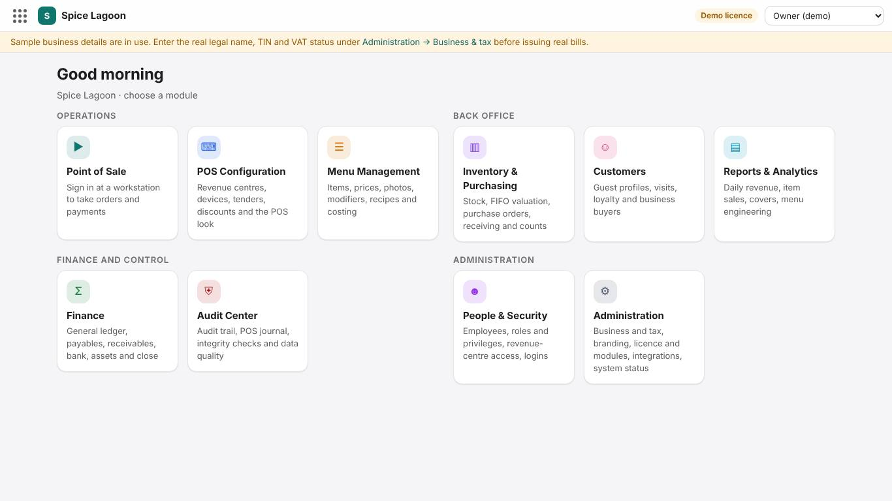

**The top bar** is on every back-office screen:

| Element | Use |
|---|---|
| ⋮⋮⋮ (launcher) | Jump to any workspace. |
| Business name / workspace | Where you are. Choose the business name to return to the launchpad. |
| Licence badge | Your edition and days left (for trials and demos). |
| **+ Business** | Owners and administrators: add another business (for example a second restaurant company, or a training copy with the demo restaurant). |
| **Sign out** | Ends your back-office session. |

**Inside a workspace**, the left sidebar lists its pages. **← All modules** at the bottom returns to the launchpad. On phones, open the sidebar with ☰.

**Back-office login roles** (set by the owner or an administrator under People & Security → Back-office logins):

| Role | May change |
|---|---|
| Owner | Everything, including licence, modules and logins |
| Administrator | All configuration and logins, except removing the owner |
| Manager | Menu, prices, staff, reports, stock and POS operations |
| Accountant | Accounting, journals and reports; read-only elsewhere |
| Storekeeper | Stock, receiving, counts, waste and purchase orders |
| Auditor | Read-only access to everything, including the audit trail and exports |
| Viewer | Read-only access to reports and settings |
| POS terminal | Connected phones, tablets and PCs (section 3.1), and the Print Agent: checks, payments and print jobs only |

> **Tip:** POS staff (stewards, cashiers) do not need back-office logins. They sign in to the POS with an employee number and PIN.

---

## 3. The POS on a terminal

This section covers the **terminal layout** used on counter terminals, PCs and large tablets. Phones use the app layout in [section 4](#4-the-pos-app-on-phones-and-tablets); the rules and functions are the same.

### 3.1 Setting up the device (once)

**Phones, tablets and counter PCs are connected with a code**, once, by the owner or a manager:

1. In the back office: **POS Configuration → Workstations & printers → Connect a phone**. Name the phone (*Nimal's phone*), choose **+ New workstation for this phone** or an existing one, and press **Show the code**.

   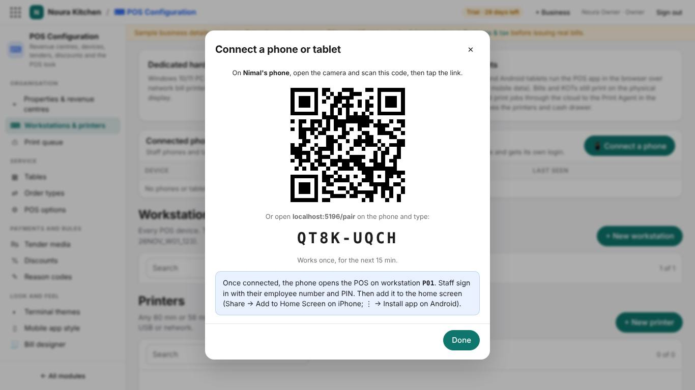

2. On the phone, scan the QR code with the camera and tap the link (or open the system's address followed by `/pair` and type the code). Press **Connect**.

   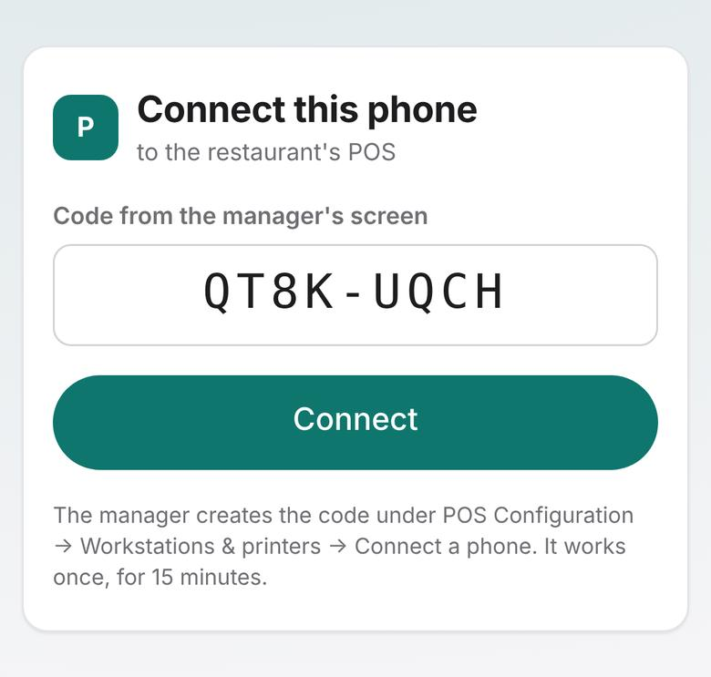

3. The POS opens on that phone's workstation. Add it to the home screen: Share → **Add to Home Screen** (iPhone), ⋮ → **Install app** (Android).

The phone now has its own login for the POS only; nobody types or shares a password. It works over the internet on Wi-Fi or mobile data. **Connected phones and tablets** on the same page lists every device and when it was last seen. **Remove** one when a phone is lost or replaced, or its owner leaves: it is locked out at once and shows *This phone is no longer connected*.

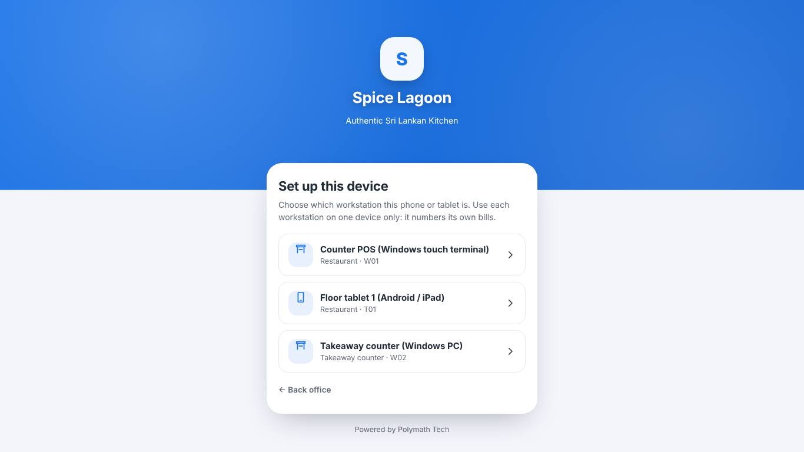

A device connected without a workstation (or a PC opened by a manager) asks **which workstation** it is the first time the POS opens. Choose it from the list. Each workstation:

- numbers its own bills (the workstation code is part of every invoice number, for example `26NOV_W01_112`);
- keeps its own tamper-evident transaction journal;
- has its own bill printer and revenue centres.

Use each workstation on **one device only**. To change it later, choose **Change workstation** on the sign-in screen (a manager should do this).

### 3.2 Signing in

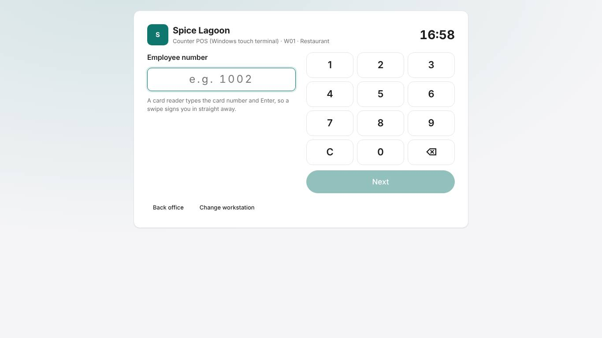

How you sign in depends on the sign-in policy (People & Security → Sign-in policy):

| Method | What you do |
|---|---|
| **Employee number + PIN** (most venues) | Type your employee number, press **Next** (or Enter), then your PIN on the keypad. |
| **Card swipe + PIN** | Swipe your employee card (the reader types the number and Enter), then your PIN. |
| **Tap name + PIN** (small teams) | Tap your name, then enter your PIN. |

- A wrong PIN is refused and counted. After the set number of wrong PINs (default 5) you are **locked**: a manager unlocks you from **Functions → Unlock employee**.
- If the business requires clock-in, you are asked to **Clock in** before you can start work.
- You can only sign in while your employment is active and if you are set up for this outlet and revenue centre.
- The POS **signs you out automatically** after a set time without a touch (default two minutes; a workstation can have its own time). Your open checks stay safe.

### 3.3 Choosing a revenue centre

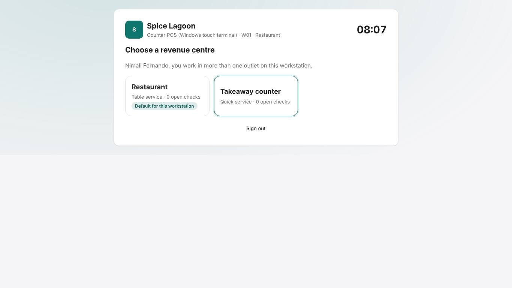

If you work in more than one revenue centre on this workstation (for example *Restaurant*, *Takeaway* and *Bar*), choose where you are working now. Each shows its open checks. Managers can switch later from the drop-down in the top bar. Switching needs the **Change revenue centre** privilege.

### 3.4 The order screen

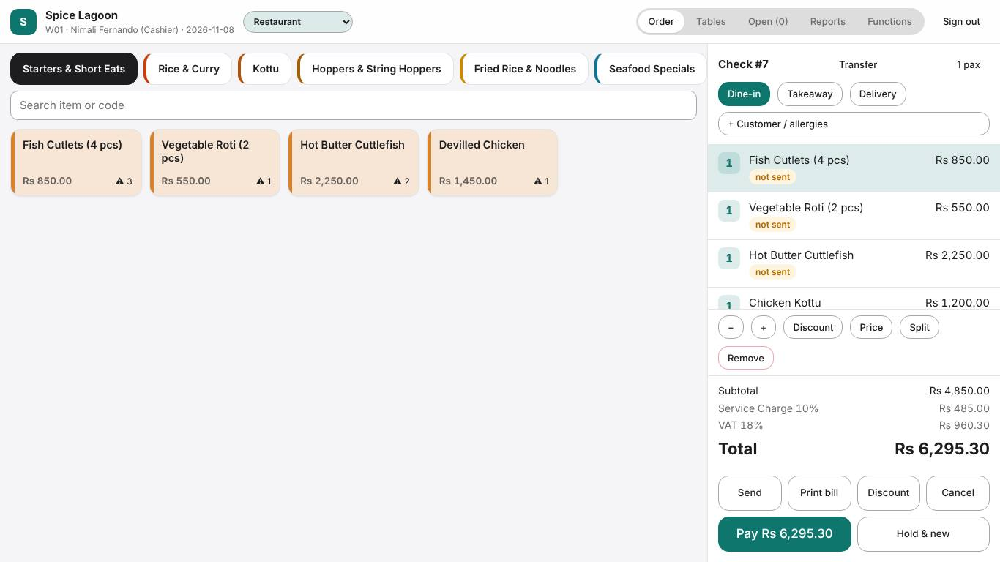

| Area | What it does |
|---|---|
| **Top bar** | Restaurant, workstation, your name and role, business date; revenue centre; views **Order · Tables · Open (n) · Reports · Functions**; **Sign out**. |
| **Categories** | Tap a category to show its items. |
| **Search** | Type part of an item name or its code. |
| **Item buttons** | Tap to add one. Photos appear if the theme shows them. ⚠ shows the number of allergens. Items marked **86** are out of stock. If there are more items than fit, use **‹ Prev / Next ›** or swipe. |
| **Check panel** | The current check: number, table, guests (pax), order type, customer, the items, totals and action buttons. |

**Adding items**

1. Tap an item. If it has **modifiers** (for example spice level, add-ons) a window opens: choose the options, set the quantity, add a kitchen note and tap **Add**.

   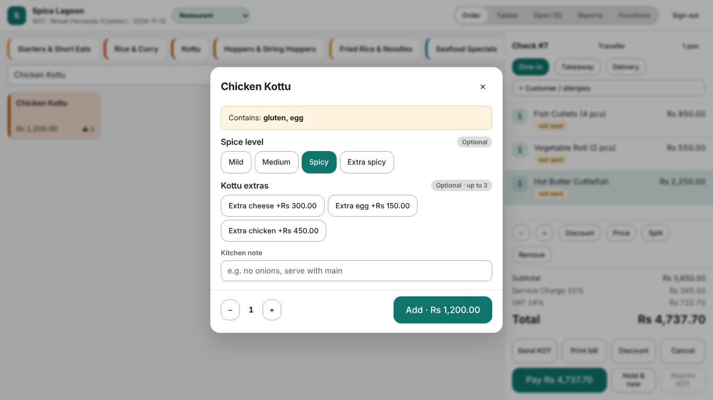

2. An **open-price** item asks for the price (needs the *open price* privilege).
3. If the guest has a recorded **allergy** that the item contains, an allergy alert asks you to confirm.
4. New lines show **not sent** until you send them to the kitchen.

**Working with a line:** tap a line to select it, then use the buttons under the list:

| Button | Use |
|---|---|
| **− / +** | Change the quantity (only before the item is sent). |
| **Discount** | Discount this item. |
| **Price** | Change the price (before sending; may need approval above your limit). |
| **Split** | Move the item to a separate check (separate bills). |
| **Remove / Void** | *Remove* an unsent item. *Void* a sent item: choose a reason; a kitchen void ticket prints; voids above your limit need approval. |

**Check buttons**

| Button | Use |
|---|---|
| **Order type chips** (Dine-in, Takeaway, Delivery…) | Set the order type. Dine-in attracts service charge. |
| **Transfer** | Give the check to another employee or move it to another table. |
| **n pax** | Change the number of guests. |
| **+ Customer / allergies** | Attach a guest profile, record allergies, or enter a **VAT-registered buyer** (name, TIN, address) for a tax invoice in their name. |
| **Send KOT** | Send new items to the kitchen and bar and print the kitchen ticket (KOT/BOT) at once: on the kitchen or bar printer, or on this device's bill printer when the restaurant has one printer for everything (see [6.2](#62-workstations--printers)). The check is saved and the screen clears for the next order. |
| **Reprint KOT** | Print the kitchen tickets of what was already sent on this check again, marked **REPRINT** (for a lost or torn ticket). Recorded in the transaction journal. |
| **Print bill** | Prints the guest check (a pre-bill, not a tax invoice). It can carry a LankaQR code for payment. |
| **Discount** | Discount the whole check. |
| **Cancel / Close** | *Cancel* drops unsent items (needs the privilege if items are on it); *Close* leaves a check that has nothing unsent. |
| **Pay** | Take payment (see 3.5). |
| **Hold & new** | Send and keep the check open, ready for the next order. |

### 3.5 Taking payment

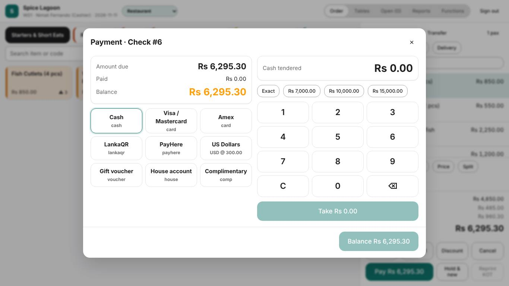

1. Tap **Pay**. The window shows the amount due, paid so far and the balance.
2. Choose how the guest pays:
   - **Cash:** tap a quick amount (**Exact**, the next 1,000 or 5,000) or type the cash received on the keypad, then **Take**. The change is shown.
   - **Foreign cash** (for example USD): enter the foreign amount; the system converts at the rate set for that tender.
   - **Card:** run the card on the bank's card machine first, then key in the **approval code** and tap **Take**.
   - **LankaQR / PayHere:** the guest scans the QR. When the bank or gateway confirms, enter the transaction reference and **Confirm received**. (In demo mode, **Simulate payment received**.)
3. To split the bill between methods, take part with one method and the balance with another. Remove a payment with ✕.
4. When the balance is zero, tap **Close check** (or **Close · change Rs …**). The cash drawer opens for cash.
5. The invoice is issued with the next number in the workstation's series and printed on the bill printer. A copy appears on screen. **Print from this device** prints it on a printer attached to this device.

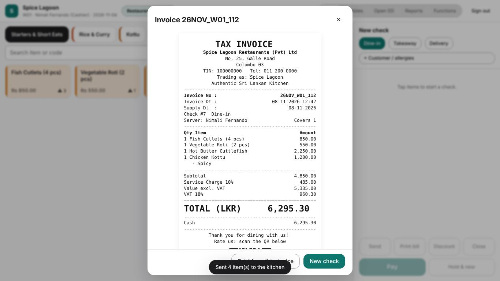

A VAT-registered business always prints an **IRD tax invoice**: the words TAX INVOICE, your TIN, invoice number and dates, value excluding VAT, VAT and total. Other businesses print an invoice. What else appears is set in the [Bill designer](#68-bill-designer).

### 3.6 Tables and open checks

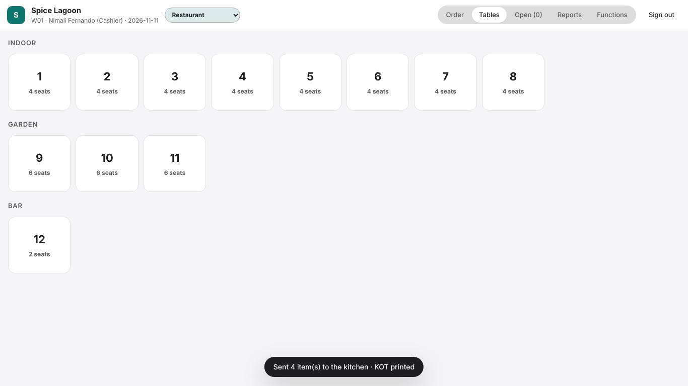

- **Tables** shows each table by area. Busy tables show guests, minutes open and the amount. Tap a free table, enter the number of guests, and start ordering. Tap a busy table to pick up its check.
- **Open (n)** lists every open check in this revenue centre: number, table, employee, time and amount. Tap one to pick it up. Picking up another employee's check needs the *pick up any check* privilege.

### 3.7 Reports on the POS

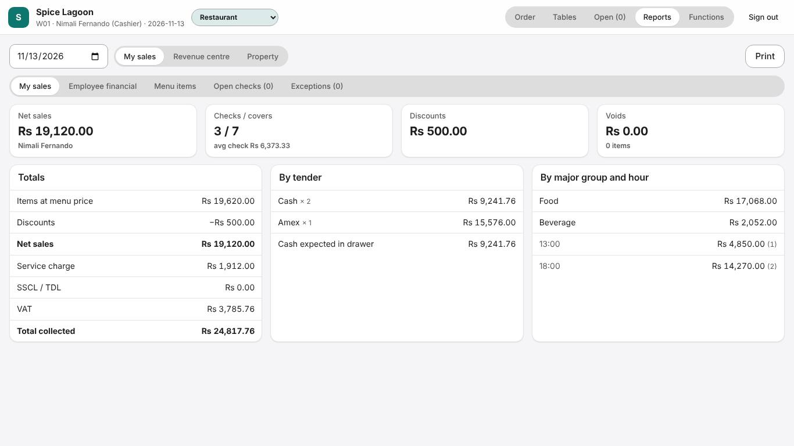

Choose the scope (**My sales**, **Revenue centre** or **Property**) and the report:

- **Summary:** net sales, checks, guests, averages, discounts, voids, tenders.
- **Employee financial:** sales, checks, voids and discounts per employee, and the cash each should hold.
- **Menu items:** quantity and sales per item.
- **Open checks:** what is still open, by whom.
- **Exceptions:** voids, discounts, price changes, approvals, no-sales and paid-outs, with who approved them.

Print any report on the bill printer. Employees with only *own reports* see their own figures.

### 3.8 Functions

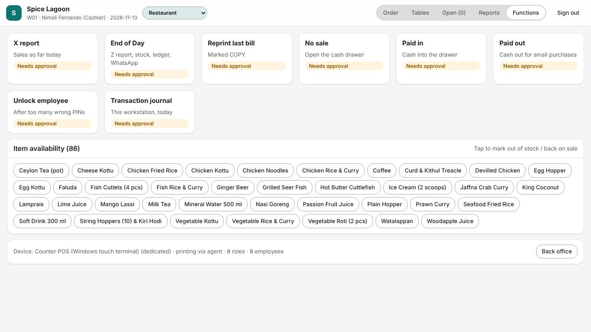

| Function | Use | Usually |
|---|---|---|
| **X report** | Sales so far today, without closing anything. | Supervisor |
| **End of Day** | Warns about open checks, deducts stock (FIFO), posts the day to the ledger, prints the Z report and sends the WhatsApp summary to managers. Can be re-run for late sales. | Manager |
| **Reprint last bill** | Prints a copy marked COPY. | Supervisor |
| **No sale** | Opens the cash drawer (logged). | Supervisor |
| **Paid in / Paid out** | Cash into or out of the drawer, with the amount (logged; paid-outs above the limit need approval). | Cashier with approval |
| **Clock out** | Ends your shift on the time card. | Everyone |
| **Unlock employee** | Unlocks someone locked out by wrong PINs. | Supervisor |
| **Transaction journal** | Everything that happened on this workstation today. | Supervisor |
| **Item availability (86)** | Tap an item to mark it out of stock (86) or back on sale. It shows immediately on every device. | Supervisor, kitchen |

Buttons marked **Needs approval** ask for a senior employee (see [section 5](#5-approvals-privileges-and-the-transaction-journal)).

---

## 4. The POS app on phones and tablets

The POS opens as an app on phones, tablets and PCs (the administrator can keep the terminal layout on some screens, [6.7](#67-mobile-app-style)). Each screen gets a layout made for it:

- **Phones and portrait tablets:** one screen at a time with the bottom bar (Home · Tables · Menu · Orders · More).
- **PCs and landscape tablets:** a **navigation rail** on the left, the **menu in the middle and the order beside it** (always visible, with *Send KOT* and *Pay*), more dishes per row, payment with the order on the left and the methods next to the amount, and option sheets shown as dialogs in the middle of the screen.

The buttons, colours and steps are the same everywhere, so staff who know the phone know the PC.

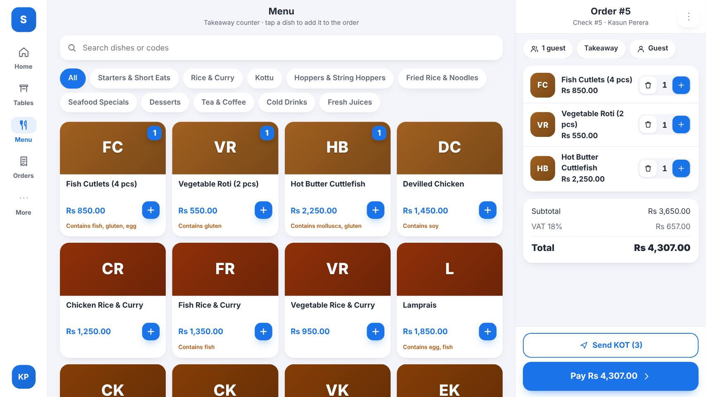

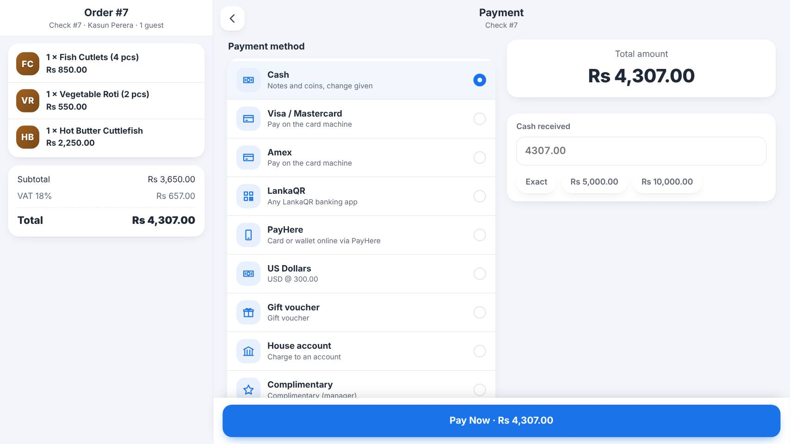 Staff can use their own phones: a manager connects each one once with a code ([3.1](#31-setting-up-the-device-once)), and it works on the restaurant Wi-Fi or mobile data. Bills and kitchen tickets print on the restaurant's printers through the Print Agent; if the connection drops for a moment, orders carry on and are sent when it returns. There are two styles, chosen by the administrator in [POS Configuration → Mobile app style](#67-mobile-app-style):

| Bright | Indigo |
|---|---|
| 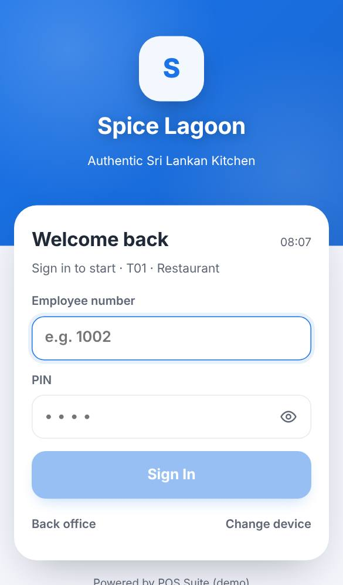 | 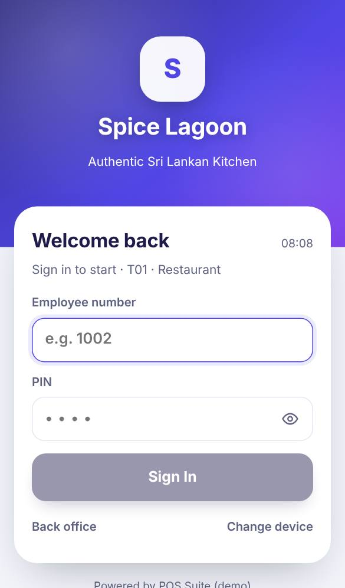 |

Both styles work the same way. This section shows Bright; Indigo screens are at the end.

### 4.1 Signing in

1. The first time, choose the workstation for this phone (**Set up this device**).
2. Enter your **Employee number** and **PIN** (tap 👁 to see the PIN), then **Sign In**. In *tap name* mode, tap your name first. Card readers work as on the terminal.
3. If you work in more than one revenue centre, choose one.

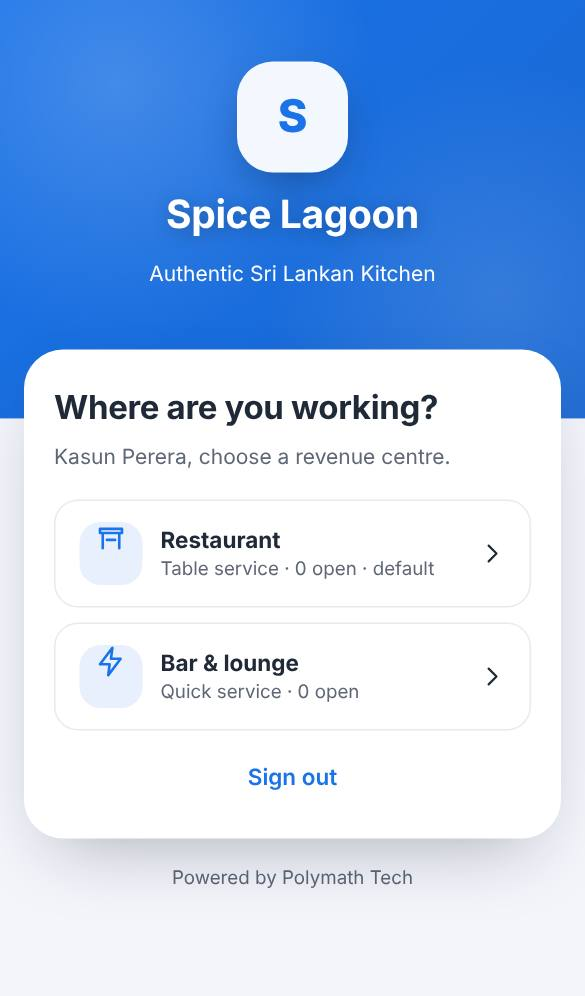

**Back office** opens the back office; **Change device** picks another workstation (managers only). Wrong PINs, lockout, clock-in and automatic sign-out work exactly as on the terminal.

### 4.2 Home

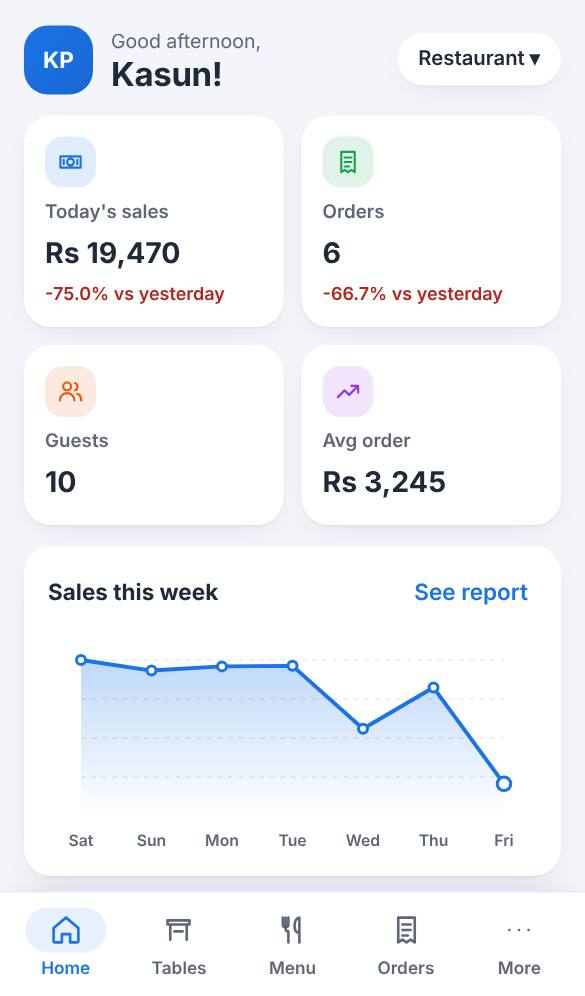

- A greeting with your name, and your revenue centre (tap to change if you work in more than one).
- **Today's sales, Orders, Guests, Avg order** with the change from yesterday, and the week's sales chart. Only employees whose role includes reports see the business figures; others see their own sales or none. The administrator can hide the figures.
- **Quick actions:** New order, Tables, Orders, Reports.
- **My open orders:** tap one to continue it.

The **bottom bar** is on every screen: **Home · Tables · Menu · Orders · More**. Without the tables module, *Reports* replaces *Tables*.

### 4.3 Tables

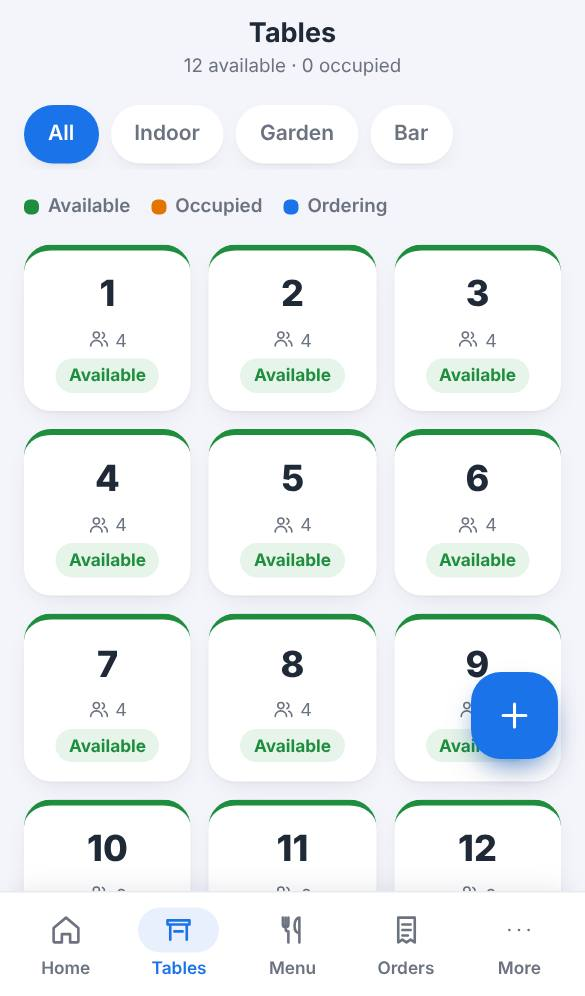

- Filter by area (All, Indoor, Garden, Bar…) and by status: tap **Available** or **Occupied** in the legend.
- Each table shows its number, seats and status: **Available** (green), **Occupied** (orange, with the amount and minutes open) or **Ordering** (the check you have open now).
- Tap a free table, enter the number of guests, and the menu opens. Tap an occupied table to open its order.
- The **+** button starts an order without a table (takeaway or counter).

### 4.4 Menu

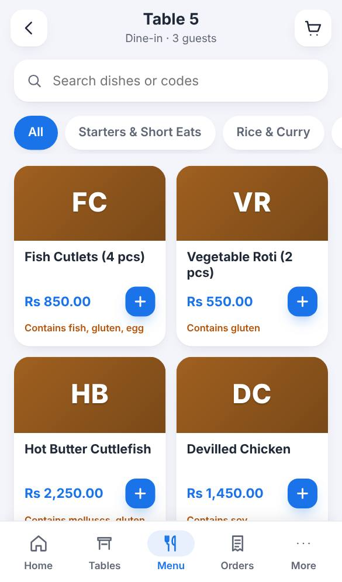

- The title shows the table (or order number), order type and guests.
- **Search** dishes by name or code, or filter with the category chips.
- Tap **+** (or the picture) to add a dish. Modifiers, open prices and allergy alerts appear as on the terminal, as a sheet from the bottom.
- A blue number on a dish shows how many are on the order. **Sold out** dishes cannot be added.
- The bar at the bottom shows the items and total: tap it to see the order.

### 4.5 The order (cart)

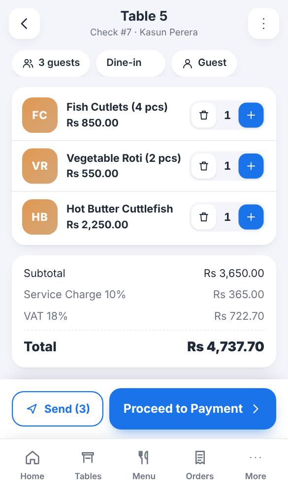

- **Guests**, **order type** and **Guest** (customer, allergies, VAT buyer) at the top.
- Each line shows the dish, options, notes and amount. Use **− / +** to change quantities before sending; **−** on a quantity of 1 (the bin icon) removes it. Sent items show *sent* and their quantity.
- Tap a line for more: **Discount this item**, **Change price**, **Move to a separate bill**, **Remove / Void**.

  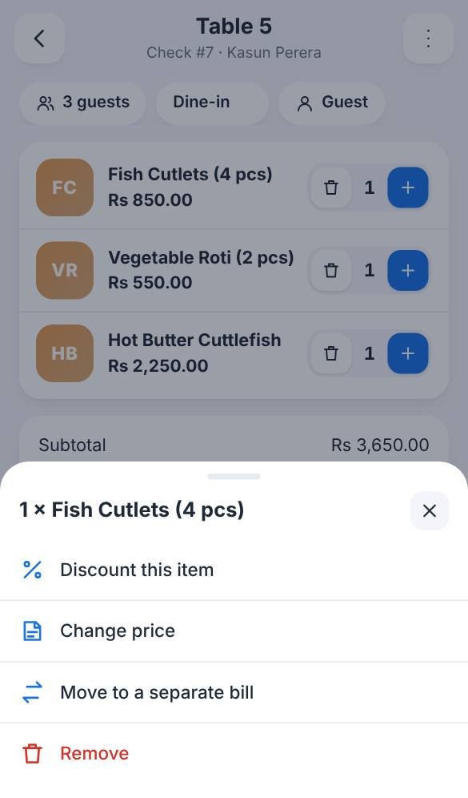

- **⋮** (top right) opens the order options: *Print bill*, *Discount the whole bill*, *Number of guests*, *Guest, allergies, VAT buyer*, *Transfer to a table or employee*, *Send, print the KOT and hold*, *Print kitchen ticket again (KOT)* (once something has been sent; marked REPRINT), *Cancel unsent items*.
- **Send KOT (n)** sends the n new items to the kitchen and bar, prints the kitchen ticket straight away and returns to the tables. With one printer for everything, the ticket comes out of the same printer as the bills: tear it off and hand it to the kitchen. **Proceed to Payment** (on a PC: **Pay**) takes payment.

### 4.6 Payment

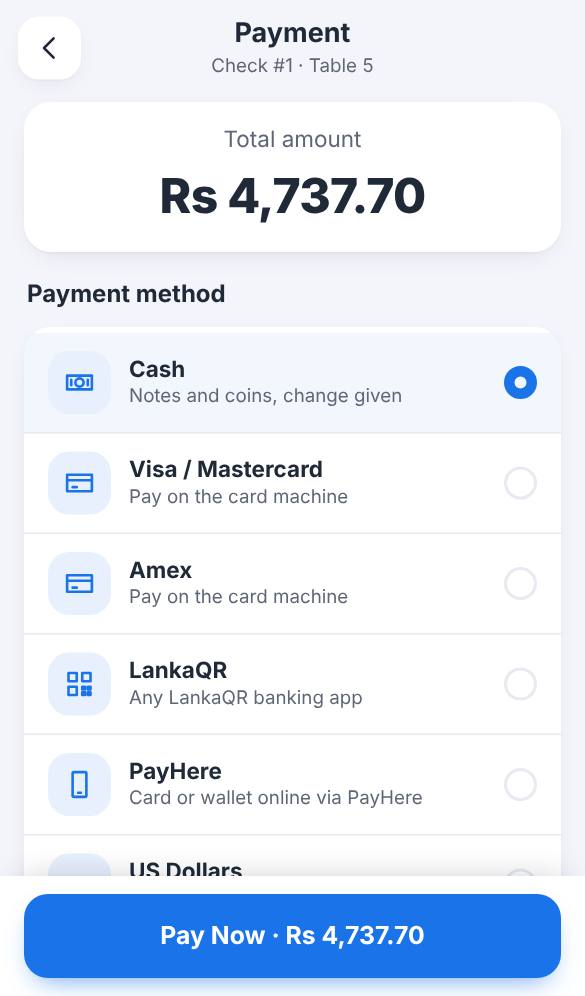

1. Choose the payment method from the list (cash, card, LankaQR, PayHere, foreign currency, vouchers…).
2. **Cash:** type the cash received or tap a quick amount (*Exact*, next 1,000…). The change to give is shown.
3. **Card:** run the card on the bank's machine, then enter its approval code.
4. **LankaQR / PayHere:** show the QR to the guest; enter the transaction reference when payment is confirmed.
5. To split, enter a smaller amount: the payment is taken and the balance stays to pay with another method.
6. **Pay Now** (Bright) or **Complete Payment** (Indigo) takes the payment and closes the bill.

Employees whose role does not include taking payment are asked for a manager's approval when they choose *Proceed to Payment*.

### 4.7 Payment successful

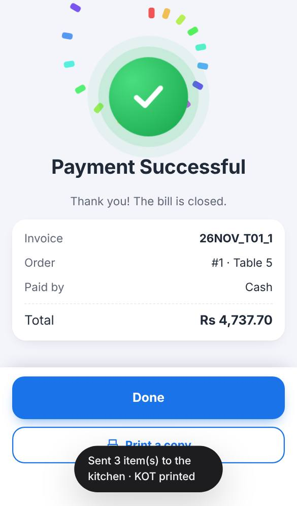

Shows the invoice number, order and table, how it was paid, the total and the **change due** (in large type when there is change). The bill prints automatically if the business has that switched on.

- **Done** returns to the tables (or menu) for the next order.
- **Print Receipt** prints the bill (when it has not printed yet). After that the button reads **Print a copy**, which prints a copy marked COPY and may need approval.
- **View receipt** shows the bill on the screen.

### 4.8 Orders

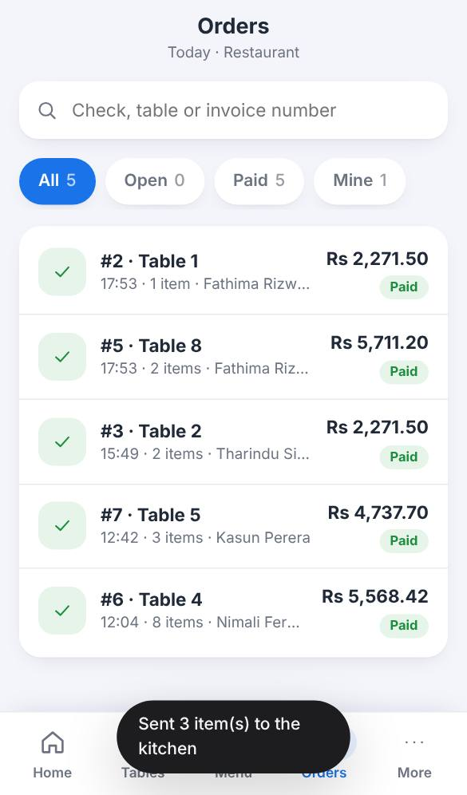

Today's orders in this revenue centre. Filter **All / Open / Paid / Mine**, or search by check, table or invoice number. Tap an open order to continue it. Tap a paid order to view its receipt or reprint a copy. Employees without the *pick up any check* or *reports* privilege see only their own orders.

### 4.9 Reports

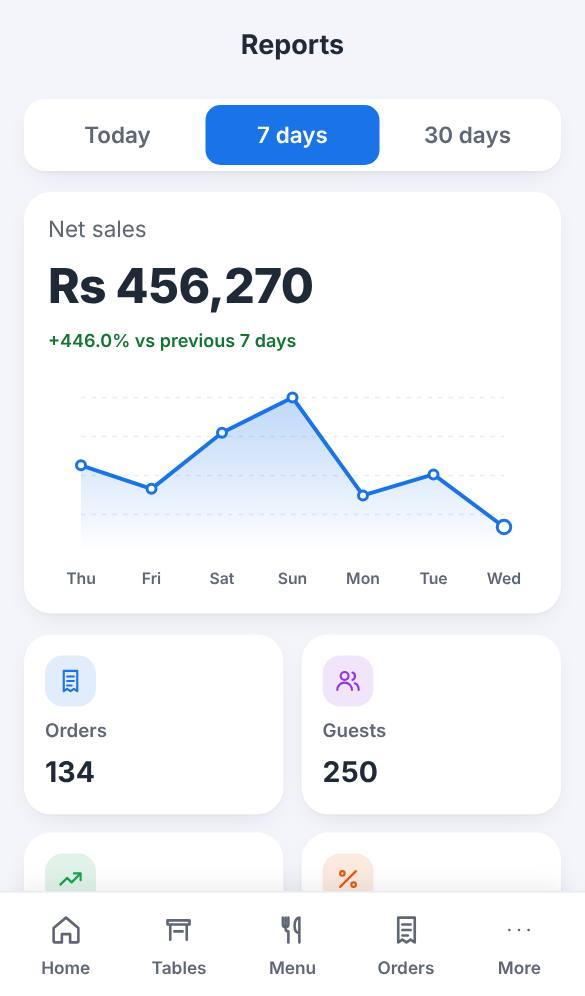

**Today / 7 days / 30 days**: net sales with the change from the previous period and a chart; orders, guests, average order and discounts; **Top dishes** and **Payment methods** with bars. **Detailed reports** opens the full POS reports from [3.7](#37-reports-on-the-pos).

### 4.10 More

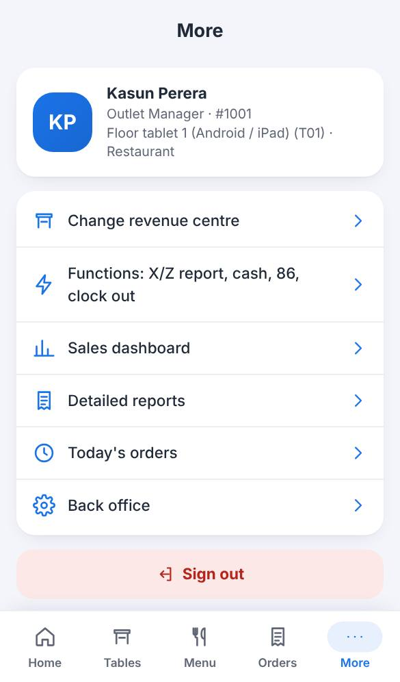

Your profile (role, employee number, device, revenue centre) and:

- **Change revenue centre**
- **Functions:** X/Z report, End of Day, cash (no sale, paid in/out), 86, clock out, unlock, journal (see [3.8](#38-functions))
- **Sales dashboard** and **Detailed reports**
- **Today's orders**
- **Back office**
- **Sign out**

### 4.11 The Indigo style

| Home | Menu | Order | Payment | Successful |
|---|---|---|---|---|
| 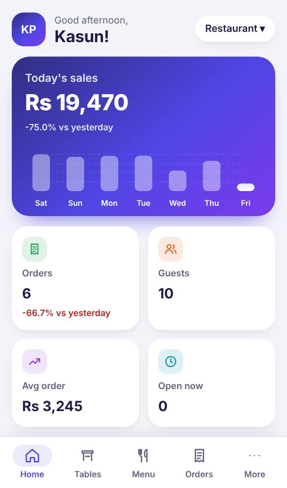 | 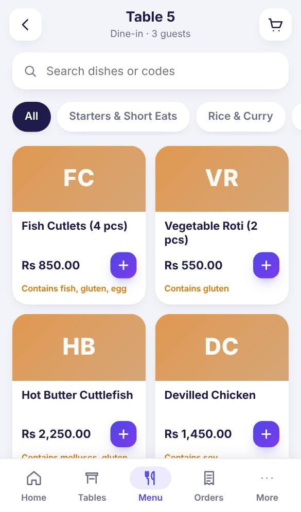 | 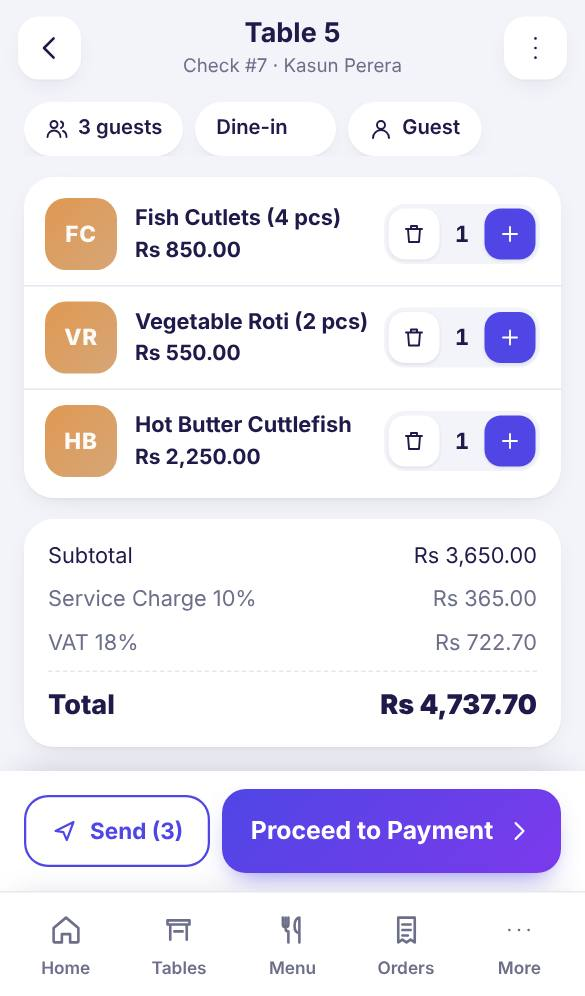 | 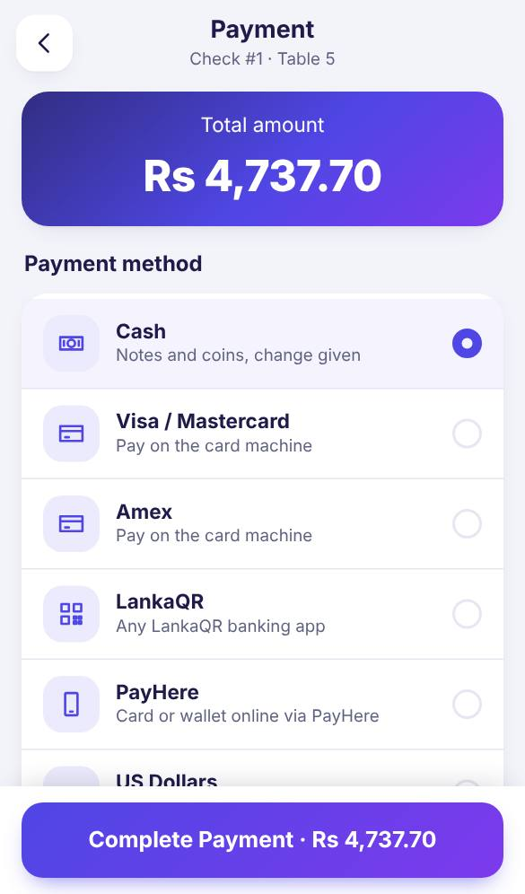 | 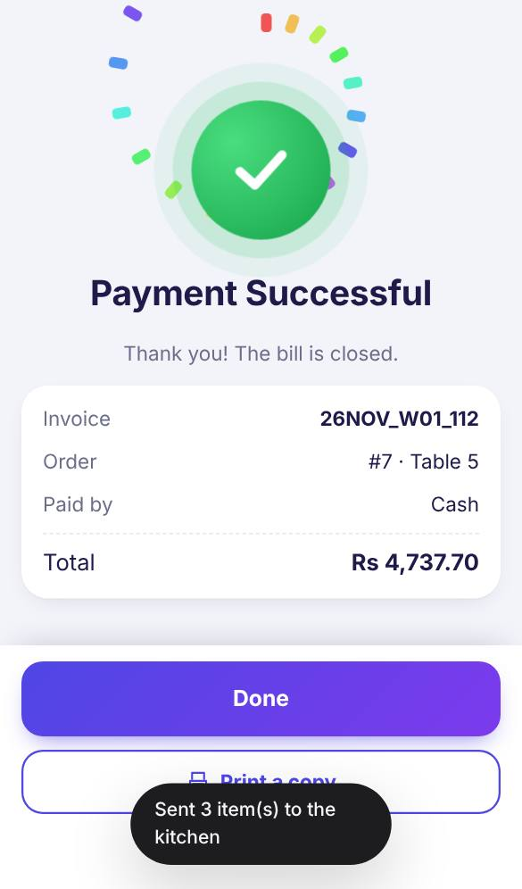 |

---

## 5. Approvals, privileges and the transaction journal

**Privileges** decide what each employee may do on the POS. They come from the employee's **role** (People & Security → Roles & privileges). A role also has a **level** (1 is the most senior) and **limits**: maximum discount %, single void, price change %, refund and paid-out.

When you try something your role does not allow, or that is above your limit, the **Manager approval** window opens:

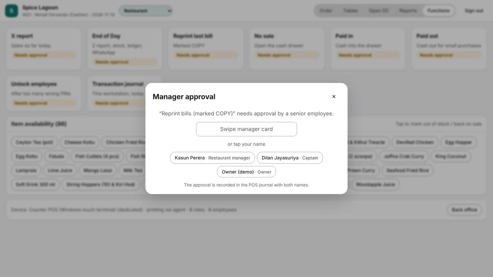

1. A more senior employee **swipes their card**, or **taps their name** in the list of people who may approve and enters their PIN. Only people allowed to approve this action are listed; the person asking is never among them.
2. The approver must be a *different* person, hold that privilege and the *manager override* privilege, be at the same or a more senior level, and be within **their** limit.
3. The action goes ahead and is recorded with **both names**.

PINs are checked by the server. Wrong PINs at the approval window count towards that person's lockout, just like at sign-in, so PINs can't be guessed.

Some roles have privileges marked **approval** (for example a cashier's paid-outs and reprints): they always need a second person, even though the role has the privilege.

**The POS transaction journal** records every sign-in and sign-out, failed PIN, lockout, check opened, items sent, removed or voided, price change, discount, payment, transfer, split, cancel, no sale, paid in/out, reprint, 86, clock in/out, report and End of Day. Each record is linked to the previous one by a cryptographic hash, so a deleted or changed record is detected by the integrity check. See it on the POS under **Functions → Transaction journal**, and for all workstations in the **Audit Center**.

---

## 6. POS Configuration

### 6.1 Properties & revenue centres

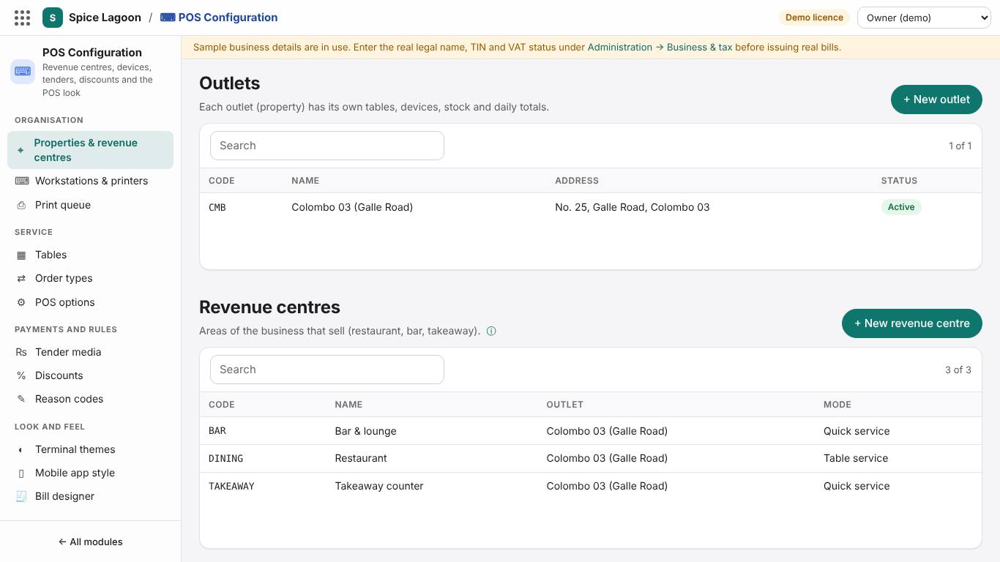

- **Property** (outlet): name, address, phone. Most restaurants have one.
- **Revenue centre:** a place that sells, such as *Restaurant*, *Takeaway* or *Bar*. Set its service mode (table service or quick service) and default order type. Reports and access can be per revenue centre.

### 6.2 Workstations & printers

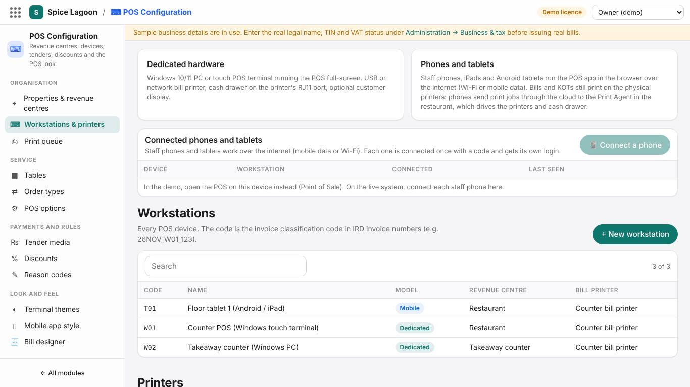

**Workstations** are your POS devices:

| Field | Meaning |
|---|---|
| Code | Short code printed in invoice numbers (W01, T01…). 1–15 capital letters or digits. |
| Name | For example *Counter POS* or *Floor phone 1*. |
| Outlet, revenue centre | Where it sells by default. |
| Allowed revenue centres | Revenue centres employees may choose at sign-in on this device. |
| Hardware model | Dedicated POS / Windows PC, or Mobile (tablet / phone). |
| **Screen style** | *Business setting* (follow Mobile app style), *Terminal layout*, *Bright app* or *Indigo app*: choose per device. |
| Bill printer | The printer for this device's bills. |
| Printing | *Print Agent* (the restaurant's printers, for every device), *Bluetooth printer next to this phone or tablet* (no Print Agent: for one phone and one printer), *Direct from POS Shell* (USB on this PC), or *On-screen only* (demo). |
| Bluetooth route, paper, kitchen tickets | For Bluetooth printing: *From the browser* (Chrome on Android) or *Through the RawBT app* (Android, any Bluetooth printer); 80 or 58 mm paper; whether kitchen and bar tickets print on the same printer. |
| Automatic sign-out | Overrides the business setting for this device (seconds; 0 = never). |

**Printers:** name, role (receipt, kitchen, bar, report), model, connection (network/USB/Bluetooth), address and port, paper width (80 or 58 mm), the Print Agent that drives it, and a backup printer.

**One printer for bills and kitchen tickets.** Where kitchen tickets print: the bar or kitchen printer of the dish's route; if there is none, the kitchen printer; if there is no kitchen printer either, **the bill printer of the workstation that sent the order**. So a restaurant with a single printer needs no kitchen printer record: *Send KOT* prints the ticket on the bill printer, and the bill prints there at payment. With a Bluetooth printer, keep *Kitchen and bar tickets* set to print on the same printer.

**Print queue** (separate page) shows bills and tickets waiting for the Print Agent. Preview a job, print it from the browser, or mark it printed if it came out.

**One phone and a Bluetooth printer.** A small business can run with one phone and one Bluetooth receipt printer beside it (for example an Xprinter XP-T80Q), without a PC: set the phone's workstation to *Bluetooth printer next to this phone or tablet*. On the phone, the **printer button** (home screen, or More → Bluetooth printer) shows whether the printer is connected:

1. Switch the printer on, tap **Connect printer** → **Choose the printer** and pick it from the list.
2. Press **Test print**.

The phone remembers the printer and reconnects by itself. Bills, kitchen tickets, reports and the cash drawer all use it. If it is off, prints wait on the phone (*Printer: 2 waiting*) and come out once it is connected. Android with Chrome is recommended; on an iPhone use the Bluefy browser. A printer with classic Bluetooth only works through the RawBT app (Android).

### 6.3 Tables, order types and POS options

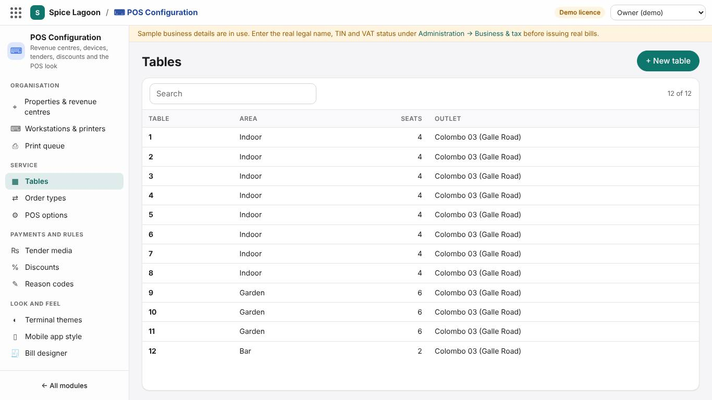

- **Tables:** name or number, area (Indoor, Garden, Bar…), seats, order on screen.
- **Order types:** Dine-in, Takeaway, Delivery and your own; whether a table is required; order on screen. Service charge applies to the order types set under Business & tax.

**POS options:** when the business day starts (sales before this hour count for the previous day, for late-night service), whether the bill prints automatically when a check is paid, whether a **kitchen ticket (KOT) prints when an order is sent** (on by default; switch off only if the kitchen reads orders from a screen), the default outlet for back-office reports, and the loyalty points earned per Rs 100.

### 6.4 Tender media (payment methods)

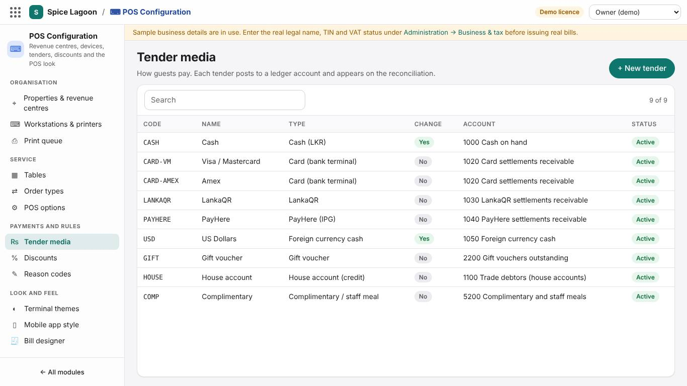

Each tender has a type (cash, card, LankaQR, PayHere, foreign cash, voucher, house account, complimentary), whether it gives change, needs a reference, opens the drawer, the exchange rate (foreign cash) and the **ledger account** it posts to. Switch off tenders you don't accept.

### 6.5 Discounts and reason codes

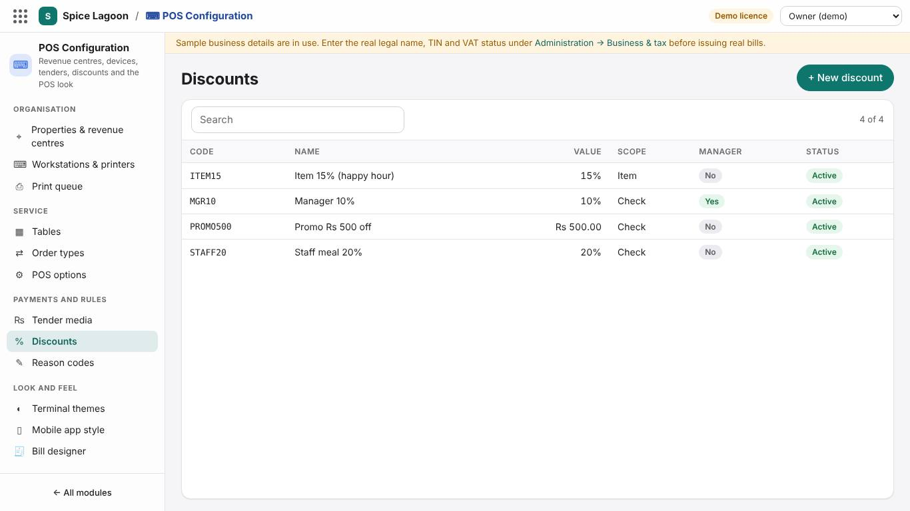

- **Discounts:** name, percentage or fixed amount, item or whole check, and whether a manager must approve it.
- **Reason codes:** the reasons employees choose for voids, refunds, discounts, complimentary items, waste and paid-outs. They appear in the exceptions reports.

### 6.6 Terminal themes

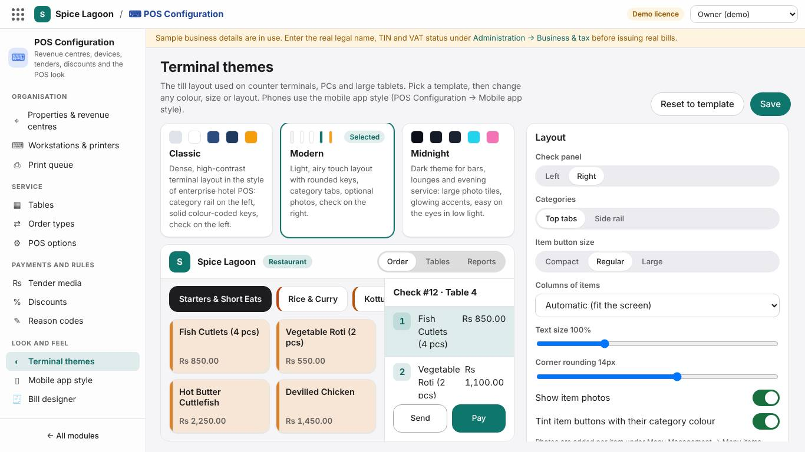

The look of the terminal layout. Pick **Classic**, **Modern** or **Midnight**, then change colours, button size, text size, corner rounding, the check side (left or right), category tabs or side rail, the number of item columns, item photos and category colours. The live preview shows the result. **Save** applies it to every terminal on the next screen refresh.

### 6.7 Mobile app style

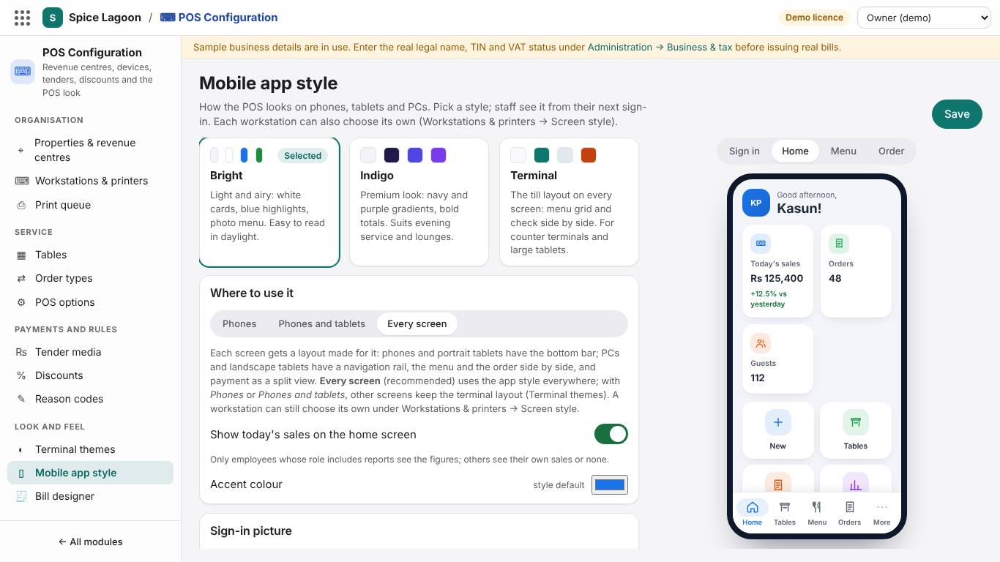

1. Choose **Bright**, **Indigo** or **Terminal** (the till layout everywhere).
2. **Where to use it:**
   - **Every screen** (recommended, the default): phones, tablets and PCs all use the app, each with its own layout ([section 4](#4-the-pos-app-on-phones-and-tablets));
   - **Phones and tablets** (also touch screens up to 1,100 px on the short side);
   - **Phones** (screens narrower than 600 px).

   With the last two, other screens keep the terminal layout.
3. **Show today's sales on the home screen:** switch off to hide figures from everyone.
4. **Accent colour:** change the highlight colour to your brand, or keep the style's own.
5. **Sign-in picture:** upload a landscape photo of your restaurant or a signature dish. It is resized automatically (about 100 KB).
6. Use the **Sign in / Home / Menu / Order** preview to check, then **Save**.

Each workstation can override the style (Workstations & printers → Screen style). For example, the counter PC keeps *Terminal layout* while waiters' phones use *Indigo app*.

### 6.8 Bill designer

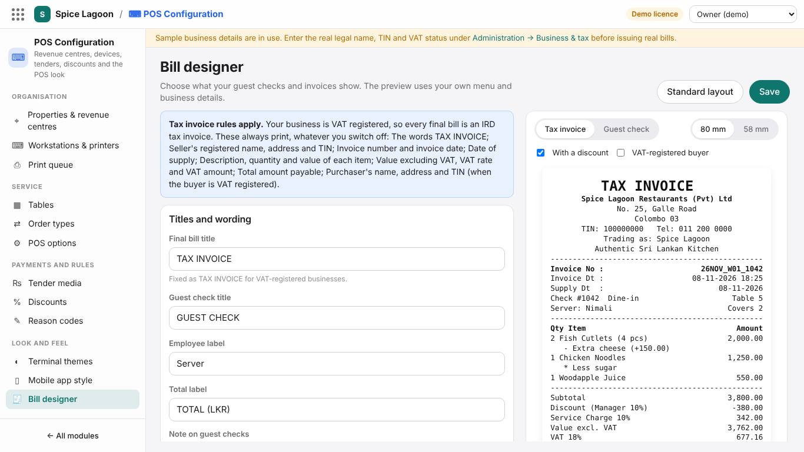

Choose exactly what your guest checks and invoices print. The preview on the right uses your own menu and business details. Switch between **Tax invoice / Invoice** and **Guest check**, **80 mm** and **58 mm** paper, and try *With a discount* and *VAT-registered buyer*.

| Group | What you can change |
|---|---|
| **Final bill** | **Print the final bill as a TAX INVOICE**: on for VAT-registered businesses; off (and unavailable) when the business isn't registered, so bills print as a standard bill. |
| **Titles and wording** | Final bill title (fixed as TAX INVOICE while bills print as tax invoices; for a standard bill, for example *INVOICE* or *BILL*), guest check title, what to call the employee (Server, Steward, Cashier…), total label, the note on guest checks, lines under the address, footer lines. |
| **Print style** | Header alignment (centre or left), quantity style (*2 Kottu* or *Kottu x2*), title and total size, discounts shown one by one or as one total, blank lines before the cut. |
| **Header** | Logo, address, phone, email, website, "Trading as". |
| **Check details** | Check number, order type, table, employee name, guests, printed time. |
| **Items** | Column headings, combine identical items, unit price for multiples, modifiers, modifier prices, notes, seat numbers. |
| **Totals and payment** | Item count, subtotal, "You saved Rs …", payment methods, payment references, change. |
| **Footer** | LankaQR pay-by-QR on guest checks, feedback QR on invoices (with your link and caption), guest name and loyalty points, "Powered by". |

**Tax invoice or standard bill.** A business that isn't registered for VAT (or SSCL) prints a **standard bill**: the business name, address and phone, **Bill No** and **date and time**, table and server, items, service charge, total, payments and change. It has no TIN and no tax-invoice wording, as the law requires for an unregistered business. Once the business registers, turn on VAT under Administration → Business & tax, and the final bill becomes a tax invoice. A VAT-registered business can switch the tax invoice off only on its accountant's advice. A bill for a VAT-registered buyer (TIN entered on the POS) still prints as a tax invoice.

**Tax invoice rules.** If your business is VAT registered, the Inland Revenue requires certain particulars on every tax invoice. These always print, and their switches show **Always on a tax invoice**:

- the words TAX INVOICE;
- the seller's registered name, address and TIN;
- the invoice number and date, and the date of supply;
- each item with its quantity and value;
- the value excluding VAT, the VAT rate and VAT amount, and the total;
- the purchaser's name, address and TIN when the buyer is VAT registered.

**Standard layout** returns every switch to the original layout. **Save** applies the layout to every new bill immediately.

---

## 7. Menu Management

### 7.1 Menu items

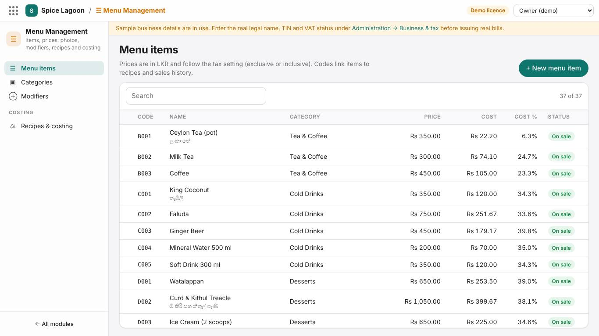

Choose **+ New menu item**, or tap an item to edit it:

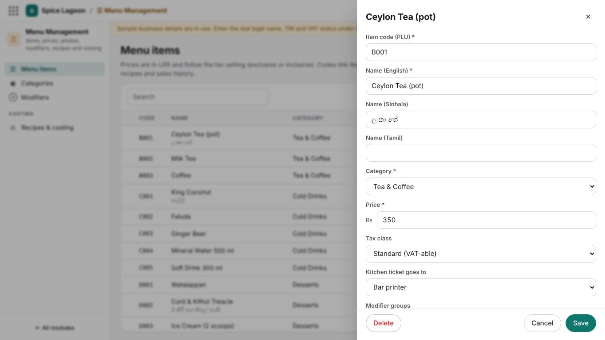

| Field | Meaning |
|---|---|
| Item code (PLU) | Unique code; also the key for Excel import and reports. |
| Name (English / Sinhala / Tamil) | Names on screen and tickets. |
| Category | Where it appears on the POS; the category decides its major group (Food, Beverage, Liquor…) for reports and the ledger. |
| Price | Selling price in rupees, exclusive or inclusive of tax according to Business & tax. |
| Tax class | Standard (VAT-able), exempt, etc. |
| Kitchen ticket goes to | Kitchen printer / KDS, bar printer, or no ticket. |
| Modifier groups | Options offered when the item is ordered. |
| Allergens | Shown on the POS and printed on kitchen tickets; trigger allergy alerts. |
| Description, sort order | Description of the dish; position within its category. |
| POS button colour | Overrides the category colour on the POS. |
| Open price | The employee enters the price at the time of sale (needs the open-price privilege). |
| Available | On sale now. Off = 86'd (out of stock). |
| Active | On the menu at all. |
| **Photo** | Upload a picture. It is resized automatically and shown on the POS when the terminal theme or the mobile app shows photos. |

The cost comes from the item's recipe (Recipes & costing).

The list shows cost and cost % next to the price, so you can spot under-priced dishes. On phones each item is a card.

### 7.2 Categories and modifiers

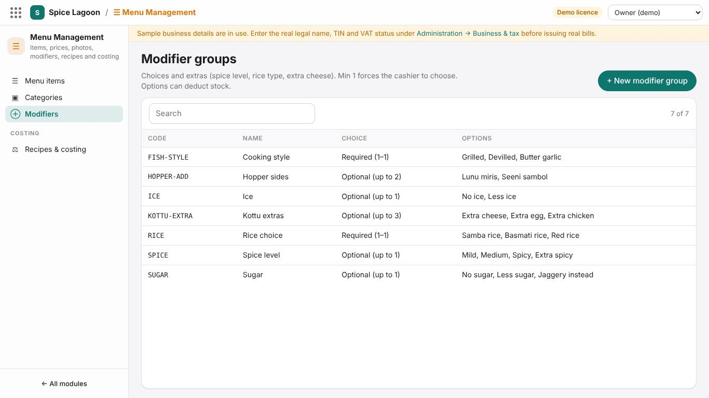

- **Categories:** name, major group, colour and order on screen.
- **Modifiers:** a group (for example *Spice level*) with options and prices, and the minimum and maximum a guest must choose. An option can deduct a stock item (for example *Extra cheese* deducts 20 g of cheese).

### 7.3 Recipes & costing

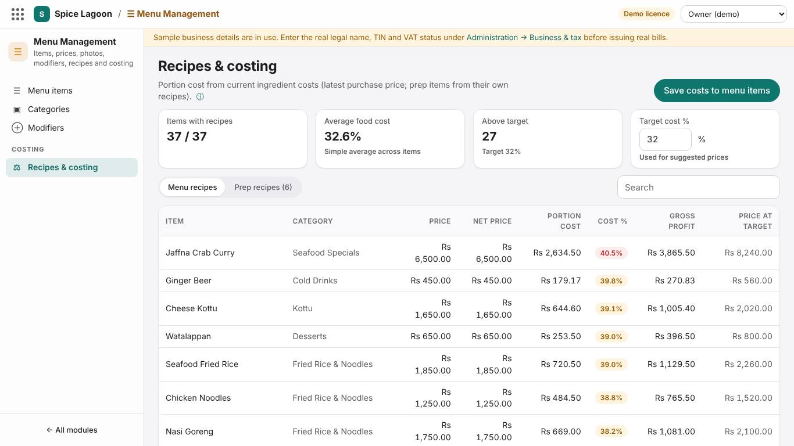

Each recipe lists ingredients (stock items or prep recipes) with quantities and wastage %. The system calculates the cost per portion from the latest purchase prices, the food-cost % against the selling price, and the suggested price for your target food cost. **Prep recipes** (gravies, batters) can be produced in batches and used in other recipes. Sales deduct ingredients through recipes at End of Day.

---

## 8. Inventory & Purchasing

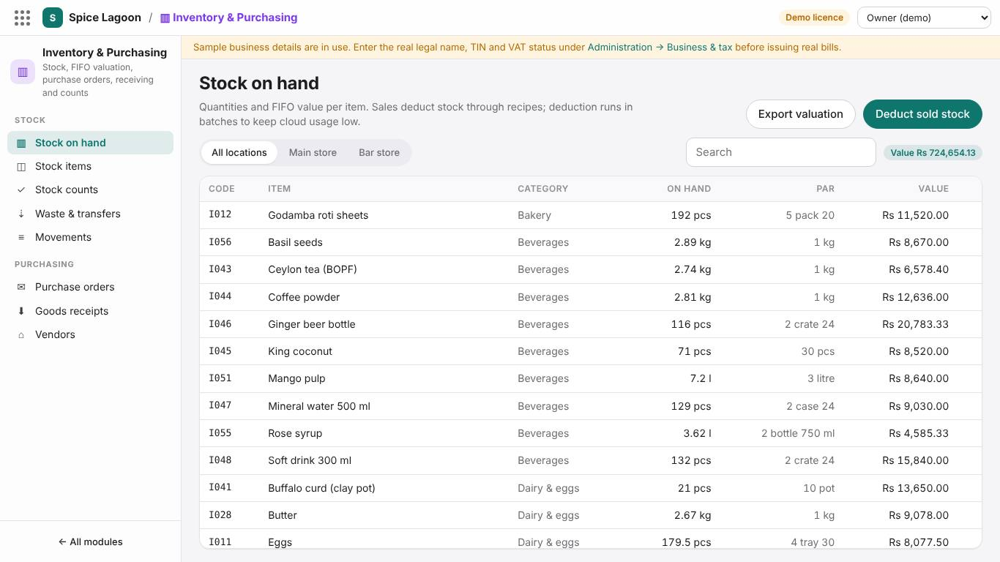

| Page | What you do there |
|---|---|
| **Stock on hand** | Quantities and FIFO value per item and location; items below their reorder level are highlighted. |
| **Stock items** | Ingredients and goods: code, name, category, major group, stock unit (g, ml, pcs), purchase unit and stock units per purchase unit, cost per purchase unit, main vendor, par level and reorder quantity, whether it is a prep item, and whether stock is tracked. |
| **Purchase orders** | Order from vendors: items and quantities in purchase units, the delivery store and date. **Suggest from par levels** drafts orders for everything below par. Set the status to approved, then **Receive** when the delivery arrives (this drafts a goods receipt). |
| **Goods receipts (GRN)** | Record deliveries: vendor, supplier invoice number, items and costs, input VAT, and a photo of the delivery note or bill (**Add photo or scan**). **Post to stock** adds FIFO stock lots at the received cost and updates the latest purchase price. The supplier's bill is then entered in Finance → Payables and matched against the order and the receipt. |
| **Stock counts** | Choose the **type of count**, **Start a count**, enter what is on the shelves, **Post count**. *Regular count:* differences are losses or errors (stock count differences). *Kitchen usage:* for businesses without POS sales, what is missing since the last count is what the kitchen used (cost of sales). *Opening stock:* the first count when you start. Losses are costed at FIFO, gains at standard cost. With accounting on, counts, waste and receipts post to the books at once. |
| **Waste & transfers** | Record spoilage with a reason, move stock between stores, or cook a batch of a prep item (production). |
| **Movements** | Every change to stock with its FIFO cost: the audit trail behind stock value and cost of sales. |
| **Vendors** | Supplier details, TIN, payment terms. |

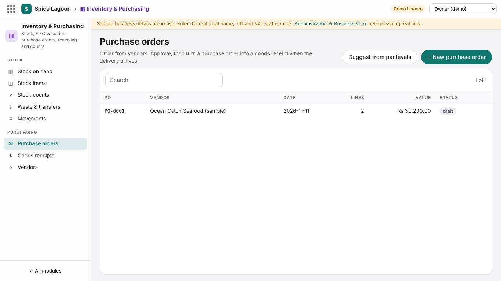

**FIFO** (first in, first out) means stock is used, and costed, in the order it was received.

---

## 9. Customers and loyalty

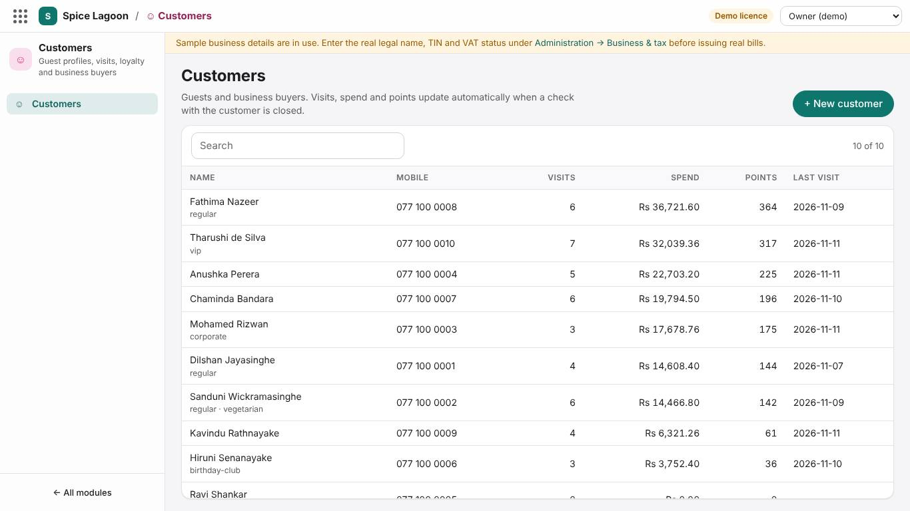

- **Guest profiles:** name, mobile, email, birthday, tags, consent to WhatsApp/email offers, notes (preferences, allergies). Visits, spend and points update automatically when a check with the guest is closed.
- **Loyalty points:** earned per Rs 100 spent (POS Configuration → POS options), shown on the POS when the guest is attached to the check, and optionally printed on the bill.
- **Business buyers:** enter the VAT TIN and address on the profile, so a tax invoice can be issued in the buyer's name.
- Attach a guest on the POS with **+ Customer / allergies** (terminal) or **Guest** (app).

---

## 10. Reports & Analytics

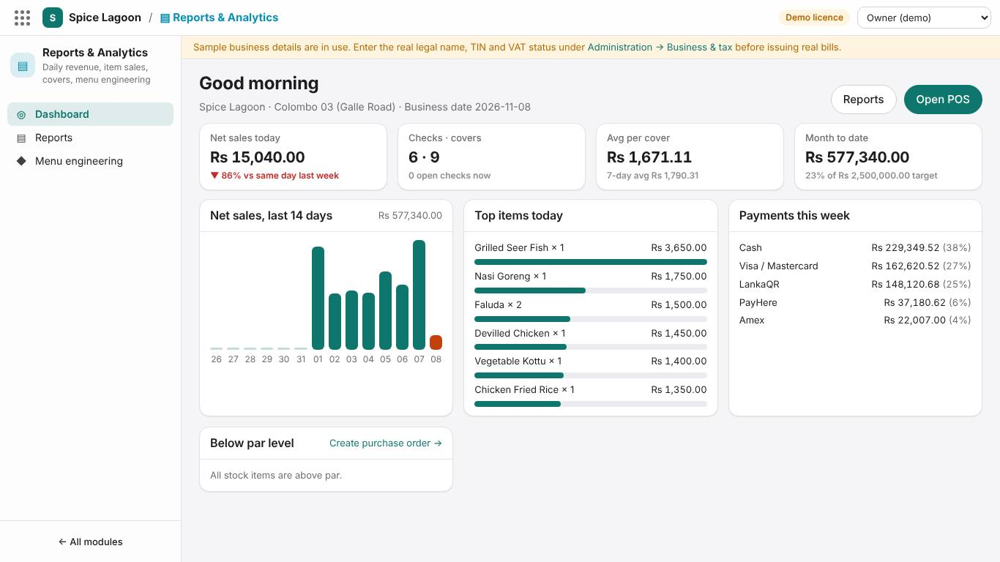

**Dashboard:** today's net sales against the same day last week, checks and guests, average per guest, open checks, top items and recent days.

**Reports:** choose dates (Today, Yesterday, Last 7 days, Last 30 days, or a range) and a report:

| Report | Shows |
|---|---|
| **Daily revenue** | Per day: checks, guests, net sales, service charge, VAT, total, discounts. |
| **Item-wise** | Quantity, sales, cost and margin per menu item; by category and major group. |
| **Covers** | Guests and average spend by order type. |
| **Sales analysis** | Sales by hour, category and payment method. |
| **Checks** | Every closed check with its invoice. |

**Export to Excel** downloads the report. **WhatsApp EOD** shows the end-of-day summary text sent to managers.

**Menu engineering** classifies each item by popularity and profit (Kasavana & Smith method):

| Class | Popularity | Profit | Action |
|---|---|---|---|
| ⭐ Star | High | High | Keep, feature prominently |
| 🐴 Plowhorse | High | Low | Raise price slightly or reduce cost |
| ❓ Puzzle | Low | High | Promote, reposition on the menu |
| 🐶 Dog | Low | Low | Rework or remove |

---

## 11. Finance

The Finance module is a full double-entry general ledger. POS sales, stock and purchases post to it automatically; accountants add journals, bills and payments.

| Page | Use |
|---|---|
| **Overview** | Key figures, work waiting, and **Days to post**: any POS day, or day of stock receipts, counts and waste, not yet in the ledger, with a **Post** button; **Post day** posts any date you choose. |
| **Approvals** | Journals above the approval threshold wait here for a second person (four-eyes control). |
| **Record an expense** | One form for a supplier bill or a cash purchase (vegetables, gas, rent, repairs…) with a photo of the bill: supplier, what it was for, total, VAT, and how it was paid (cash, petty cash, bank, or not yet). Posted at once; paid bills get their payment too. |
| **Daily sales (manual bills)** | A day of handwritten bills as one entry: food, beverage and other sales, service charge, taxes and discounts against the cash, card and bank money received. They must match. |
| **Bills & receipts** | Photograph or scan paper bills first (many at once from a phone), add date, supplier and amount, then **Record as expense** for each. Every file keeps a fingerprint so it can't be changed afterwards. |
| **Journals** | Manual journal entries. Posted entries cannot be edited or deleted: **reverse** them with a reason. Filter by status: draft, awaiting approval, posted, cancelled. |
| **Payables** | Supplier bills (from GRNs or entered), payments, ageing. |
| **Receivables** | Credit customers' invoices, receipts, ageing. |
| **Bank reconciliation** | Import the bank statement (CSV or Excel), accept suggested matches, investigate the rest. |
| **Fixed assets** | Asset register and depreciation. |
| **All documents** | Every financial document with its number and status. |
| **Financial statements** | Trial balance, financial position (balance sheet), profit or loss, cash flows, general ledger, VAT & taxes. |
| **Budgets** | Budgets per account and period, compared with actuals. |
| **Period close** | Close a month so nothing more can post to it; reopen if a correction is unavoidable (recorded); open the next fiscal year. |
| **Suppliers, Customers** | Suppliers with payment terms, and credit customers, kept by the accountant (also without the Purchasing or Customers modules). |
| **Chart of accounts** | Accounts, types and codes (Sri Lankan restaurant chart included). |
| **Finance settings** | Which accounts POS sales, VAT, service charge, discounts, stock and payables post to; approval thresholds (owner or administrator only). |
| **Excel import** | Bring the books in from the accounting workbook: opening balances, opening stock, suppliers and customers with what they owe, supplier bills (paid or not), expenses, daily sales and fixed assets. **Download the example (filled in)** shows what goes where. Every row is checked and the totals shown before anything is saved; importing the same file again skips what is already in. |

**Photos and scans of bills.** Every expense, supplier bill, payment, journal and goods receipt has **Add photo or scan**, and **From inbox** to attach one already in Bills & receipts. Open a file to see it full size, check its fingerprint and download it. Accountants, storekeepers, managers and administrators can file bills; only an owner or administrator can remove a file, and only while it is still unfiled.

The configuration guide explains the accounts, approval limits, opening balances and the accounting workbook step by step.

**Numbering:** every financial document gets the next number in its series, and numbers are never reused. Gaps or duplicates show in the Audit Center.

---

## 12. Audit Center

| Tab | What it shows |
|---|---|
| **Integrity** | **Run integrity check** verifies the hash chains of invoices, the ledger and the POS journal, the seals, and that the books balance. Any break means a record was changed or removed outside the system. |
| **Audit trail** | Every change to every record in the back office: who, when, before and after. |
| **POS journal** | The POS transaction journal for all workstations, filterable by date, workstation, employee and event. |
| **Exceptions** | Voids, discounts, price changes, approvals, no-sales and paid-outs by employee: the report for spotting misuse. |
| **Data quality** | **Run data quality check** finds invalid records, broken references, duplicates, circular recipes and missing ledger mappings. |
| **Numbering** | Gaps and duplicates in invoice and document numbers. |
| **Segregation of duties** | People who can both create and approve the same transactions. |
| **Access review** | Who has which back-office access and POS role, for periodic review. |
| **Auditor exports** | Excel files for external auditors: ledger, invoices, journal, audit trail. |

---

## 13. People & Security

### 13.1 Employees

| Field | Meaning |
|---|---|
| Employee number (sign-in ID) | The ID typed on the POS. |
| Name, job title, department, mobile, email | Employee details. |
| Role (default at every property) | What the employee may do; can differ per property. |
| Properties, revenue centres | Where the employee may sign in and keep operator records (empty = all). |
| Staff card (mag stripe / RFID) | Card number for card sign-in and approvals. |
| PIN | **Set PIN** / **Reset PIN**. 4–8 digits; easy PINs (1111, 1234) are refused; stored only as a salted hash that nobody can read back. |
| Start date, end date | Outside these dates the employee cannot sign in. |
| Status | Active, Suspended, or Terminated (access removed; history is kept). |

### 13.2 Roles & privileges

A grid of privileges (rows) by role (columns). Click a cell to cycle: **—** not allowed → **✓** allowed → **✓ approval** allowed but a senior employee must approve each time. Under the grid, set each role's **level** and **limits** (max discount, max single void, max price change, max refund, max paid out).

The standard roles are Owner/General Manager (level 1), Outlet Manager (10), Supervisor (20), Cashier (40), Server/Steward (50), Bartender (50), Kitchen (70) and Trainee (90). Add your own with **Add role**. A person can only approve for roles at their own level or below.

### 13.3 Time cards and sign-in policy

- **Time cards:** clock-in and clock-out per employee per day, with the outlet and minutes worked, for payroll.
- **Sign-in policy:** sign-in method, wrong PINs before lockout, automatic sign-out time, minimum PIN length, and whether employees must clock in.

### 13.4 Back-office logins

Invite people by email and give them a back-office role (see [section 2](#2-signing-in-to-the-back-office)). Remove access when someone leaves. Phones and tablets are not listed here: they are connected and removed under POS Configuration → Workstations & printers ([3.1](#31-setting-up-the-device-once)).

---

## 14. Administration

**Setup checklist** shows what the business still needs, in order, for the modules it uses (business details, standard set-up, fiscal year, suppliers, opening balances, stock items, opening stock, menu, employees, logins, licence), each with a button to do it.

### 14.1 Business & tax

- **Legal entity:** legal name, trading name, TIN, VAT registration, SSCL liability, address, phone, email, website. These print on every bill exactly as entered.
- **Charges and taxes:** prices exclusive or inclusive of tax, service charge rate and the order types it applies to, VAT rate, SSCL and TDL rates, bill rounding, and when invoice numbers restart (monthly, yearly or never).

> Enter the real legal details **before** issuing real bills. The yellow banner reminds you while sample details are in use.

### 14.2 Adding a business

**+ Business** in the top bar (owners and administrators) creates another business in the same system: give it a name and choose its modules, or load a demo business as a training copy:

- **Load the Noura Kitchen demo:** a small restaurant set up like Noura Kitchen. It is not VAT or SSCL registered (standard bills), has a restaurant and a takeaway counter, one counter phone printing kitchen tickets and bills to a Bluetooth printer, and an office PC that shows bills on screen for exploring. It comes with a Sri Lankan menu with recipes and costs, stock, suppliers, a month of sales and books (opening balances, supplier bills, payroll, fixed assets, a few items waiting for approval). Sign in to the POS with 1001/1111 (manager), 1002/2222 (cashier) or 1003/3333 (steward).
- **Load the demo restaurant:** Spice Lagoon, a larger VAT-registered restaurant with network printers and a Print Agent, a full sample menu, staff and a week of sales.

Each business has its own menu, staff, bills and books. Switch between businesses with the business list in the top bar (shown once you have more than one).

> In the **local demo** (the system running on your own PC without the cloud), the browser keeps one business at a time: loading a demo replaces the business stored in that browser. The page warns you first.

### 14.3 Branding

Display name, logo (resized automatically), primary and accent colours for the back office and terminal, the lines under the address and footer lines on bills, and the "Powered by" text. The mobile sign-in picture is set under Mobile app style.

### 14.4 Licence & modules

- **Licence:** your edition, add-ons, limits and expiry. Paste a new licence key from your supplier and choose **Activate licence**.
- **Modules:** switch licensed modules on or off for this business.
- **Editions:** what each edition includes.

### 14.5 Integrations

- **PayHere:** online card and wallet payments (merchant ID; mock, sandbox or live).
- **LankaQR:** QR payments through any Sri Lankan banking app (merchant details; mock or live).
- **WhatsApp reports:** the end-of-day summary to managers' phones.
- **Accounting export:** export to an external accounting package if you don't use the Finance module.

Mock mode works with sample data until your accounts with the bank or gateway are approved.

### 14.6 Excel import & export

1. **Get the template:** **Download blank template** (with drop-down lists) or **Export current data**.
2. Fill in or change categories, menu items, prices, modifiers, stock items, recipes, vendors and customers.
3. **Import:** choose the filled workbook. Every row is checked and the results are shown; nothing is saved until you confirm. Codes are the keys, so re-importing updates existing records instead of duplicating them.

### 14.7 System status

**Administration → System status** shows:

- the version running on the server and in this browser;
- each POS device: version, last contact, who is signed in (a device on an older version shows *update pending*);
- recent errors seen on screens, for support;
- **Employee PINs: Secure** when every PIN and card is stored where only the server can read it. Owners and administrators can secure older records with one click.

### 14.8 About this system

The **About** tile on the launchpad (owners and administrators; also Administration → About this system) shows:

- **The version you are running**, when it was built, and whether it is up to date. **Check for updates** asks the server; when a newer version is live, **Update now** loads it. (Screens that nobody is using update by themselves within a few minutes.)
- **What's new:** the release notes of the latest versions, with the one you are on marked.
- **Licence:** the edition, its status and days left, the limits (workstations, employees, back-office users, outlets) and the modules switched on.
- **Where it runs:** cloud or local demo, the Firebase project and data region, the business ID, and how many devices are not yet updated. Quote the version and business ID when you contact support.
- **Polymath Tech: help and support:** Polymath Tech's phone, WhatsApp, email and website, and when the system last checked in with Polymath Tech. The system checks in once a day: that is how licence renewals and upgrades arrive by themselves, with no key to type. **Check now** checks in at once (for example right after Polymath Tech tells you a renewal is ready).
- **Share daily figures with Polymath Tech** (on unless you switch it off): yesterday's number of bills and covers and the sales totals, so Polymath Tech can support you and plan your subscription. Nothing about customers, menu items or staff is sent.

**Messages from Polymath Tech.** Owners and administrators may see a line at the top of the back office, for example *Your subscription renews on 1 December*. If Polymath Tech ever has to suspend an account (for example an unpaid subscription), the message says until when the system keeps working; after that the licensed modules stop like an expired licence, **your data is kept**, and everything comes back as soon as Polymath Tech restores the account.

---

## 15. Daily, weekly and monthly routines

**Opening (supervisor)**

1. Switch on terminals, printers and the Print Agent PC. Check each printer prints (Print queue empty).
2. Check the business date on the POS top bar.
3. Count the opening float; record it as **Paid in** if the drawer starts empty.
4. Mark unavailable dishes **86** (Functions → Item availability).

**During service**

- Send orders promptly; print guest checks when guests ask for the bill.
- Voids and discounts only with a reason; approvals by the supervisor on duty.

**Closing (manager)**

1. Make sure every check is paid or transferred (POS → Open, or Reports → Open checks).
2. Print the **X report** and count the cash against **Employee financial**.
3. Run **End of Day** (Functions). It deducts stock, posts the day to the ledger, prints the Z report and sends the WhatsApp summary.
4. Collect the cash and record any paid-outs with receipts.

**Weekly:** stock count of high-value items; review **Exceptions** in the Audit Center; check **Menu engineering**; place purchase orders.

**Monthly:** full stock count; reconcile the bank; review payables and receivables; check the VAT & taxes statement for the VAT return; run the **Integrity** and **Data quality** checks; **close the period** in Finance; review back-office access (Access review).

---

## 16. Troubleshooting

| Problem | What to do |
|---|---|
| "Wrong PIN (n tries left)" | Check the employee number and PIN. After the limit you are locked: a supervisor unlocks you (Functions → Unlock employee). |
| "Not allowed" at sign-in | Your employment dates, outlet or revenue centres don't allow this workstation. A manager checks People & Security → Employees. |
| The POS signed me out | Automatic sign-out after inactivity. Sign in again; your open checks are saved. |
| A button asks for approval | Your role needs a senior employee for that action or amount. See [section 5](#5-approvals-privileges-and-the-transaction-journal). |
| Kitchen ticket or bill didn't print | Check the printer (paper, power, network) and that the Print Agent PC is on. In the back office, POS Configuration → Print queue: reprint or mark printed. |
| A dish is missing on the POS | It is inactive, in an inactive category, or 86'd. Check Menu Management → Menu items. |
| The phone shows the terminal layout | Mobile app style is set to *Terminal*, or the workstation's *Screen style* overrides it. |
| Bills show the wrong name or TIN | Administration → Business & tax. Changes apply to new bills. |
| Figures on the phone home screen are missing | Your role has no reports privilege, or the administrator switched off *Show today's sales*. |
| "Ledger posting failed" at End of Day | Post the day later from Finance → Overview (**Post** next to that day). |
| "No internet" notice | Orders and cash payments are kept on the device and sent when the connection returns. Employees who signed in on this device in the last 7 days can still sign in. Card approval codes can be entered; LankaQR, PayHere and printing through the Print Agent need the connection. Restore it as soon as possible (4G backup router). |
| "Version x is available" | A new release is live. Tap **Update now** when convenient; devices where nobody is signed in update by themselves. |
| "Update required" | This screen is too old to be used safely. Tap **Update now** (a few seconds; nothing saved is lost). |
| "Workstation … is also open on another device" | Two devices are using the same workstation, so bills may fail to number. Set one of them up as a different workstation (sign-in screen → Change device). |
| "Something went wrong on this screen" | Tap **Reload**. The error is reported to System status; nothing already saved is lost. |
| "Verify your email address first" | When accepting an invitation, open the link in the verification email (check spam), then press **Accept invitation** again. |

---

## 17. Glossary

| Term | Meaning |
|---|---|
| **86** | Out of stock: the dish can't be ordered until put back on sale. |
| **Check** | An order: its items, guests, table and payments, from opening to payment. |
| **Covers / pax** | Number of guests. |
| **End of Day (EOD)** | The daily close: stock, ledger, Z report. |
| **FIFO** | First in, first out: stock costing in the order received. |
| **Guest check** | The pre-bill printed before payment; not a tax invoice. |
| **IRD** | Inland Revenue Department of Sri Lanka. |
| **KOT / BOT** | Kitchen order ticket / bar order ticket. |
| **Level** | A role's seniority; 1 is the most senior. |
| **Revenue centre (RVC)** | A selling area, such as Restaurant, Takeaway or Bar. |
| **Tender** | A payment method. |
| **TIN** | Taxpayer identification number. |
| **Void** | Cancelling an item already sent to the kitchen, with a reason. |
| **Workstation** | A POS device with its own invoice series and journal. |
| **X report / Z report** | Sales so far (X) / the closing report at End of Day (Z). |
